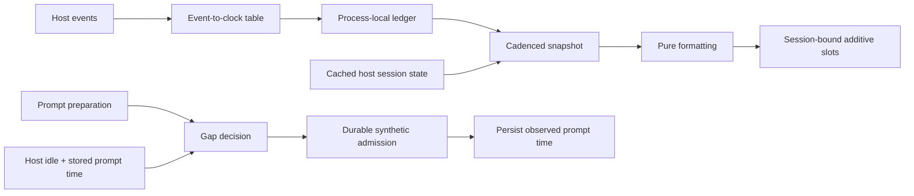

# 1. Assessment in brief

**Keep the architecture; tighten the meaning and evidence at its host seams.**
Lastact has a sensible small shape: an inexpensive activity readout and a
durable transcript recorder, each using the host rather than building another
session engine. Pure formatting and configuration sit beneath bounded adapters.
The design deliberately pays for fixed-cadence observation instead of doing
reactive work on every streaming event. That is an appropriate tradeoff for
this plugin, and the user's report of successful operation is credible evidence
that its ordinary path is useful.

The main concerns are not module count or missing abstractions. They are
**what the clocks actually mean**, **where prompt admission becomes durable**,
and **which host guarantees the checks really establish**. A concrete numeric
configuration coercion defect also deserves a small fix. Confidence is high in
these source observations, lower in their operational incidence; no live session
was exercised during this review.

# 2. Basis and boundaries

Whole repository at `43515611e7dd243d3815e2530147d5dfd45283f5`, not an artificial
diff. I inspected all 13 source files, the six test files, test/typecheck
configuration, README, and the settled-clock/activity-ledger/subagent design
accounts. The parent review is independent of peer conclusions, but not
independent of protocol authorship.

Intent comes from the [baseline README][readme] and
[activity-ledger design][design], plus the user's testimony. Package contract
basis is `@opencode-ai/plugin`/schema `0.0.0-dev-18695`, including the installed
Effect prompt and TUI declaration files. Current V2 plugin/CLI documentation
was consulted. Source corroboration uses local archive OpenCode commit
`4306c07b340b9a0504e65785f366d2793cd1b169`; this is **not a claim that the running
server is that revision**. The ordinary `~/src/opencode` checkout does not have
the V2 `packages/core/src/session/prompt.ts` path, so I did not silently treat it
as the relevant host.

I ran `pnpm test` (**86 tests across six files passed**) and
`pnpm run check:type` (**passed**), plus a read-only Node probe described below.
No installs, source changes, prompt injection, packaging/deployment tests, issue
mutations, or live host verification. The proposed additional resumption feature
is outside this baseline review.

# 3. Architectural account

The plugin has **two temporal products with intentionally different durability**:

| Responsibility | Owner and lifetime | Architectural judgment |
|---|---|---|
| Live activity evidence | `ActivityTracker`, one in-memory map per TUI setup | Small monotone cells; no framework dependence or event-time timer churn. |
| Presentation snapshot | `status.tsx`, one ticker per mounted surface | Joins event evidence with cached host state; component lifetime owns cleanup. |
| Transcript gap | Effect server prompt hook, per-location plugin instance | Writes a synthetic marker and plugin storage before returning to admission. |
| Last observed prompt | Server plugin storage, survives setup/restart | Deliberately separate from host metadata recency; not an exported universal clock. |
| Host session/execution/inbox | OpenCode | Plugin borrows status, persistence, ordering and identity rather than reimplementing them. |



The separation is useful, not needless duplication: transcript records need
durability and ordering; the visual signal needs cheap live evidence. Sharing
duration formatting is appropriate. Forcing both products through one universal
“activity” object would hide their different truth contracts.

[Event routing][events] is direct and configurable, [ledger writes][tracker]
are monotone, and [slot setup][plugin] is additive, deduplicated, and disposed.
The child-pane distinction belongs at rendering, not in activity identity.
The [server hook][server] has carefully tested overlap, failed-holder, and
interruption handling. These are earned strengths worth preserving.

The largest concentration of host policy is now `companionOptions`, which
reconstructs registration options from inventory and ordered documents because
the host does not supply them directly to advertised companions. That seam is
legitimate compatibility work, but should not grow into a general configuration
engine. Prefer a verified host capability when available.

# 4. Close findings

## P1 — “Prompt/LLM clocks” overstate the evidence being measured

**Contract/documentation mismatch; medium impact; high source confidence.**

The README promises the last user prompt and last LLM part. Yet
[snapshot reconciliation][status] (lines 66–85) always takes the maximum of the
prompt ledger and `time.updated`, irrespective of `refreshOn.updated: false`.
The archive host [projector][host-projector] (lines 544–572) advances that clock
on agent/model selection and rename; [client refresh][host-data] (lines 661–672)
hydrates rename changes back into cached session info. Thus renaming an old
session can refresh the displayed **prompt** age despite no user prompt.

Also, `activityFromEvent` checks only event type and session ID: a
`session.inbox.enqueued` whose `item.type` is `synthetic` still advances the
prompt clock. A direct Node probe returned
`{ sessionID: 'ses_example', clock: 'prompt', atMs: 1000 }` for that input.
The host synthetic method uses this common inbox path. `session.synthetic`
also maps to the part clock although a plugin can emit it independently of
the LLM. These are related failures to preserve evidence provenance, not three
independent bugs to inflate the count.

**Response:** decide whether this UI measures broad session activity or strict
conversational activity. If broad, label the proxies honestly. If strict,
filter inbox subtypes and give durable prompt evidence a truthful source or an
explicit unknown state; simply disabling one subscription does not fix the
store seed. Verify rename, synthetic-only, real prompt, and restart scenarios.
The server recorder already deliberately excludes metadata recency, a useful
contrast rather than an implementation to copy blindly.

## P2 — Observed prompt time is written before successful user admission

**Architectural pressure with a source-derived failure path; medium impact;
high confidence in ordering, unmeasured incidence.**

[Server lines 77–99][server] admit the marker and persist the clock during the
prompt hook. Host [prompt preparation][host-prompt] (lines 38–88) invokes hooks
**before** materializing attachments and resolving skills. User admission occurs
later in [Session.prompt][host-session] (lines 154–184).

Counterexample: after a long gap, submit a prompt with an unreadable attachment.
Lastact can durably record a resumption and advance its clock; attachment
resolution then rejects the actual prompt. A subsequent corrected prompt sees
the advanced clock. The tests prove behavior when **synthetic admission** fails,
not failure after this hook returns. A later hook can also change delivery after
Lastact has captured it. `resume: false` prevents the marker from waking an idle
session; it does not make both admissions one transaction.

**Response:** first document that this is an observed *attempt*, or explicitly
require an admitted-prompt contract and investigate a host-supported boundary.
Do not add compensating deletion of durable history casually. Verification is
a host-level unreadable-attachment/later-hook-failure test followed by retry,
including marker text, clock state, and ordering.

## P3 — The advertised drift check compares two local declarations

**Contract/documentation mismatch and coverage gap; medium impact; high
confidence.**

[Local `SlotMap`][context] is handwritten. The assertion in
[plugin lines 40–43][plugin] compares `SLOT_PATHS` with that local interface;
tests repeat the same relation. None imports the actual host `SlotMap` for
comparison. A host removal cannot make this project fail typecheck unless
someone first updates the local copy. The README's “host change fails here
first” guarantee is therefore stronger than the check.

The installed `dist/tui/context.d.ts` does expose `SlotMap` and presently agrees
for the used slots. Historical package/host disagreement explains the local
adapter, but does not turn it into an automatic host-drift detector.

**Response:** retain the adapter if needed, but connect an explicit compatibility
check to the actual supported package contract and record the tested host
revision. Verify that removing/changing a host fixture slot fails that check.
Do not import arbitrary newer types and claim runtime compatibility follows.

## P4 — Invalid JSON values can silently enable every-gap recording

**Defect against documented invalid-value fallback; low-to-medium impact;
reproduced with high confidence.**

[Config `readInt`][config] (lines 173–177) calls `Number(value)` on anything.
The `gapThresholdMs` decoder accepts the result if nonnegative. Read-only probe:

```ts
for (const value of [null, false, "", []]) {
  console.log(resolveConfig({ gapThresholdMs: value }).gapThresholdMs)
}
// 0, 0, 0, 0 — default is 14_400_000
```

All four inputs are valid JSON but not a meaningful duration. They turn a typo
or nullable configuration into persistent transcript noise instead of the
documented default. **Response:** admit numbers and deliberately supported
nonempty numeric strings, not arbitrary coercible JSON. Add these cases and
preserve explicit numeric zero. Separately, very large `refreshMs` values are
unbounded; runtime timer limits deserve checking rather than assumed safety.

## P5 — The most important presentation logic is never executed by tests

**Coverage gap; medium impact; high confidence.**

[Vitest configuration][vitest] explicitly says render closures are never
invoked. [TUI tests][tui-tests] check registration, routing, option recovery and
disposal; render tests start from already assembled snapshots. No test executes
`snapshotFor`, mounted ticking, session changes, reactive host refresh, or
component cleanup. P1 sits precisely in that untested join.

**Response:** make snapshot derivation a small pure seam with controlled
`nowMs`, without redesigning the ledger; test its evidence precedence, unknown
state, and outcome selection. Add one real Solid/OpenTUI lifecycle smoke test
for root/child mounting and timer cleanup. Arrival evidence is rendered output
changing correctly under controlled store/events, not another subscription
count assertion.

# 5. Evidence and coverage

The 86 passing tests give substantial confidence in pure formatting, defaults
covered by fixtures, event routing as declared, monotone ledger writes, additive
registration, option lookup, and server semaphore/cancellation behavior. They do
not establish installed-package loading, actual host event classification,
renderer lifecycle, or atomicity with downstream admission. My source-derived
P2 is not a reproduced production failure.

Both the TUI ledger and server lock map retain a row per encountered session
for their instance lifetime. Durable prompt records also remain after deletion,
as documented. This is a **watch** item for high session churn, not a demand to
add unrequested pruning. Observe cardinality before designing eviction; never
evict an in-flight lock merely to bound a map.

# 6. Direction, not a rewrite mandate

- **Preserve:** domain grouping, pure formatting, touch-only event path,
  per-session identity, additive surfaces, server-side transcript ownership,
  and the tested scoped-concurrency mechanics.
- **Fix/verify next:** correct numeric coercion; settle the clock vocabulary;
  test snapshot derivation; replace the false drift claim with a real supported
  contract check. These are coherent small changes, not a new architecture.
- **Watch:** companion-option recovery as host APIs evolve, map cardinality,
  and admission failure semantics. Decide whether recorder failure should block
  a real prompt: currently hook defects propagate through the host, which is
  consequential policy for an auxiliary plugin rather than an automatic error
  handling bug.
- **Defer:** framework extraction, global schedulers, persistent live telemetry,
  automatic pruning, and broad portability claims without runtime evidence.

For the later feature, the plugin **already writes a duration-bearing marker
before a user prompt resumes a session after the threshold**. “Before resuming
too” could instead mean native `session.resume` without a prompt, or a TUI notice
with display duration. Those are different entrypoints and requirements. Ask
before treating the phrase as a duplicate implementation request.

# 7. Reflection on this review form

The form usefully forced state lifetimes and upstream ordering into a review
that could otherwise congratulate the directory tree and passing tests. Its
separation of strengths, source-derived risks and reproduced defects prevented
the non-atomic hook from becoming an exaggerated universal failure claim.

Three changes would improve a second form:

1. Require a short **claim-to-evidence table** for load-bearing documentation
   promises. “Drift catcher” and “prompt clock” show why names deserve auditing.
2. Ask the reviewer to identify **where tests replace the real boundary** early,
   then spend effort there. A generic lens list is less useful than this seam map.
3. Establish comparable **review budgets and required host basis** before
   dispatch. Reviewer-selected source generations and word counts confound a
   run-off even with an identical prompt. Record variance rather than pretending
   this single experiment measures intrinsic model quality.

[readme]: https://github.com/rektide/opencode-lastact/blob/43515611e7dd243d3815e2530147d5dfd45283f5/README.md
[design]: https://github.com/rektide/opencode-lastact/blob/43515611e7dd243d3815e2530147d5dfd45283f5/.design/settled-clock/activity-ledger0.unk.md
[events]: https://github.com/rektide/opencode-lastact/blob/43515611e7dd243d3815e2530147d5dfd45283f5/src/tui/events.ts#L57-L155
[tracker]: https://github.com/rektide/opencode-lastact/blob/43515611e7dd243d3815e2530147d5dfd45283f5/src/activity/tracker.ts#L51-L90
[plugin]: https://github.com/rektide/opencode-lastact/blob/43515611e7dd243d3815e2530147d5dfd45283f5/src/tui/plugin.tsx
[server]: https://github.com/rektide/opencode-lastact/blob/43515611e7dd243d3815e2530147d5dfd45283f5/src/server/plugin.ts
[status]: https://github.com/rektide/opencode-lastact/blob/43515611e7dd243d3815e2530147d5dfd45283f5/src/tui/status.tsx#L56-L97
[context]: https://github.com/rektide/opencode-lastact/blob/43515611e7dd243d3815e2530147d5dfd45283f5/src/tui/context.ts#L1-L61
[config]: https://github.com/rektide/opencode-lastact/blob/43515611e7dd243d3815e2530147d5dfd45283f5/src/config/config.ts#L173-L177
[vitest]: https://github.com/rektide/opencode-lastact/blob/43515611e7dd243d3815e2530147d5dfd45283f5/vitest.config.ts
[tui-tests]: https://github.com/rektide/opencode-lastact/blob/43515611e7dd243d3815e2530147d5dfd45283f5/tests/tui.test.ts
[host-projector]: https://github.com/anomalyco/opencode/blob/4306c07b340b9a0504e65785f366d2793cd1b169/packages/core/src/session/projector.ts
[host-data]: https://github.com/anomalyco/opencode/blob/4306c07b340b9a0504e65785f366d2793cd1b169/packages/client/src/solid/data.ts
[host-prompt]: https://github.com/anomalyco/opencode/blob/4306c07b340b9a0504e65785f366d2793cd1b169/packages/core/src/session/prompt.ts
[host-session]: https://github.com/anomalyco/opencode/blob/4306c07b340b9a0504e65785f366d2793cd1b169/packages/core/src/session/session.ts
