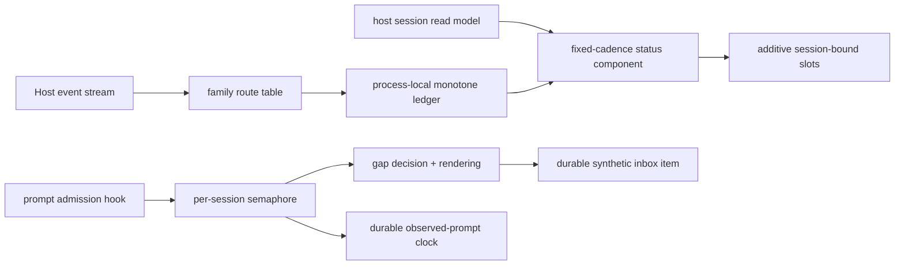

# 1. Assessment in brief

Lastact has a good small-system shape: pure decoding, time arithmetic, and
rendering surround two narrow host adapters. The TUI side reduces a large event
vocabulary to monotone per-session cells and keeps derivation at the view
boundary; the server side uses the prompt-admission hook to place a durable,
ordered notice rather than approximating one in UI state. Additive slot claims,
explicit cleanup, deterministic synthetic IDs, and per-session serialization
are particularly worth preserving.

That shape fits the purpose, but three confidence claims are stronger than the
evidence. First, the automatically advertised TUI companion loses all server
options on the host currently built in this workspace because the plugin
inventory schema changed. Second, durable `time.updated` is not a durable “last
prompt” clock: metadata and synthetic admissions also advance it. Third, a TUI
opened during an already-running turn cannot tell whether `time.idle` belongs to
the current turn; it can therefore render a previous turn as current part
activity. These are contained seams, not reasons for a redesign. Confidence is
high in the static conclusions and unit-level core, moderate in live TUI
behavior because the assigned no-live-experiment boundary leaves the project’s
acceptance checklist open.

# 2. Basis and boundaries

- **Target and scope:** whole `/home/rektide/src/opencode-lastact` system at Git
  `43515611e7dd243d3815e2530147d5dfd45283f5`; the working copy was clean at
  start and after checks. No artificial diff base was used.
- **Intent:** target [`README.md`](https://github.com/rektide/opencode-lastact/blob/43515611e7dd243d3815e2530147d5dfd45283f5/README.md), the four prior
  `.design/settled-clock/` documents, read-only Beads export, and the user’s
  operational testimony that the plugin works well. Testimony supports utility;
  it is not treated as proof of every restart or compatibility case.
- **Pinned contract:** package and lockfile pin `@opencode-ai/plugin` and
  `@opencode-ai/schema` `0.0.0-dev-18695`. I inspected their installed
  declarations, including the official
  [`SlotMap`](file:///home/rektide/src/opencode-lastact/node_modules/@opencode-ai/plugin/dist/tui/context.d.ts#L129-L212),
  [`SessionPrompt`](file:///home/rektide/src/opencode-lastact/node_modules/@opencode-ai/plugin/dist/effect/session.d.ts#L12-L18),
  event envelope
  [`created`](file:///home/rektide/src/opencode-lastact/node_modules/@opencode-ai/schema/dist/event.d.ts#L41-L53),
  and session clocks
  ([`session.d.ts`](file:///home/rektide/src/opencode-lastact/node_modules/@opencode-ai/schema/dist/session.d.ts#L153-L161)).
  Archive commit
  [`4a977b2`](https://github.com/anomalyco/opencode/tree/4a977b2b3158adba43daec52fb3a9ab386dad3a8),
  twelve minutes before the registry publication timestamp, matches these
  installed shapes and supplies runtime-source evidence; registry metadata does
  not include a `gitHead`, so exact package-to-source provenance is not claimed.
- **Actual/current host evidence:** `/usr/local/bin/opencode` resolves to a
  2026-09-05 build under `/home/rektide/src/opencode-working`. Its current source
  working commit is `d08e633fccd45b0d6acf92f4075ce42b8fb1de5c`, parent
  `090c1292670e98199f73f4f54761774eabff6dc5`; four generated client files are
  dirty, while cited plugin/session/TUI source files are not.
- **Identity:** native session `ses_f8725fb73ffeDugTUrhZUcSGJc`; model identity
  supplied by dispatch and runtime label: `openai/gpt-5.6-sol#xhigh` (Sol).
- **Exclusions:** no peer reports or synthesis, product edits, install, issue
  mutation, network state mutation, or live OpenCode session experiment.

# 3. Architectural account

The package has two cooperating adapters around one vocabulary:

`config/`, `time/`, and `render/` are deterministic policy. `activity/` owns
ephemeral timestamps for the TUI plugin lifetime. `tui/events.ts` translates
host events without doing elapsed-time work; each mounted status component owns
its interval and reconciles ledger hints with host store clocks. `server/plugin.ts`
owns process-local locks and plugin-scoped durable prompt records, and executes
inside the host’s pre-admission hook. The host owns message durability,
idempotent inbox admission, session status hydration, and slot composition.

This is appropriately deep for a small plugin: host-specific uncertainty is
mostly confined to `tui/context.ts`, `tui/plugin.tsx`, and `server/plugin.ts`.
The pure functions make format and concurrency policy cheap to test. Future
views belong in rendering; new activity families belong in the route table; a
different durable marker remains server-side. The main weakness is that the
supposed host-contract boundary is handwritten rather than mechanically tied
to the installed contract, so drift crosses that seam silently.

# 4. Close findings

## Highest consequence

### LA-COMP-01 — **defect**: current advertised companion drops server options

**Impact:** medium-high. **Confidence:** high, source-derived; not live-reproduced
by assignment. The README promises one registration and shared options
([lines 130–160](https://github.com/rektide/opencode-lastact/blob/43515611e7dd243d3815e2530147d5dfd45283f5/README.md#L130-L160)), including
`enabled: false` disabling both halves
([line 176](https://github.com/rektide/opencode-lastact/blob/43515611e7dd243d3815e2530147d5dfd45283f5/README.md#L176)). Lastact searches
for `item.status === "active"` and reads `source.package`
([`companionOptions`, lines 80–109](https://github.com/rektide/opencode-lastact/blob/43515611e7dd243d3815e2530147d5dfd45283f5/src/tui/plugin.tsx#L80-L109)).
The current host instead exposes `state.status`, `features.tui`, and
`source.target`
([current `plugin.ts` lines 10–43](file:///home/rektide/src/opencode-working/packages/schema/src/plugin.ts#L10-L43)); its TUI resolver itself consumes
`source.target`
([current `context.tsx` lines 96–112](file:///home/rektide/src/opencode-working/packages/tui/src/plugin/context.tsx#L96-L112) and
[296–307](file:///home/rektide/src/opencode-working/packages/tui/src/plugin/context.tsx#L296-L307)). Thus the server is never found and `{}` defaults are used: non-default
TUI placement/view settings, and TUI disablement, are lost while server options
still apply. The pinned declarations use the old shape, explaining why tests
pass. Smallest response: decode both inventory generations (or use a stable
host-supplied companion-options seam), with fixtures for each; verify one
non-default option and `enabled:false` against the current host.

### LA-TIME-01 — **defect**: durable prompt seed is broader than prompts

**Impact:** medium. **Confidence:** high, source-derived and not live-reproduced. The primary domain
claim is a last-prompt clock
([README lines 26–35](https://github.com/rektide/opencode-lastact/blob/43515611e7dd243d3815e2530147d5dfd45283f5/README.md#L26-L35)), but every bucket
unconditionally reconciles that cell with `info.time.updated`
([`snapshotFor`, lines 61–85](https://github.com/rektide/opencode-lastact/blob/43515611e7dd243d3815e2530147d5dfd45283f5/src/tui/status.tsx#L61-L85)), even when
`refreshOn.updated` is false. The host advances `time_updated` for agent/model
selection and rename
([current projector lines 544–573](file:///home/rektide/src/opencode-working/packages/core/src/session/projector.ts#L544-L573)), and for every inbox item—including
synthetics—not only user prompts
([lines 623–638](file:///home/rektide/src/opencode-working/packages/core/src/session/projector.ts#L623-L638)). After such activity and a store refresh/restart, the displayed “prompt”
clock moves. The smallest response is either to rename the durable concept
honestly to “session update,” or derive the latest durable user-prompt timestamp
from prompt/message data while retaining `time.updated` only as an explicitly
enabled approximation. Verify rename, model selection, and synthetic-only
counterexamples across restart.

### LA-TIME-02 — **architectural pressure**: a mid-turn restart has no current-part seed

**Impact:** medium. **Confidence:** high in the source-derived counterexample,
medium in its frequency; not live-reproduced. `partAtMs` always seeds from `time.idle`, while `working` comes from
current status
([`status.tsx` lines 66–96](https://github.com/rektide/opencode-lastact/blob/43515611e7dd243d3815e2530147d5dfd45283f5/src/tui/status.tsx#L66-L96)). The host writes
`time.idle` only at a non-shutdown terminal
([current projector lines 402–429](file:///home/rektide/src/opencode-working/packages/core/src/session/projector.ts#L402-L429)); status is separately hydrated from execution state. Open the TUI during a running second turn: the
known part seed is the first turn’s terminal, so the “working holds `now` while
no part has been seen” branch cannot run. The line can present old activity as
current-turn silence. No current host scalar resolves this ambiguity. The next
decision should explicitly choose and document restart degradation—prefer
unknown/`now`, or inspect the current assistant-message timestamps—then test an
active restart after a prior idle.

## Assurance and lifecycle

### LA-COMP-02 — **contract/documentation mismatch**: the drift-catcher is not connected upstream

**Impact:** medium. **Confidence:** high, source-derived. The README says host slot changes fail
typecheck
([lines 123–126](https://github.com/rektide/opencode-lastact/blob/43515611e7dd243d3815e2530147d5dfd45283f5/README.md#L123-L126)). In fact,
Lastact declares its own `SlotMap` and string-accepting event API
([`context.ts` lines 24–62](https://github.com/rektide/opencode-lastact/blob/43515611e7dd243d3815e2530147d5dfd45283f5/src/tui/context.ts#L24-L62),
[159–185](https://github.com/rektide/opencode-lastact/blob/43515611e7dd243d3815e2530147d5dfd45283f5/src/tui/context.ts#L159-L185)); the assertion only compares paths to that local declaration
([`plugin.tsx` lines 38–43](https://github.com/rektide/opencode-lastact/blob/43515611e7dd243d3815e2530147d5dfd45283f5/src/tui/plugin.tsx#L38-L43)). No type imports
the official `Plugin.Context`. Current host additions (`showDetails`,
`session.panel`) already leave the “full map” stale while `check:type` passes
([current contract lines 159–201](file:///home/rektide/src/opencode-working/packages/plugin/src/tui/context.ts#L159-L201)). Import the official context/event types, define the plugin through its official constructor, or add mutual assignability checks. Verification is an intentionally altered contract fixture that must fail typecheck.

### LA-AVAIL-01 — **open question**: durable ordering is fail-closed for prompts

**Impact:** potentially high; expected frequency low. **Confidence:** high,
fixture-reproduced and host-source-confirmed. The
hook converts all marker-path errors to defects
([`server/plugin.ts` lines 115–144](https://github.com/rektide/opencode-lastact/blob/43515611e7dd243d3815e2530147d5dfd45283f5/src/server/plugin.ts#L115-L144)); a test explicitly proves failed synthetic admission rejects the prompt and leaves the clock retryable
([`server.test.ts` lines 268–280](https://github.com/rektide/opencode-lastact/blob/43515611e7dd243d3815e2530147d5dfd45283f5/tests/server.test.ts#L268-L280)). The host runs prompt hooks before user-item admission
([pinned-era host `prompt.ts` lines 35–52](https://github.com/anomalyco/opencode/blob/4a977b2b3158adba43daec52fb3a9ab386dad3a8/packages/core/src/session/prompt.ts#L35-L52)). This strongly guarantees marker-before-prompt, but makes an observational plugin part of prompt availability. Decide and document whether fail-closed is intentional. Arrival evidence is a host-level fault test showing either explicit rejection or best-effort prompt continuation without duplicate records.

### LA-COV-01 — **coverage gap**: the load-bearing reconciliation/view seam is untested

**Impact:** medium. **Confidence:** high. The 86 tests cover policy functions,
route decisions, setup registration, and server concurrency well, but
`snapshotFor` is private and no test mounts `LastactStatusLine`, exercises the
session-kind gate reactively, or crosses a real store/event boundary. The
project’s own `oplast-live-acceptance` record confirms all live checklists remain
open. Extract snapshot derivation as a pure function and add store/ledger/status
matrix tests; then run the already specified live acceptance rather than adding
more mocks. No substantiated formatting or semaphore defect was found beyond
the findings above.

# 5. Evidence and coverage

`pnpm test` passed all 6 files / 86 tests; `pnpm run check:type` passed. These
establish decoder behavior, duration and line formatting, monotone ledger
updates, event-family routing, additive claim registration/cleanup, old-schema
companion lookup, threshold boundaries, deterministic marker payloads, overlap
suppression, retry after failure, interruption, and scope shutdown. Direct host
source establishes hook-before-admission ordering, idempotent synthetic inbox
admission, slot mount/suppression behavior, event timestamps, terminal status
hydration, and clock projection.

They do not establish rendering in a real Solid/OpenTUI tree, current-host
companion option propagation, cold/mid-turn restart output, visual placement,
or behavior under a real server reconnect. The archive source-to-published-package
mapping is strongly matched but not cryptographically attested. No diagnostic
scratch was needed.

# 6. Direction, not a rewrite mandate

- **Preserve:** domain grouping; pure config/time/render core; touch-only event
  path; additive claims and cleanup; deterministic marker identity; per-session
  serialization; explicit distinction between durable and process-local state.
- **Fix/verify next:** make companion inventory decoding current-host compatible;
  make the official types actually constrain the adapter; extract and test
  snapshot derivation; resolve the prompt-seed and active-restart semantics.
- **Watch:** `ActivityTracker` and server `locks` maps never evict session keys
  ([tracker lines 51–89](https://github.com/rektide/opencode-lastact/blob/43515611e7dd243d3815e2530147d5dfd45283f5/src/activity/tracker.ts#L51-L89),
  [server lines 109–119](https://github.com/rektide/opencode-lastact/blob/43515611e7dd243d3815e2530147d5dfd45283f5/src/server/plugin.ts#L109-L119)); durable prompt entries are explicitly retained. This is low pressure now, but long-lived high-session processes need measured bounds or deletion handling.
- **Deliberately defer:** saga reports, roll-ups, stall toasts, and new host slots.
  They are declared futures, not remedies for the baseline findings.

# 7. Reflection on this review form

The form forced useful separation of pinned declarations, matching upstream
source, current host source, tests, and user testimony. That exposed both the
inventory drift and the otherwise easy-to-miss running-restart ambiguity. Its
restart/recovery and disposal lenses also prevented a “pure core + green tests”
review from ending too early.

Three concrete improvements:

1. Require an explicit **runtime-under-review** field distinct from dependency
   pins; here the pinned SDK and currently built host are both relevant but not
   identical.
2. Ask reviewers to state whether each claimed compatibility guard is
   **mechanically connected** to upstream, not merely copied from it.
3. Allow the close-findings heading to use a compact evidence table for lower
   consequence items; repeating impact/confidence/provenance prose is useful but
   increases reading cost in a focused report.
