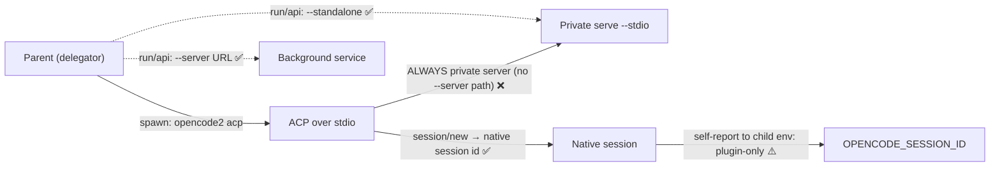

# Rekon Tooling Capabilities And Gaps

## Situation and mandate

This report answers the tooling fronts of
[`brief0.gpt6a.md`](/assess/rekon/brief0.gpt6a.md): what already exists across
`summarizer`, `sum-pub`/`pubsum`, `hyalo`, Beads history, and OpenCode ACP/`--server`; where each
capability is implemented, only proposed, absent, or unverified. The user's named vectors: an
emerging home-base in `~/src/summarizer` or `~/src/sumpub`; Rust Markdown library `hyalo`;
ticket-native changelogs from record creations/revisions/rework; ACP delegation with input and
native OpenCode session self-reporting; and forwarding `--server` as a notable capability.

No product or source files were modified, no servers were launched against live sessions, no
tickets were touched, and no web sources were needed — every claim below comes from local
checkouts, installed binaries, or Rekon's own corpus.

## Claim key and evidence planes

- **Observed** — directly present in inspected source, CLI help, or command output (read-only).
- **Derived** — consequence drawn from multiple observed facts; analysis, not an upstream promise.
- **Hypothesis** — candidate direction needing a design decision or experiment.

Matrix statuses: **implemented** (Observed), **proposed** (documented intent, absent code),
**absent-in-search** (searched for and not found on this machine), **unverified** (plausible,
not established here).

| Plane | Identity | Notes |
|---|---|---|
| hyalo archive | `/home/rektide/archive/ractive/hyalo`, commit `b50f828`, `git describe` `v0.20.0-13-gb50f828` | No `llms.txt` present. **Not installed** (`hyalo not found`). |
| summarizer | `/home/rektide/src/summarizer`, `c71e2e2` | Rust workspace, ACP spike + rich design corpus. |
| pubsum | `/home/rektide/src/sum-pub`, `a225567`; symlink `/home/rektide/src/pubsum -> sum-pub` | **No directory named `sumpub` exists**; the name resolves to `sum-pub`/`pubsum`. |
| OpenCode V1 | `/home/rektide/src/opencode`, `f109c00a64`, package `opencode` v1.1.49 | Source reference; not the installed runtime. |
| OpenCode V2 | `/home/rektide/src/opencode-acp` (repo default branch `v2`), `@opencode-ai/cli` v1.18.4 | Contains `packages/opencode` (V1) "for reference only" per its `AGENTS.md`. |
| Installed runtime | `/usr/local/bin/opencode` **and** `/usr/local/bin/opencode2` both report `opencode2 v0.0.0-local-202609051106` | The active `opencode` command on this machine is the V2 CLI. |
| Beads | `bd version 1.0.3 (dev: 772a656888d3)` | Matches the plane already established in [`beads-offerings0`](/constitution/naming/exploration/beads-offerings0.sol56x.md). |
| Rekon | this repo, `package.json` v0.3.0 | Assembler and CLI exist (below). |

## Rekon already has tooling — do not claim otherwise

**Observed.** [`rekon.ts`](/rekon.ts) exposes six commands: `agents` (the assembler),
`combine`, `install-commands`, `interpolate`, `project-files`, and `ln`. The assembler is
implemented and tested ([`src/agents/assemble.ts`](/src/agents/assemble.ts),
[`src/agents/assemble.test.ts`](/src/agents/assemble.test.ts)); its contract, provenance
comments, context-byte accounting, and deliberately deferred production cutover are documented in
[`agents-assembly.md`](/constitution/agents-assembly.md#agents-assembly-status). No production
manifest exists and [`AGENTS.md`](/AGENTS.md) remains hand-maintained — a status, not an absence
of tooling.

## What hyalo actually does

**Observed** from the archive checkout (README, `Cargo.toml`, workspace crates
`hyalo-cli`/`hyalo-core`/`hyalo-mdlint`, `docs/`):

- Structured vault operations: BM25/regex/frontmatter `find`, bulk `set`/append of properties and
  tags, `mv` that rewrites all `[[wikilinks]]` and Markdown links, `links fix`/`links auto`,
  schema-driven `lint` with `--fix`, `summary` statistics, `new` scaffolding, completions,
  `--jq`, JSON-when-piped output, dry-run on all writes.
- **Profiles** packaged as composable TOML fragments: `okf`, `madr`, `skills`, `changelog`.
  The `okf` profile validates Open Knowledge Format bundles and ships **deterministic
  `hyalo okf index` / `hyalo okf log` generators** (managed marker regions, dry-run default,
  non-zero exit on drift — doubling as a CI freshness check). The `changelog` profile enforces
  Keep-a-Changelog grammar and maintains `CHANGELOG.md` via `hyalo changelog add` / `release`.
- Claude Code integration (`init --claude`) installing `hyalo` + `hyalo-tidy` skills and a scoped
  rule; a GitHub Actions lint gate (`setup-hyalo`).
- hyalo's own dogfooding knowledgebase (`hyalo-knowledgebase/`) uses `iterations/`, `backlog/`,
  `research/`, `reviews/` — a live example of an agent-maintained vault lifecycle.

**Observed boundary.** hyalo is deterministic mechanics only: no ACP agents, no semantic
summarization, no source adapters beyond Markdown, no model context. Its `summary` command is
vault statistics, not prose. This matches and grounds the boundary already drawn in summarizer's
own [`doc/discovery/hyalo-juncture.md`](/home/rektide/src/summarizer/doc/discovery/hyalo-juncture.md)
(2026-08-07): *summarizer owns semantic production and structural context propagation; hyalo owns
the materialized Markdown/OKF knowledgebase lifecycle.*

**Observed operational gap.** hyalo is **not installed on this machine** (`hyalo not found`) and
has no `llms.txt`. Adopting it means installing a pinned binary (brew/apt/cargo routes exist) —
a real prerequisite for any Rekon integration, flagged but not acted on.

## summarizer / pubsum boundaries and the home-base question

**Observed — summarizer** (`~/src/summarizer`) is an ACP spike plus a design corpus:

- Code (~500 lines total): `crates/summarizer-acp` wraps ACP process spawn, initialize,
  permission auto-approve, and a response buffer; `crates/summarizer-opencode` creates one ACP
  session, sends one file-summary prompt, **sleeps five seconds**, and prints the buffer;
  `crates/summarizer-example-multiproject` repeats for two roots. No tree walk, provider system,
  pipeline, or artifact model exists. The design docs say the same, and their claims matched the
  code I read.
- Design corpus is far ahead: [`doc/design.md`](/home/rektide/src/summarizer/doc/design.md)
  (axes: frontmatter, locator, prompter, mcp, phases, scion; ticket index `sum-*`),
  [`hyalo-juncture.md`](/home/rektide/src/summarizer/doc/discovery/hyalo-juncture.md) (bubble/capture
  two-pass algorithm, README-centered concept trees, hyalo integration modes — subprocess at phase
  barriers recommended), and
  [`opencode-vs-acp.md`](/home/rektide/src/summarizer/doc/discovery/opencode-vs-acp.md)
  (HTTP API vs ACP feature matrix).

**Observed — pubsum** (`~/src/sum-pub`, symlinked as `pubsum`) is the working product: a TS/gunshi
EPUB chapter summarizer driving **opencode sessions directly** — session create/resume/rotate,
proactive context-limit rotation, reactive compaction detection (token drop >50% → redo in fresh
session), retry, append-to-markdown output. Its README notes it "should probably be switched to
acp or some-such". The git history literally renamed `sum-pub` → `pubsum`, which is why the
user-facing name `sumpub` does not exist as a directory.

**Derived.** The three-way boundary is already crisp and source-grounded: hyalo = deterministic
Markdown/OKF lifecycle; summarizer = agent-mediated semantic derivation (bubble/capture over
summary-unit trees); pubsum = sequential prefix conditioning over EPUB spines with battle-tested
opencode session management. The design corpus explicitly plans to absorb pubsum's behavior
(`sum-pubsum`, p1) rather than keep two products.

**Unverified.** Which repo is the intended "home-base" for Rekon's tooling future. summarizer has
the design corpus and the OKF/hyalo story; pubsum has the working session-management loop;
neither has absorbed the other. This is a user decision, not a fact I can establish from sources.

## Ticket-native changelogs: event history vs JSONL export

**Observed.** Rekon's `.beads/issues.jsonl` (31 records) carries **current state only** — keys are
identity, prose, lifecycle, assignment, time, and dependency fields; there is no event, history,
or audit field. This confirms (by direct inspection) what
[`beads-offerings0`](/constitution/naming/exploration/beads-offerings0.sol56x.md#beads-offerings-events)
established: JSONL is interchange, not history.

**Observed.** The installed `bd 1.0.3-dev` exposes owner-native history **today**:

- `bd history <id>` — per-issue version history through Dolt. For
  `rekon-agents-maintenance-assembler` it returns **55 entries**; `--json` entries are
  `{CommitHash, CommitDate, Commiter, Issue}` where `Issue` is the full record snapshot at that
  commit — i.e., a replayable state timeline from which creations, revisions, closures, and
  reopens are derivable by differencing snapshots.
- `bd diff` — changes between commits/branches; `bd show --as-of <hash|branch>` — point-in-time
  snapshot; `bd reopen`, `bd close --reason`, `bd update --append-notes` — the rework surfaces.
- `bd dolt` — server lifecycle, commit/push/pull, remotes.
- Absent from the installed CLI (confirmed again): `bd events`/journal commands, `bd serve`,
  lease/reclaim. `bd audit` exists but is the separate LLM-interaction sidecar
  (`.beads/interactions.jsonl`), not issue history.

**Derived.** A "changelog projection" needs no new storage: `bd history --json` per issue +
snapshot differencing is a complete substrate now. Nothing in Rekon consumes it yet — the
projection itself is **absent-in-search** (no script/tool in this repo reads `bd history`).
One data-quality caveat observed: history `Committer` is `root` (the default actor resolution),
so actor attribution in any projection will be weak until actors are set deliberately.

**Hypothesis.** The natural first projection is derived, read-only, and regenerable — e.g.,
per-ticket or per-day Markdown assembled from `bd history`, materialized through hyalo's
`changelog`/`okf log` discipline or plain generation — never a parallel hand-maintained lifecycle
and never summaries that summarize themselves.

## ACP delegation, `--server` forwarding, and native session identity

### Two generations, one runtime reality

**Observed.** Two OpenCode generations exist locally. V1 (`~/src/opencode`, v1.1.49): `opencode acp`
is a first-party command that **starts its own embedded HTTP server**
([`cli/cmd/acp.ts`](/home/rektide/src/opencode/packages/opencode/src/cli/cmd/acp.ts): `Server.listen(opts)`
with default port 0, SDK client pointed at `http://<host>:<port>`), then speaks ACP over stdio.
V1 has no client-side `--server` flag; it has `opencode serve` (headless, `--port/--hostname/--mdns/--cors`,
`OPENCODE_SERVER_PASSWORD` basic auth) and `opencode attach <url>` (TUI attach with `--session`,
`--password`).

**Observed.** V2 (`~/src/opencode-acp`, branch `v2`) is the generation actually installed:
both `/usr/local/bin/opencode` and `/usr/local/bin/opencode2` report
`opencode2 v0.0.0-local-202609051106` (a local build from 2026-09-05).

### Protocol sessions are native sessions

**Observed.** In both generations the ACP session id **is** the native opencode session id:

- V1: `acp/session.ts` creates ACP sessions via `sdk.session.create({title, directory: cwd})` and
  keys all state by that native id; `session/load` re-attaches via `sdk.session.get`.
- V2: `packages/cli/src/acp/service.ts` `session/new` calls `client.session.create({location:
  {directory: cwd}, agent, model})` and returns `sessionId: state.id` (the created session's id);
  it advertises `sessionCapabilities: {close, delete, fork, list, resume}` and implements
  session listing over `client.session.list`. There is no separate "protocol session" namespace
  to translate — a delegated ACP job's id is directly usable with native session tooling.

**Observed (V1 docs, unverified at runtime).** V1's `acp/README.md` lists limitations
(no streaming `session/update`, no tool-call reporting, `session/load` not restoring history,
auth stub). V2's ACP implementation is substantially richer in source (streaming updates,
permission requests, tool reporting, mode/model config options), but I did not drive either
implementation live, so runtime fidelity is **unverified** here.

### `--server`: exact semantics and the forwarding gap

**Observed.** V2 defines the flag pair
([`commands/commands.ts`](/home/rektide/src/opencode-acp/packages/cli/src/commands/commands.ts)
`ServerParams`): `--standalone` ("Run with a private server instead of the background service")
and `--server <url>` ("Connect to a server URL instead of the background service"). Default is
the **elected background service** (`opencode2 service start/stop/status/set`, incumbent
detection, lease registration; `service get password` for the credential).
[`services/server-connection.ts`](/home/rektide/src/opencode-acp/packages/cli/src/services/server-connection.ts)
resolves in order: explicit `--server` (basic auth from `OPENCODE_PASSWORD`, 5s health check,
version-mismatch warning, "did not provide a compatible V2 health response" error) →
`--standalone` (private server) → managed background service (`mismatch: replace|ignore|error`).
`--server` + `--standalone` together is a hard error. The flag surfaces on the root command
(default TUI) and on `run`, `api`, `models`, `export`, `import`, `mini` — verified both in
source handler inputs and in installed `--help` output.

**Observed — the gap.** **`opencode2 acp` accepts neither `--server` nor `--standalone`.**
Verified two ways: installed `opencode2 acp --help` shows only generic global flags; and the
source handler ([`commands/handlers/acp.ts`](/home/rektide/src/opencode-acp/packages/cli/src/commands/handlers/acp.ts))
unconditionally calls `Standalone.start()`, which spawns `<self> serve --stdio --port 0` with a
random password and a stdin lease pipe
([`services/standalone.ts`](/home/rektide/src/opencode-acp/packages/cli/src/services/standalone.ts)).
So a delegated ACP job **cannot attach to the elected background service or an explicit server
URL today** — every ACP spawn is an isolated private server, even though its sessions are native
sessions inside that server. This is precisely the "forwarding `--server`" capability the user
named: it exists as first-class client machinery, but it does not reach the ACP entrypoint.
(Upstream contribution or a thin wrapper would be the seam; not assessed further here.)

### Native session self-reporting

**Observed.** Three distinct surfaces, with different owners:

1. **Protocol response (native, both generations):** `session/new` returns the native session id;
   a delegating parent gets the id without any plugin. V2 `run` also emits `sessionID` in its JSON
   output/error reports (`packages/cli/src/run/run.ts`), and V1 `opencode run --format json`
   emits `{type, timestamp, sessionID, ...}` per event.
2. **Ambient in-process self-report (NOT native):** searching V2 `cli/core/server/protocol`
   sources finds **no** `OPENCODE_SESSION_ID`. It exists only in the 1st-party plugin
   [`opencode-session-id-plugin`](/home/rektide/src/opencode-session-id-plugin) v2.0.0, which sets
   `OPENCODE_SESSION_ID` / `OPENCODE_MESSAGE_ID` / `OPENCODE_MODEL[_VARIANT]` on processes a
   session spawns (fiber propagation, or a host patch for `!command`), with documented coverage
   gaps (PTY terminal tabs and worktree start commands get nothing).
3. **Child self-knowledge:** an agent inside a session cannot natively state its own session id
   today; the plugin's env vars are the working mechanism, and they are exactly what would let a
   delegated ACP job self-report "I am `ses_...`" in its final receipt.

**Derived.** "Native session self-reporting" is therefore two claims: id **return** is native and
solid; id **self-knowledge** is plugin-provided. A delegation tracer can be fully parent-side
today (id from `session/new`), and child-side self-report needs the plugin installed in the
delegated runtime.

**Unverified.** Where standalone-server sessions persist (the server DB path defaults to
`opencode[.<channel>].db`, but its directory and whether an ACP standalone's sessions are visible
to the background service afterwards were not established). Also unexplored: `~/src/opencode-session-report`
(a full opencode V1 monorepo variant, likely session-reporting work — not dived, name suggests
relevance) and `~/src/opencode-session-move` (already proven in this session's lineage: the
`session_move` native tool).

## Capability matrix

Status legend: **I** implemented (observed) · **P** proposed (doc/ticket, no code) · **A** absent
(in this machine's sources/search) · **U** unverified.

| Capability | Status | Evidence |
|---|---|---|
| AGENTS.md fragment assembler + `--check` + tests (rekon) | **I** | [`/src/agents/assemble.ts`](/src/agents/assemble.ts), [`agents-assembly.md`](/constitution/agents-assembly.md) |
| Rekon CLI (`agents`, `combine`, `install-commands`, `interpolate`, `project-files`, `ln`) | **I** | [`/rekon.ts`](/rekon.ts) |
| Assembler production cutover / production manifest | **P** (deliberately deferred) | [`migration status`](/constitution/agents-assembly.md#agents-assembly-status) |
| hyalo deterministic vault ops (find/set/mv/links/lint/new/summary) | **I** upstream | hyalo README + crates, v0.20.0-13 |
| hyalo OKF profile: `lint --profile okf`, `okf index`, `okf log` generators | **I** upstream | hyalo README "Profiles" |
| hyalo changelog profile: Keep-a-Changelog lint + `changelog add/release` | **I** upstream | hyalo README "Profiles" |
| hyalo installed locally | **A** | `hyalo not found` |
| summarizer semantic pipeline (bubble/capture, units, locators, phases) | **P** | [`doc/design.md`](/home/rektide/src/summarizer/doc/design.md), [`hyalo-juncture.md`](/home/rektide/src/summarizer/doc/discovery/hyalo-juncture.md) |
| summarizer ACP spike (spawn, init, prompt, sleep, buffer) | **I** (spike only) | `crates/summarizer-opencode/src/main.rs`, `crates/summarizer-acp/src/client.rs` |
| ACP completion handling without sleep / session rotation / retry | **A** (spike sleeps 5s) | spike code; pubsum has the TS analog working |
| pubsum EPUB loop: sessions, resume, rotation, compaction detection | **I** | `~/src/sum-pub` README + `src/{cli,state}.ts`, gunshi plugins |
| Directory named `sumpub` | **A** (resolves to `sum-pub` dir + `pubsum` symlink) | `ls ~/src`, git rename commit |
| Beads per-issue event history (`bd history`, 55 entries, JSON snapshots) | **I** | `bd history --json rekon-agents-maintenance-assembler` |
| Beads diff / time-travel (`bd diff`, `--as-of`) | **I** | `bd --help`, `bd show --help` |
| JSONL export containing event history | **A** (current-state keys only) | `.beads/issues.jsonl` inspection |
| Workspace events journal / `bd serve` | **A** in installed CLI (archive-current upstream) | [`beads-offerings0`](/constitution/naming/exploration/beads-offerings0.sol56x.md#beads-offerings-versions) |
| Changelog projection consuming `bd history` | **A** | no consumer in rekon sources |
| ACP session id == native session id (create/list/resume/fork caps) | **I** | V2 `acp/service.ts:198,211-217`; V1 `acp/session.ts` |
| `--server <url>` / `--standalone` on `run`/`api`/root | **I** | `commands.ts` ServerParams; installed `--help`; `server-connection.ts` resolve order |
| `--server` accepted by `opencode2 acp` | **A** — always private standalone server | `opencode2 acp --help`; `handlers/acp.ts` → `Standalone.start()` |
| Background service election (`service start/status/get password`, lease) | **I** | V2 `service` commands; `server-process.ts` incumbent/register |
| Session id returned by non-interactive run (JSON) | **I** | V2 `run/run.ts`; V1 `run.ts` emit |
| Ambient `OPENCODE_SESSION_ID` in spawned processes (native) | **A** in core | rg over V2 `cli/core/server/protocol` |
| Same via 1st-party plugin (with coverage gaps) | **I** | `opencode-session-id-plugin` v2.0.0 README |
| ACP runtime fidelity (streaming, permissions, load) | **U** | V1 README lists gaps; V2 richer in source; not driven live |
| Standalone-server session persistence/visibility | **U** | `server-process.ts` DB path defaults; location unestablished |
| Home-base choice (summarizer vs pubsum) for future tooling | **U** | user decision; boundaries documented above |

## Gaps and tensions worth naming

1. **The `--server` seam stops at ACP.** The capability the user called "notable" exists and is
   well-built for interactive/one-shot clients, but the ACP entrypoint is hardwired to an
   isolated private server. Delegated ACP jobs therefore never share the elected service's
   sessions, config, or credentials surface unless upstream changes or a wrapper intervenes.
2. **Self-report is parent-side by default.** Native id return is solid; child self-knowledge is
   plugin-carried. Any "agent reports its own native session" receipt depends on plugin
   deployment in the delegated runtime — an operational dependency, not a protocol fact.
3. **History exists; projections don't.** `bd history` is rich (55 snapshots on one ticket) but
   actor fields default to `root`, and no tool renders it. The changelog front is a consumption
   problem, not a storage problem.
4. **hyalo is the strongest unused lever.** OKF index/log generators and changelog maintenance
   map directly onto Rekon's documentation constitution mechanics — but it is not installed, and
   summarizer's design corpus (which already did this analysis in
   `hyalo-juncture.md`) is the right integration contract to cite rather than re-deriving.
5. **Two summarization products, one design corpus.** pubsum works; summarizer designs. The
   corpus plans absorption (`sum-pubsum` p1); until that lands, "home-base" is ambiguous.

## Bounded tracer proposal (not authorization)

A first tracer slice, small enough to adjudicate the biggest unknowns, if the parent chooses to
authorize it — in a disposable `.test-agent/` workspace, no live sessions:

1. **ACP delegation receipt (parent-side only):** spawn the installed `opencode2 acp`, send one
   `session/new` + one prompt with a small input file, record the returned **native** session id
   and confirm `unstable_listSessions`/session listing sees it; capture prompt completion without
   polling-by-sleep. Demonstrates: protocol-native sessions, delegation with input, parent-held
   session receipt — zero plugins required.
2. **Child self-report variant:** repeat with `opencode-session-id-plugin` installed and have the
   job echo `$OPENCODE_SESSION_ID` in its answer; compare with the parent-held id. Establishes
   the operational cost of child-side self-report and its coverage edges.
3. **`--server` gap probe (read-only):** document concretely that `opencode2 acp` cannot be
   pointed at `opencode2 service` — one paragraph of evidence for an upstream issue or wrapper
   decision; no code changes.
4. **Changelog micro-projection:** `bd history --json <one scratch ticket>` → diff adjacent
   snapshots → render a dated event list (creations/revisions/reopen) as Markdown, once, by hand
   or tiny script. Establishes whether snapshot-differencing yields a readable changelog and how
   bad actor attribution is in practice.

Interoperability/report receipt: the receipt discipline this very subagent runs under (report
path + native session id + commit receipt, findings gated) is already a working interop pattern
between OpenCode sessions and needs no new tooling — codifying it is documentation work, not
engineering.

## Investigation boundaries

- Read-only throughout: source reading, `--help`/`--version` invocations, `bd` reads
  (`version`, `--help`, `show --json`, `history`). No bd mutations, no `bd prime`, no installs,
  no pushes, no servers launched, no live sessions contacted, no auth changes.
- Web was not needed; archive-first order was honored (`hyalo`, `anomalyco/opencode` in
  `~/archive`; 1st-party checkouts in `~/src`).
- The OpenCode skill was not loaded: local primary sources (two full checkouts + installed
  binaries) answered every question the brief posed.
- Not explored, flagged for follow-up: `~/src/opencode-session-report` (full V1 monorepo variant,
  likely relevant to session reporting), `~/src/opencode-session-move` (already proven native),
  `~/archive/anomalyco/opencode` upstream mirrors beyond confirming they exist, beads
  archive-current features beyond what `beads-offerings0` already establishes, and any concurrent
  lineage/Lastact artifacts (excluded by mandate).
- Freshness caveat: V2 is a fast-moving local build (`v0.0.0-local-202609051106`); flag
  surfaces verified 2026-09-06 may shift. Cite commit `@opencode-ai/cli` v1.18.4 sources when
  durable references are needed.

## Cross-references

- [`/assess/rekon/brief0.gpt6a.md`](/assess/rekon/brief0.gpt6a.md) — originating brief; this
  report answers its Tooling-home, Tickets-as-changelog, and ACP-interoperability rows and
  respects its evidence gates.
- [`/constitution/naming/exploration/beads-offerings0.sol56x.md`](/constitution/naming/exploration/beads-offerings0.sol56x.md) —
  prior Beads inventory; this report adds the concrete installed-surface confirmation
  (`bd history`, JSONL key inspection) its version-boundary section anticipated.
- [`/constitution/agents-assembly.md`](/constitution/agents-assembly.md) — the existing-tooling
  counterweight this report amplifies: "a strongly pro-tooling world" already has one working
  Rekon-native tool.
- [`/constitution/index.md`](/constitution/index.md) — reading map; no acceptance is implied by
  this report's filing under `assess/`.
- External (not bundle-relative): `~/src/summarizer/doc/discovery/hyalo-juncture.md` and
  `~/src/summarizer/doc/design.md` — the standing summarizer/hyalo boundary contract;
  `ractive/hyalo` upstream (v0.20.0+) for OKF/changelog generators; `~/src/opencode-acp`
  (branch `v2`) for `--server`/service/ACP sources.

## Open questions for the parent

1. Home-base: is future tooling work meant to land in summarizer (design corpus, OKF story) or
   pubsum (working loop), or a fresh home that absorbs both per `sum-pubsum`?
2. Is installing hyalo (pinned, local) an authorized prerequisite, or does Rekon stay
   hyalo-free until a decision?
3. For ACP delegation: accept parent-side session receipts as the tracer standard, or is
   child-side self-report (plugin dependency) a requirement?
4. Is the `--server`-to-ACP forwarding gap worth an upstream issue/wrapper now, or recorded and
   revisited?
5. Changelog projection: per-ticket or per-day shape, and does actor attribution (`root`)
   need fixing before any projection is worth rendering?
