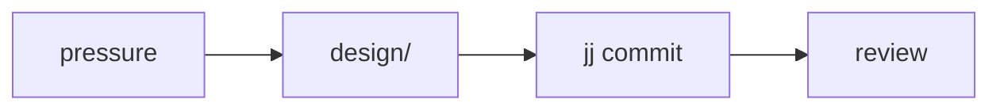

# Planning rules

## No time-frames

Never write time-frames like "days" or "weeks" into plans. Agent estimates
are crude and will not match actual delivery timelines — leave them out
entirely. Sequence and dependency order carry the plan; calendars do not.

## Breaking changes under 1.0

While a project is `<1.0`, the default posture is future-forward, not
compatibility-preserving: breaking changes are fine, and the build and
delivery strategy aims at the right destination shape rather than carrying
old shapes along. Do not spend plan space on compatibility machinery —
shims, dual paths, transitional forms — that a pre-1.0 project does not owe
anyone.

Migration steps are usually unnecessary too. The call is a cost judgment,
not caution: weigh how much data is actually persisted and how much real
usage depends on it against how difficult migrating it would be. Small or
easily regenerated data, or few and internal-only users → skip the migration
and let the break land. Data whose loss would genuinely hurt, with a
tractable migration → write the step. When a plan touches persisted data,
name which case it is in so the choice is inspectable rather than assumed.

Assess actual consumer and persisted-data obligations — real external
consumers and real data, not hypothetical ones. The optional preferred
[versioning strategy](/code/versioning.md) makes API changes visible and
consumer revision uptake deliberate while retaining that design latitude.

## Domain-grouped layouts, never flat

A project layout is **never** flat: some domain-grouped structure,
always. When asked to propose layouts, offer **multiple** suggestions of
domain groupings that might make sense — the grouping is a design
decision the human should get to weigh, not a detail to bury.

The tree-shape rules themselves — no package prefixes in directories,
when a `crates/`/`packages/` bucket is allowed, where registry prefixes
live, worked examples — are owned by
[`layout.md`](/code/layout.md).

## Mermaid diagrams

Mermaid diagrams are excellent visual references for plans. Use
**meaningful node identifiers** when creating them — `watcher --> debounce --> emitter`,
not `a --> b --> c` — so the diagram reads as a map of the actual system.

## Cross-references

- [`/code/README.md#code-planning`](/code/README.md#code-planning) — the
  common-weight summary.
- [`/code/layout.md`](/code/layout.md) — owns the tree-shape rules plans
  propose layouts under.
- [`/code/review-handling.md`](/code/review-handling.md) — what happens
  when a plan's output gets reviewed.
- [`/code/task-reconstruction/README.md`](/code/task-reconstruction/README.md)
  — when a plan should restart a line rather than extend it.
- [Workflow diagrams](/praxis/workflow-diagrams/README.md) — applies consistent
  naming to Mermaid nodes and shows feedback, evidence, conditional courses, and
  the distinction between informing relations and actual blocking dependencies.
