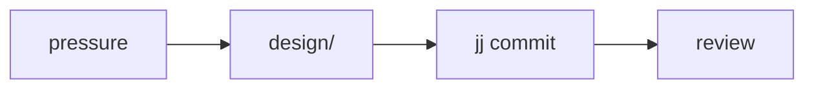

# Planning rules

## No time-frames

Never write time-frames like "days" or "weeks" into plans. Agent estimates
are crude and will not match actual delivery timelines — leave them out
entirely. Sequence and dependency order carry the plan; calendars do not.

## Breaking changes under 1.0

Breaking changes are fine while a project is `<1.0`. Do not spend plan
space on compatibility machinery that a pre-1.0 project does not owe
anyone; spend it on the right destination shape.

## Domain-grouped layouts, never flat

A project layout is **never** flat: some domain-grouped structure,
always. When asked to propose layouts, offer **multiple** suggestions of
domain groupings that might make sense — the grouping is a design
decision the human should get to weigh, not a detail to bury.

## Mermaid diagrams

Mermaid diagrams are excellent visual references for plans. Use
**meaningful node identifiers** when creating them — `watcher --> debounce --> emitter`,
not `a --> b --> c` — so the diagram reads as a map of the actual system.

## Cross-references

- [`/code/README.md#code-planning`](/code/README.md#code-planning) — the
  common-weight summary.
- [`/code/review-handling.md`](/code/review-handling.md) — what happens
  when a plan's output gets reviewed.
- [`/code/task-reconstruction/README.md`](/code/task-reconstruction/README.md)
  — when a plan should restart a line rather than extend it.
- [Workflow diagrams](/praxis/workflow-diagrams/README.md) — applies consistent
  naming to Mermaid nodes and shows feedback, evidence, conditional courses, and
  the distinction between informing relations and actual blocking dependencies.
