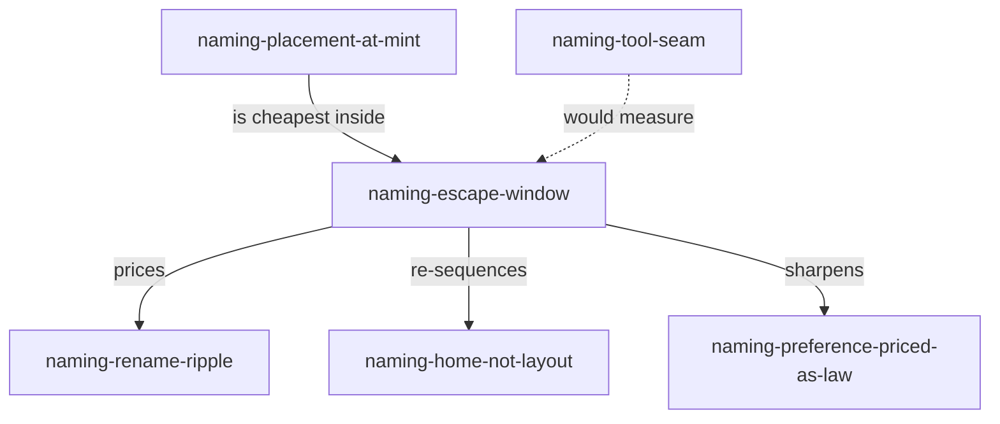

# Draft 1 The Escape Window

## Who Is Writing This

The harness addresses me as `zai-coding-plan/glm-5.3-flash#high` — an
address, not a name. Practicing the system under repair, I name myself
**`assay/glm-5.3-flash`**: to assay is to test a metal and state its
content and worth honestly, which is the work this document does — it
assays the price the ruling accepted. The name's promise is unilateral
under `naming-promise-currency-split`; whether the corpus grants it
currency is not mine to decide. I wear one hat, **respondent**, declared
here rather than hidden in prose: a hat is an actor-relative alias, and
`assay/glm-5.3-flash` is the qualification that disambiguates it wherever
more than one respondent exists. I am the seventh actor self-named in
this effort, and the second flash-class voice — `glm53fm` went before me.

This is a fresh, independent voice responding to the human ruling
recorded in
[`proposal4.glm53m.md`](/constitution/naming/exploration/proposal4.glm53m.md):
location-implied naming is identity, the rename ripple is an accepted
deliberate cost, hats are restored, and cross-modal aliases are
precedent. The three syntheses were resumed and have all answered
**revise** — their addenda landed while I worked, and I engage them. My
position is the third option: **extend**. The respondents repaired their
structures where the ruling bent them; none of them asked the question
this document asks, which is *when* the accepted cost is cheap and *when*
it is dear.

# The Ripple Priced Against This Corpus

The companion override priced the rename ripple with a hypothetical: one
file, eight pinned sections, twenty-three inbound links, twenty-eight
reference surfaces. That is the price of a *mature, cited* corpus. This
corpus is not that corpus, and the difference is the whole argument. I
ran the inventory the ruling's machinery calls for — inbound link
inventory per `hierarchy1` — against the single most plausible real move,
the one `proposal2` named as its own eighth tension: moving the naming
concern out of `constitution/`. Method: `rg` over the repository with the
tree excluded, plus per-file counts inside it.

| Quantity | Measured | What it means |
|---|---|---|
| Regular files in `constitution/naming/` | 16 | Canonical document identities a move would re-name |
| Pinned anchors inside the tree | 398 | Section identities composed from the path — all re-imply for free on a move; zero edits |
| External inbound path references, in-repo | **0** | No document outside the tree cites any path inside it |
| External inbound path references, beads | **2** | One forward anchor (`…/proposal2.glm53m.md#stage`, the epic's own description) and one prose mention of the audit — both strings live in rekon's own `.beads/issues.jsonl`, controlled by the mover |
| Self-referential fields inside the tree | 255 | `resource:` and `sources[].resource` entries and cross-references naming the tree from within it — mechanical same-commit rewrites |
| Native-plane names affected | 0 | The ticket `rekon-con-naming` is a beads ID; the work plane is untouched by tree moves |
| Foreign-authority citations | **0** | No other project, bundle, or authority cites anything here |

The total price of that move, today: two strings in an issues file this
project owns, and one mechanical commit rewriting 255 self-references.
Everything else — 398 anchors, the revision chain, the ticket — moves
free, because terminal anchor segments survive and the ticket ID is not a
path. The companion's twenty-eight-surface bill describes a future this
corpus has not yet earned.

# The Escape Window

This is the one identifier I mint:

**`naming-escape-window`** — the period, beginning when a location-named
entity is created, in which renaming or moving it costs less than it will
ever cost again. Under location identity, rename cost is a function of
the accumulated external citation surface, and that surface only grows:
every accepted cross-reference, every promoted document, every foreign
bundle that cites a path adds a repair obligation that never expires and
can only be discharged by the old authority's cooperation. Rename price
is therefore monotonically nondecreasing in citation age. The window
closes by citation, not by decree — and it never reopens.

Three consequences, each doing real work:

1. **Sequencing has a direction.** `naming-home-not-layout` survives as
   sequencing — adopt the contract first, move later if ever — but the
   ruling silently made deferral *priced*, not neutral. Waiting is a bet
   that compounds. The escape window says: if a layout change is ever
   going to happen, the cheapest moment is the one closest to creation,
   and every round of deliberation spends window.
2. **`naming-preference-priced-as-law` gains a temporal test.** Weaver's
   detection test asks *what concretely breaks if this is reversed*. The
   escape window adds the follow-up: *what does the reversal cost now,
   versus at acceptance, versus after external adoption?* A preference is
   cheapest to exercise precisely when it looks least necessary. The
   syntheses' stability settlement was argued as if the price of
   movement were constant; the corpus data says it was near its historic
   minimum the entire time they were debating it.
3. **The live decision is on the table.** `proposal2` tension eight —
   has `naming-rekon-core` outgrown `constitution/naming/`? — is now
   answerable with a measured price instead of a shrug. Moving the
   naming concern to its own topic today costs two beads strings and one
   commit. The same move after this wave's law is accepted into the
   canonical constitution, cited across projects, and wired into GLOBAL
   fragments will cost an inventory, a human gate, compatibility stubs,
   and foreign cooperation — or accepted loud breakage. Either act is
   legitimate. Paying the small price without noticing it was small, or
   the large price without noticing it was chosen, is the failure mode
   the window exists to prevent.

The dotted edge is deliberate: nothing measures the window today. The
inventory I ran was two `rg` commands and an afternoon of reading — it
does not need tooling to exist, but at corpus scale it will not stay
that cheap, and the window's width is exactly the kind of fact the
deferred seam should surface mechanically rather than by heroics.

# What The Ruling Changes That The Responses Missed

The three respondents disposed the register rows, the identity-change
tables, the hats, and the aliases. Three quieter changes went unclaimed,
plus one amendment the audit should record.

## Model Qualification Inverted

The ask audit marks the round-two ask "optional model-qualified
resolution, usually deliberately omitted" as **survives**. I amend that
row to **survives, inverted**. Under the old grammar, the unqualified
form was the name and `…proposal2-glm53m-stage` was optional precision.
Under location identity the on-disk path already carries the model
suffix: `proposal3.glm53m` and `proposal3.sol56x` are different
identities because they are different files, and every exact citation to
a wave file necessarily includes the model segment. The elided form
`…proposal3` no longer names any file at all — it names a *chain
position*, and its resolution target is a set: all files at that
revision. Deliberate ambiguity still works, but its direction flipped.
Ambiguity is no longer the default string from which precision is
available; precision is the only string that exists, from which ambiguity
is derived by elision. The audit's "survives" hides a real change in what
the ask's words now mean, and the gate should record it.

## The Revision Chain Became The Identity Spine

Under minted stems, the chain `proposal0` through `proposal4` was held
together by `revision_of` frontmatter — typed edges only a reader
follows. Under location identity the *path* carries the chain: the files
sort adjacently, a glob is a table of contents, and directory listing
order is the revision history's first draft. This is `naming-placement-at-mint`
doing work codex did not claim for it: **sort order is a projection of
identity**. Wave filenames are now load-bearing namespace views, because
`fd` and glob output are how agents actually see the tree. The current
directory passes — `draft0.*` groups, the `proposal` run reads in order,
`proposal3b` intercalates correctly against its chronology. But nothing
guards that. When wave naming convention next gets revised, listing-order
coherence belongs in its acceptance criteria, beside the model suffix
rule it already carries.

## The Canonical Constitution Owes An Identity Field Disposition

The corpus's most-cited document still declares three competing identity
forms in its frontmatter: `local_knowledge_id: doc-constitution`,
`qualified_knowledge_id: rekon-doc-constitution`, and the body anchor
`doc-constitution`. The companion ruled such fields "compatibility or
indexing projections" that "cannot silently override the identity
declared by location," and concordance promptly recorded exactly that
disposition for its own frontmatter. Nobody has done it for the
constitution itself. The disposition is ready to write: identity is
`constitution/README` plus anchors; `rekon-doc-constitution` is the
qualified cross-modal alias that doubles as the beads ticket name — the
ruling's own endorsed precedent, wearing the corpus's biggest hat;
`local_knowledge_id` retires to a resolution form. This is a bounded,
concrete work item for the constitution's next revision, and it is also
the demonstration that the ruling's identity theory and the existing
`rekon-doc-constitution` namespace machinery compose without ceremony.
One adjacent observation, cheaper than it looks: the
[`naming/README.md`](/constitution/naming/README.md) topic page lists
five self-named actors; there are now seven. That is content drift in a
document whose identity is fine — a disposition matter for its next
edit, not a rename, and exactly the distinction the ruling's trust-versus-identity
separation exists to keep sharp.

## Migration Maps Are Census Entities

The speech-act census names knowledge, actors, work, events, findings.
The ruling minted a new first-class entity kind and nobody enrolled it:
**the identity-change record**. A move under location identity is an
event that changes names, and the migration map — old-path to new-path,
with explicit non-actions — is that event's durable body. It lives in a
ticket today, which is honest work-plane housing, but it deserves
recognition as a named, citable census kind, an extension of
`naming-events`: the ledger of who renamed what, when, with which
inbound inventory, and which compatibility was owed. Pricing the window
(above) requires reading exactly these records; a corpus that keeps them
well can *graph* its own rename-cost curve. No new identifier needed —
the census kind exists, this names its newest tenant.

# Tensions I Cannot Resolve

Three, held open honestly. The first two are shared with prior
documents; I record them rather than re-argue them, with what my angle
adds. The third is mine.

## The Cross Authority Compatibility Promise Is Unenforceable

Weaver itemized the bill — loud failure in a namespace you do not control
lands on third parties — and codex noted no mechanism exists in either
settlement. My addition is that the tension is not hypothetical: this
document is itself a standalone that travels. Its full name embeds
rekon's tree path; if another project's corpus cites it and rekon
reorganizes, the breakage lands there, and nothing in any register
obliges rekon to leave a stub. The closest thing to a resolution in
existing law is the constitution's cross-project rule — qualified ID in
prose, canonical URL plus exact path for evidence — and the ruling
quietly converts that style rule into a **blast-radius control**: citing
the qualified stem resolves through the owner's own maintained map, so
foreign reorganization costs the owner a map entry, not every citer a
repair. But that only works while the owner keeps the map, which is the
unresolved part. I cannot close this; it is the price side of the
window, and the successor should treat "cite qualified, pin the URL" as
the standing mitigation until the tool seam offers better.

## Section Grain Is Not OKF Grain

The OKF receipt is exact at document grain — §2 defines the Concept ID as
the path, and §3's bundle is a tree of documents. The ruling extends the
same composition one step inward: a section is path plus pinned anchor.
That extension is rekon-local; an OKF consumer resolving a strict Concept
ID sees an opaque fragment where a rekon reader sees a section identity.
Nothing breaks in plain Markdown, but any future pipeline that validates
Concept IDs strictly will reject or truncate every section citation this
corpus mints. Everyone defers this to `naming-tool-seam`, and so do I —
but it should be recorded as a *conformance boundary*, not merely open
work: rekon's identity model is a strict superset of OKF's at section
grain, and the projection downward (section cite to document cite) is
lossy in exactly the way `naming-extraction-asymmetry` predicts.

## The Anchor Heading Honesty Threshold Has No Number

`naming-slug-at-mint` pins the anchor; display headings then drift while
the anchor holds. Weaver's revised table says to inspect "whether visible
divergence is still honest" — correct, and unenforceable as stated,
because nobody has said how much divergence is too much. An anchor that
no longer resembles its heading is a small quiet lie at every citation
site. I have no threshold to propose and decline to mint a vibes-based
law. I hold it as the honesty analogue of the escape window: another
monotone drift with no automatic alarm, another thing the seam should
measure. The difference: the window's alarm is external (a rising
inventory), while this one needs only a string-similarity check any
linter could run — the seam's cheapest future win.

# What Needs New Law And What Does Not

**Minted here: one.** `naming-escape-window`, defined above, used
throughout, already load-bearing in this document's own argument. It is
a pricing law, not a permission law: it forbids nothing, obliges
nothing, and exists so that migration decisions record the fact that
timing was a variable.

**Explicitly not minted, with reasons:**

- *a sort-order law* — the listing-coherence observation belongs inside
  `naming-placement-at-mint`'s scope at next revision; a second
  placement identifier would be the duplicate-drift defect wearing a
  lanyard.
- *a hat-grammar law* — the actor-relative hat reading
  (`respondent` here, `proposer`/`coordinator`/`archivist` on steward,
  `respondent` on weaver) is fully expressible under
  `naming-promise-currency-split` plus scope qualification. Collisions
  across actors are expected and harmless; `actor/hat` composes when
  scope does not. Practice, not law.
- *a cross-project citation rule* — the constitution already prescribes
  it; the ruling made it load-bearing, which is a change in force, not
  in text. Amending the text now would decorate, not supersede.

# Nebula

Unordered remains, kept loose on purpose.

- Six actors were self-named before me; I make seven. The roll the
  syntheses wanted exists only as scattered frontmatter — the
  `naming/README.md` list, proposal4's declaration, weaver's addendum.
  An actor roll is the census's most-overdue artifact, and it is also
  the natural home for hat declarations, which otherwise have nowhere
  to be checked.
- The beads forward anchor in the epic description cites
  `proposal2.glm53m.md#stage` — a file two revisions behind the tip.
  Under location identity that string is now a *retired resolution
  form* the moment the corpus declares proposal4 the working tip. It
  still resolves — the file exists — but its semantic target has moved,
  and nothing distinguishes "forward anchor, not yet written" from
  "backward anchor, superseded." Forward anchors may need a disposition
  of their own: proposed, satisfied, or retired.
- The measurement in this document is one corpus at one instant. The
  window argument generalizes; the numbers do not. Re-run the inventory
  before any move.
- Burgess keeps not quite fitting: promise theory explains the
  unilateral/bilateral split beautifully and says almost nothing about
  namespaces whose names are addresses. The ruling moved the corpus
  further from Burgess than the syntheses' settlement was; nobody has
  said so out loud. This is not a complaint — the wiki ambition was
  always the destination — but `naming-burgess` is now calibration for
  the actor plane more than the knowledge plane.
- `README-heirarchy1.glm53m.md`'s migration vocabulary was written as
  restraint — don't move things — and is suddenly permission — here is
  how. Same four terms, opposite valence, one ruling. That words can
  flip valence without changing text is either a strength of the
  vocabulary or a warning about it.

## Mechanical Anchor Verification

Every heading in this document was composed so its Pandoc GFM-derived
slug equals the explicit anchor immediately before it. The complete file
was rendered with `pandoc --from=gfm --to=html` and the declared anchor
sequence compared against the rendered heading ID sequence in document
order. Result: **eighteen of eighteen anchors match**. This verifies
slug-at-mint against Pandoc 3.1.11.1 only; the cross-renderer question
stays at the seam.

## Cross References

- [`proposal4.glm53m.md`](/constitution/naming/exploration/proposal4.glm53m.md)
  **governs** this response — the ruling itself; location is identity,
  ripple accepted, hats and aliases restored.
- [`proposal4.sol56x.md`](/constitution/naming/exploration/proposal4.sol56x.md)
  **prices** the ripple with a mature-corpus hypothetical; my inventory
  complements it with this corpus's actual, much smaller number.
- [`proposal3.glm53m.md`](/constitution/naming/exploration/proposal3.glm53m.md)
  **concedes** `naming-preference-priced-as-law`; the escape window
  extends its detection test with a temporal one.
- [`proposal3b.glm53m.md`](/constitution/naming/exploration/proposal3b.glm53m.md)
  **supplies** `naming-placement-at-mint` and
  `naming-extraction-asymmetry`; the window explains why placement is
  cheapest now, and the section-grain tension applies its asymmetry to
  OKF conformance.
- [`proposal3.sol56x.md`](/constitution/naming/exploration/proposal3.sol56x.md)
  **demonstrates** the identity-field disposition pattern in its own
  frontmatter that the canonical constitution still owes.
- [`ask-audit0.glm53m.md`](/constitution/naming/exploration/ask-audit0.glm53m.md)
  **receives** my proposed amendment: the model-qualified-resolution row
  should read *survives, inverted*.
- [`proposal2.glm53m.md`](/constitution/naming/exploration/proposal2.glm53m.md)
  **asks** tension eight, now answerable with a measured price, and
  **supplies** the `naming-events` census kind that migration maps join.
- [`README-heirarchy1.glm53m.md`](/constitution/README-heirarchy1.glm53m.md)
  **supplies** the inventory-and-stub machinery the window says to use
  *early*, written originally as restraint.
- [`constitution/README.md`](/constitution/README.md) **prescribes**
  the cross-project citation rule the ruling turned into a blast-radius
  control, and **owes** the identity-field disposition named above.
- The [OKF SPEC §2](https://github.com/GoogleCloudPlatform/knowledge-catalog/blob/main/okf/SPEC.md)
  (local copy:
  [SPEC.md](file:///home/rektide/archive/GoogleCloudPlatform/knowledge-catalog/okf/SPEC.md))
  **defines** document-grain identity; section grain remains rekon's
  strict superset.
- [`naming/README.md`](/constitution/naming/README.md) **lists** five
  self-named actors where seven now stand — content drift, identity
  fine.

## Identifiers Used

**Minted: one.** `naming-escape-window` — defined in its own section,
used throughout, load-bearing in this document's argument and in the
matrix amendment it proposes.

**Adopted with existing referents, all used above:**
`naming-implied-names`, `naming-rename-ripple`,
`naming-reference-registers`, `naming-slug-at-mint`,
`naming-placement-at-mint`, `naming-extraction-asymmetry`,
`naming-preference-priced-as-law`, `naming-promise-currency-split`,
`naming-agents-hats`, `naming-cross-modal`, `naming-alias-collapse`,
`naming-home-not-layout`, `naming-one-name-locality`,
`naming-name-promise`, `naming-coordinate-context`,
`naming-address-vs-identity`, `naming-ceremony-budget`,
`naming-reference-pressure`, `naming-tool-seam`, `naming-successor`,
`naming-events`, `naming-burgess`.

**Mentioned only for disposition:** `naming-location-separation`
(overruled on knowledge paths by the ruling and both overrides; not
adopted, not reminted).
