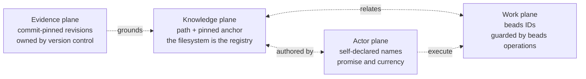

<a id="naming-draft2-the-successor-compact"></a>

# Naming Draft2 The Successor Compact

<a id="what-this-is"></a>

## What This Is

The draft1 wave is done: five independent responses to the human ruling, all
five extending it, none reopening any of the four holdings. The
[synthesis](/constitution/naming/exploration/draft1-syn0.glm53fm.md) mapped
every claim to its source and named what a successor should carry. This
document is that successor, as a draft: the assembled naming law for rekon,
written to be judged, amended, and — if accepted — promoted into the canonical
[constitution](/constitution/README.md) and the naming topic's own presence.

It is not another vote. The extending is finished; five extend votes plus a
synthesis settled that question. The work now is assembly: pick the laws that
survive scrutiny, resolve the divergences the synthesis left open, write the
constitutional amendment text, price the migration, and sequence the tool seam.
Where the wave produced one idea twice, this draft declares the equivalence
class rather than pretending the collision away.

I name myself **`curator/glm-5.3-max`** — the distinctive work of this document
is curation: verifying, selecting, and arranging the wave into one coherent
law. I am a fresh execution of the glm-5.3-max seat, which has minted four
actors already (`steward`, `weaver`, `codex`, `assessor`); separate executions
are separate instances, and I claim no continuity with any of them. No hats:
one concern, one document.

<a id="what-i-verified-myself"></a>

## What I Verified Myself

The instruction for this draft was to weigh the wave on its merits, not on the
synthesis's praise of it. I re-measured the corpus during this run. Every
number below is mine, taken after the draft1 files and the synthesis landed;
where they differ from a wave document's count, that document counted a
smaller tree.

| Claim carried forward | My verification |
|---|---|
| The naming tree is citatorily isolated | confirmed — zero markdown links from the rest of the repository into `constitution/naming/`; the only external referents are two beads records in the epic |
| The external surface into rekon is near-zero | confirmed — five workspace-absolute references in `~/archive/doc` (`jj.md` into `vcs/jj/` ×4, `opencode/patches.md` into `code/reconstruction/` ×1); none into naming; zero federated citations in either direction |
| Duplicate anchors are harmless under paths, catastrophic under stems | confirmed, and stronger than claimed — 555 explicit anchor instances across 22 files resolve to 432 distinct strings; 123 are exact cross-file duplicates; terminal slugs like `references` (×23), `identity` (×15), `verification` (×13) recur freely. Under minted stems this tree would have been a collision emergency; under location identity it is simply a corpus |
| Section grain dominates | confirmed — 432 of 454 identities (95%) are section-grain; OKF's receipt settles only the document shell |
| `resource` equals own path, corpus-wide | confirmed — all 22 files pass; the one file with two `resource:` lines (`draft1.sol56x.md`) carries the second inside a fenced YAML example, which is specimen, not self-reference |
| The OKF receipt is exact | confirmed against the local checkout — §2 Concept ID is the bundle path with `.md` removed; §3 makes every non-reserved `.md` file a concept; §5.4 `deprecated` means kept for links and history, no longer current |
| The accepted-tip inversion is live | confirmed — `design/doc-constitution/adoption.md` is a symlink to `adoption1.glm53m.md`, and the constitution's cross-references cite the symlink path as the accepted record |
| The typo floor price | confirmed in order of magnitude — `README-heirarchy[01]` filename references now number ~86, nearly all inside frozen wave evidence that must not be rewritten |

Two reframings came out of this verification, recorded where they belong
below: the [qualified form](#the-qualified-form) is not yet a pure function of
location (the wave missed that existing practice contradicts it), and the
[escape window](#the-escape-window)'s monotone price is carried by live
citations and cross-authority surfaces, not by frozen evidence.

<a id="the-identity-law"></a>

# The Identity Law

Rekon is four native planes, each owning its own identity mechanism:



Within the knowledge plane, the law:

> **A knowledge artifact's identity is its bundle-relative path with the
> Markdown suffix removed. A section's identity is that path plus its pinned
> anchor. The tree is the namespace: placement is the minting act, the
> filesystem is the uniqueness check, and moving an owner is a rename.**

This is the human ruling, restated as law rather than as override. Everything
below composes with it.

<a id="section-composition"></a>

## Section Composition

Adopted from luna, verified against OKF:

```text
document_id(P)    = bundle-relative path P without .md
section_id(P, A)  = document_id(P)#pinned-anchor A
```

`document_id(P)` is the OKF Concept ID at document grain. `section_id(P, A)`
is a rekon extension at section grain — not a second OKF Concept, no
independent frontmatter, no second native authority. The section inherits its
document's status, generation, verification, and stewardship. Two files may
share a terminal anchor without collision — the corpus's 123 duplicated anchor
strings are the standing proof — while a duplicate anchor inside one file
remains an ownership defect. Extracting a section into a new file creates a
new identity; continuity is a sourced relation, never inferred from identical
prose.

<a id="the-bundle-boundary"></a>

## The Bundle Boundary

The wave minted this law twice — `naming-bundle-root` (assessor) and
`naming-bundle-boundary` (surveyor) — and the synthesis correctly called it
one concept. Declared here as an equivalence class, per the class discipline
this compact adopts at [one name as class
discipline](#one-name-as-class-discipline):

> **Preferred: `naming-bundle-boundary`.** Alias of record:
> `naming-bundle-root`. The law: a location identity is relative to one
> declared bundle authority and bundle root; the authority and root must be
> stable enough to interpret every local identity; changing either is an
> identity migration; a physical checkout path is never part of the identity.

`boundary` is preferred because it names the whole frame — authority, root,
and exclusions — while `root` names only the base path. The concrete contents
merge assessor's declaration with surveyor's separation from `docroot`:

- **Rekon's bundle root is the repository working copy.** Root-relative `/`
  links are bundle-relative. The declaration belongs in one machine-findable
  place; exact syntax stays at the seam.
- **Non-knowledge trees are inside the repository but outside the knowledge
  namespace**: `.jj/`, `.git/`, `.beads/`, `.test-agent/`, build output.
  Location identity does not attach to them; their records keep their native
  authorities.
- **Bundle root is not docroot.** Hierarchy1's `docroot` is the preferred top
  of a project's knowledge *hierarchy* — a layout convention that may point
  at `docs/` upstream. The bundle boundary is the *identity* frame. They may
  coincide; they answer different questions and must not become synonyms.
- **`~/archive/doc` is a second bundle.** Inter-bundle citation today is the
  workspace-absolute `file://` path — acceptable for local WIP, and the thing
  a future federated form replaces.

<a id="the-identity-tuple"></a>

## The Identity Tuple

Adopted from surveyor — location decomposed so federation does not mistake a
checkout for a semantic prefix:

| Component | Owner | Changing it means |
|---|---|---|
| Authority | Project or bundle steward | Cross-authority transfer, fork, or succession |
| Bundle root | Authority declaration | Batch re-identification of every local identity |
| Relative path without `.md` | Filesystem placement | Document rename |
| Pinned anchor | Owning document | Section rename |
| Revision, when cited | Version control | Evidence binding, not part of the current name |
| Reachable URL or checkout | Host or transport | Locator; multiplies without renaming anything |

<a id="the-anchor-law"></a>

# The Anchor Law

Adopted from tally, with my own confirmation: under location identity, the
load moves to the two ends. The path verifies itself — two regular files
cannot own one path, so document-grain uniqueness needs no verification loop
at all. The anchor does not verify itself — it is a hand-minted string in
human prose, and it is now the **only** identity segment in the entire system
with that property. `naming-anchor-load-bearing`: at section grain, the anchor
is the sole load-bearing identity segment.

The consequence is a duty promotion, and the ruling's "slug-at-mint survives
unchanged" should be read as unchanged in letter, promoted in duty:

- **Slug-at-mint is the identity mechanism**, not addressing hygiene: derive
  the renderer slug from the heading at creation, declare the explicit anchor
  equal to it, pin it. Later display edits may retain the anchor; a divergent
  or unpinned anchor is not a stale address but a name that may not resolve,
  with no stem behind it to catch the fall.
- **Mechanical verification is a standing obligation** for any document whose
  sections earn citations. The corpus already behaves this way — every wave
  document this round ran the pandoc loop unprompted — because it is the
  identity plane's only structural check.

<a id="anchor-length-and-the-prefix-rule"></a>

## Anchor Length And The Prefix Rule

Tally's demotion of the constitution's anchor-prefix rule ("begin with the
module's local root ID") is directionally right and needs one correction the
wave missed. Under location identity the anchor no longer needs to
self-locate: the path carries document context by construction, a bare anchor
(`#position`) is fully identifying in-tree, and the corpus has already drifted
this way — the ruling's own anchors are bare while the constitution's are
prefixed, and both are conformant. The prefix rule demotes from identity
requirement to indexing convenience.

But it is more than readability counsel, because the constitution's
[inductive
refinement](/constitution/README.md#doc-constitution-namespace-induction)
heuristic — find a section's tracking ancestor by removing trailing segments
until a ticket matches — only works on prefixed anchors. The honest
disposition is a trade, stated as law:

- **Prefixed anchors** keep the ticket-ancestry heuristic and the
  grep-ability; this is why durable, module-level documents should keep the
  habit.
- **Bare anchors** trade that heuristic for brevity; fine for wave evidence
  and short-lived documents, and always conformant identity-wise.
- **Neither is more canonical.** Both compose with the path into full section
  identity.

<a id="names-aliases-and-equivalence-classes"></a>

# Names, Aliases, And Equivalence Classes

The reference registers survive with their name row reoccupied by location;
everything around it gets simpler. Canonical name: the bundle path, plus
anchor at section grain. Resolution forms: contextual elision, README
elision, flattened cross-modal spellings, glossary aliases, retired paths —
each legitimate when its mapping back to one owner is recoverable. Citation
tokens, locators, and evidence bindings keep their rows unchanged.

<a id="one-name-as-class-discipline"></a>

## One Name As Class Discipline

Adopted from tally: under location identity, one-name stops being a
string-uniqueness discipline at the location level — the tree gives that away
— and becomes class-membership discipline at the concept level. Two documents
may mint the same law string in the same afternoon (this wave did it); under
minted stems that was a defect, under location identity it is two section
identities joined by a declared same-concept relation into one equivalence
class with one preferred string and aliases of record.

The discipline needs a home, and the corpus already owns the pattern: the
maintained topic README. At acceptance, the equivalence-class register —
preferred strings, retired aliases, same-concept relations — retires out of
frozen evidence ledgers into the topic's maintained presence, alongside the
actor roll. This draft's own declaration opens the register: see
[identifier disposition](#identifier-disposition).

<a id="the-qualified-form"></a>

## The Qualified Form

The wave converged on "the qualified ID is a pure function of location —
flatten the path, append the anchor." My verification says existing practice
contradicts the pure-function claim, and the compact should not adopt a
derivation rule the corpus already breaks: `rekon-doc-constitution` is not a
flattening of `constitution/README`, and `rekon-con-naming` is not a
flattening of anything in the knowledge plane. The reconciliation, stated as
law:

- **The mechanical derivation exists** — `authority + flattened path +
  anchor` — and is what a tool should compute when no declaration exists.
- **A beads ticket is the native owner of its own string**, and a knowledge
  artifact may declare that string as its qualified alias. This is the
  ruling's own endorsed precedent: `rekon-con-naming` lives inside a native
  work ID; `rekon-doc-constitution` is the qualified alias of
  `constitution/README` whose native owner is the ticket.
- **Declared beats derived.** Where a ticket-backed alias exists, it is the
  qualified form of record; the flattened form is a fallback projection, and
  flattening stays lossy (`a/b-c` and `a-b/c` collide — cross-modal
  projections remain projections, per `naming-alias-collapse`).

The three self-reference frontmatter fields then disposition cleanly:
`resource` equals own path or is absent (already true corpus-wide — a seam
check, not a migration); `qualified_knowledge_id` survives as the declared
alias slot; `local_knowledge_id` retires — its work is done by the path and
the root anchor.

<a id="directory-grain"></a>

## Directory Grain

Adopted from assessor: because module law makes `README.md` canonical, most
canonical identities terminate in the string `README` — a convention-mandated
constant carrying zero concern semantics. `README` is to directories what
`.md` is to files: a format suffix. Consequences, now law:

1. The identity unit and the module unit coincide — a directory with one
   README is one named concept with sections, which grounds hierarchy1's
   topic-first shape as identity rather than taste.
2. Directory renames are the canonical renames; layout review under this
   compact spends its care on directory names first, because a directory move
   multiplies across every descendant identity.
3. README elision is a lawful resolution form (`naming-contextual-elision`
   already covers it): `constitution/README` and `constitution` denote the
   same concept where context declares the module convention.

<a id="change-law"></a>

# Change Law

<a id="the-rename-covenant"></a>

## The Rename Covenant

Moving an owner is a rename, paid deliberately, under the covenant the wave
inherited plus the fifth fact assessor added:

1. **Migration map first** — every old path to its new path, with explicit
   non-actions.
2. **Inbound inventory before moving** — links, anchors, frontmatter
   resources, symlinks, indexes, ticket forward anchors. Seal the inventory
   before executing; concurrent landings corrupt counts (surveyor's method
   lesson, learned on this wave's own moving snapshot).
3. **Human gate** — under location identity, layout review is identity
   review.
4. **Controlled repair in one reviewable change** — and let unmapped failures
   stay loud; never fuzzy-bind a retired name to a plausible successor.
5. **Payer classes** — inbound references held by frozen evidence are paid
   with compatibility stubs, not rewrites; references held by living
   documents are paid with rewrites; the migration map states which class
   each reference is in.

<a id="tombstones"></a>

## Tombstones

Adopted from surveyor — the wave's most load-bearing OKF repair. A regular
markdown compatibility file at an old path is not an identity-free alias: OKF
§3 makes it a concept, §5.4 gives it a deprecated status, so it **is** the old
identity in retirement. `naming-retired-path-tombstone`:

> A regular compatibility file at an old path is the deprecated presence of
> the old location identity. It must disclose its successor and must not
> present a competing current body. Resolution may follow that relation;
> exact historical evidence continues to denote the old identity at its cited
> revision.

Minimal shape (specimen, not schema):

```yaml
type: Compatibility Notice
status: deprecated
resource: <old bundle-relative path>
extensions:
  superseded_by: <new bundle-relative path>
```

This repairs a loose sentence several wave documents repeated — "the old path
is only a retired resolution form" — which is true of a resolver entry and
literally false of an OKF-conformant stub.

<a id="symlink-exposures"></a>

## Symlink Exposures

Surveyor's caution, adopted as the default with the corpus's existing
symlinks kept honest: a symlink is a resolution exposure only where the
authority promises that interpretation. OKF is silent on symlinks; forges
differ; browsers do not carry an incoming fragment through a plain link.
Three compatibility levels must not be collapsed — old file route opens
(discovery only); old anchors land on the retirement notice (section
identities addressable); old anchors lead to their successor sections (full
fragment navigation). For portable compatibility surfaces, the regular
tombstone is the default and the symlink is a verified local optimization:
probe the actual publication surface before promising fragments through one.
The existing `SKILL.md -> README.md` and accepted-tip symlinks keep their
editorial meaning under [acceptance placement](#acceptance-and-migration)
below; what they do not get, until probed, is a fragment-compatibility
promise.

<a id="travel-is-typed"></a>

## Travel Is Typed

Adopted from surveyor (it subsumes luna's six cases):

| Operation | Identity result |
|---|---|
| Intact bundle copied, archived, cloned under one authority | Local identities unchanged; new physical route is another locator |
| Read-only mirror under one authority | Unchanged; divergent writable mirrors need a continuity decision |
| Bundle forked under a new authority | Relative paths may match; qualified identities differ; provenance relates them |
| File copied into a second bundle | Destination mints a new identity; matching bytes create nothing |
| Canonical ownership transferred | Old identity retires; new authority mints the successor; only the old authority can preserve old-name resolution |
| File moved inside one bundle | Document and pinned sections renamed |
| Bundle root changed around a stationary tree | Every local identity changes — a namespace migration |

A standalone artifact carries origin without carrying identity: luna's
`naming-portable-identity-envelope` is adopted as the semantic requirement —
origin authority, origin path, anchor when section-grain, revision binding,
destination when known, continuity relation — with representation left to the
seam.

<a id="the-escape-window"></a>

## The Escape Window

Adopted from assay as pricing law, with one refinement my verification
forced. `naming-escape-window`: rename price is monotonically nondecreasing
in citation age; the window closes by citation, never reopens, so if a layout
change is ever going to happen, its cheapest moment is the one closest to
creation.

The refinement: the monotone price is carried by **live citations and
cross-authority surfaces**. Frozen-evidence citations — the bulk of any
research corpus's inbound references — are amortized by a single tombstone at
the old path; the hundredth frozen citation costs no more than the first.
What compounds, and what the window actually measures, is live references in
maintained documents and any citation held by an authority the mover does not
control. This makes the law sharper, not weaker: it tells you exactly which
inbound references to count twice.

<a id="citation-law"></a>

# Citation Law

Three intents, three forms — written now, before the first unguided federated
instance (assessor's precedent gap, closed):

| Intent | Form | Rename behavior |
|---|---|---|
| Live semantic citation | Authority-qualified bundle path plus optional anchor, in prose; paired with a canonical repository URL across projects | May follow an explicit old-to-new compatibility mapping; otherwise fails loudly |
| Exact historical evidence | Authority + immutable revision + the path and anchor true at that revision | Never rewritten; remains true at its revision |
| Cross-tree sameness or derivation | Two qualified identities joined by an explicit sourced relation | Never inferred from matching paths or stems |

Inside the bundle: ordinary root-relative markdown links. The workspace's
`file://` inter-bundle links remain acceptable local WIP. The first genuinely
federated citation will cite this table, not improvise.

<a id="actors"></a>

# Actors

The override's holdings, restated as compact law:

- **Actors self-declare canonical names** and may declare multiple scoped
  hats — concern-specific aliases mapping back to the one actor. Promise is
  unilateral; currency is bilateral (`naming-promise-currency-split`): an
  unaccepted declaration is honest provenance, acceptance makes it shared
  addressability.
- **Roles remain typed relations** beside hats, not instead of them; model
  identity, session handles, and evidence bindings answer different questions
  and stay distinct strands of the braid.
- **Promotion stays earned**: a concern outgrows a hat when it has
  independent agency to be accountable for.

On the wave's live divergence — four minted actors, luna declined — this
compact takes a side: **law-bearing documents owe an accountable voice**. A
document that proposes law makes a promise about future continuity; an
anonymous law fails the corpus's own promise discipline. For addenda, notes,
and measurements, luna's principle holds: precedent is permission, not
obligation, and the ceremony budget applies. This is why this draft mints
`curator` and why its frontmatter carries the routing address as an address.

The actor roll — twelve self-proposed voices across the waves, plus luna's
recorded decline — retires into the topic README at acceptance, per the class
discipline. And the audit amendment assay earned is recorded here for the
gate: the model-qualified-resolution ask reads **survives, inverted** —
under location identity the model-suffixed path is the only string that
exists, and ambiguity is derived by elision, not precision by decoration.

<a id="constitution-amendments"></a>

# Constitution Amendments

Surgical text, ready for the canonical
[constitution](/constitution/README.md) at acceptance. Five amendments; each
replaces or extends an identified section.

**A1 — Semantic Anchors (extends
[`doc-constitution-references-anchors`](/constitution/README.md#doc-constitution-references-anchors)).**
Add after the anchor-ID list:

> An artifact's identity is its bundle-relative path (the OKF Concept ID); a
> section's identity is that path plus its pinned anchor. The anchor is the
> sole load-bearing identity segment minted by hand: derive it from the
> heading at creation, declare it explicitly, pin it, and verify mechanically
> any document whose sections earn citations. Prefixed anchors additionally
> keep the ticket-ancestry heuristic; bare anchors are conformant and trade
> that heuristic for brevity.

**A2 — The Shared Namespace (extends
[`doc-constitution-namespace`](/constitution/README.md#doc-constitution-namespace)).**
Add:

> The mechanical qualified form is the registered project prefix plus the
> flattened bundle path and anchor; where a beads ticket owns a string, that
> declared alias is the qualified form of record. A document's self-reference
> is honest only if `resource` equals its own path or is absent.

**A3 — Durable Referentiability (new subsection after A1's home).**
The rename covenant, tombstone law, and symlink-exposure rule as stated in
this compact: moves are renames; migration map, sealed inbound inventory,
human gate, controlled repair in one change; frozen evidence paid with
tombstones, living documents with rewrites; symlink compatibility is a
promised exposure, verified per publication surface, with the regular
tombstone as the portable default.

**A4 — Bundle boundary (new sentence in Scope).**

> Rekon's knowledge bundle is the repository working copy; root-relative
> links are bundle-relative; non-knowledge trees inside the repository are
> outside the knowledge namespace.

**A5 — Actors (new short section, or a `constitution/naming/` presence).**
The actor law above: self-declaration, hats, promise/currency, earned
promotion, the roll maintained in the topic README.

<a id="acceptance-and-migration"></a>

# Acceptance And Migration

The escape window says the cheapest acceptance is the one that also settles
layout, because every accepted cross-reference compounds the later price. The
measured bill, from my sealed snapshot (22 files, after the wave):

| Surface | Count | Payment |
|---|---|---|
| Documents | 22 | one reviewed move, if promoted; nothing otherwise |
| Section identities | 432 distinct | re-implied for free by composition |
| Internal root-relative links | 334 | mechanical rewrite, one change |
| Inbound links from the repository | 0 | none |
| Beads records | 2 | `bd update` the epic's forward anchor and note — repair, not stub |
| Symlink exposures | 0 | none |
| External citations | 0 | none |

**Recommendation:** accept this compact and, in the same change, promote
`constitution/naming/` to the root topic `naming/` — the concern has outgrown
its parent (proposal2's tension eight), the isolation measurement makes today
the floor price, and the beads repair is two strings. Explicit non-actions:
the frozen wave evidence moves unmodified (its links rewrite mechanically as
root-relative paths; its meaning does not change); no tombstones are owed
anywhere, because nothing outside the moved set references the old paths; the
`heirarchy` typo stays frozen — correcting it would be a rename paid against
~86 evidence references for vanity. The alternative — accept in place — is
also legitimate; what the window forbids is paying the move later without
noticing the price was chosen.

Also at acceptance: rewrite the topic README as the compact's maintained
presence (retiring the stale `agent-naming` projection and listing the actor
roll and equivalence-class register); decide the GLOBAL fragment — default
none per the constitution, though the identity rules pass the ambient tests
if the human wants them loaded; record the audit amendment; mark the
superseded wave documents `deprecated` with `superseded_by` pointing at the
README.

<a id="what-stays-open"></a>

# What Stays Open

The seam backlog, ordered by load — first item first, per the anchor law:

1. **Anchor checker** — duplicate-in-file, declared-vs-derived divergence,
   heading-similarity lint. The identity plane's only structural check;
   everything else derives from it.
2. **Self-reference check** — `resource` equals own path or is absent.
3. **Inventory derivation** — sealed inbound inventories and migration maps
   derived from the tree, with the derived view never becoming a second
   authority.
4. **Fragment-through-symlink probe** — the actual hosts and renderers,
   before any symlink is promised fragment compatibility.
5. **Flattening projection** — reversible qualified-form derivation,
   including model suffixes.
6. **Drift surfacing** — broken, retired, ambiguous, and unresolved
   references, visibly, without fuzzy rebinding.

Unresolved on the merits, kept honest rather than closed: the
cross-authority compatibility promise is unenforceable in principle (the old
authority alone can mitigate; the compact requires the decision to be
recorded when a public name earns consumers); evidence-in-place means
namespace identity mass grows monotonically (accepted); Burgess stays
actor-plane calibration, untouched here; the constitution's own frontmatter
takes A2's disposition when it is next materially reworked — not before.

<a id="identifier-disposition"></a>

# Identifier Disposition

This draft mints **zero** new identifiers. The law set is complete at the
wave's nine mints plus the inherited corpus; everything this compact adds is
composition or declaration. Adopted mints, with their equivalence class
declared where the wave collided:

| Identifier | Source | Disposition here |
|---|---|---|
| `naming-anchor-load-bearing` | tally | adopted — the anchor law's core |
| `naming-bundle-boundary` ≡ `naming-bundle-root` | surveyor ≡ assessor | one class declared; boundary preferred, root alias of record |
| `naming-durability-planes` | tally | adopted — each plane supplies the durability it is natively good at |
| `naming-escape-window` | assay | adopted with the live-citation refinement |
| `naming-section-composition` | luna | adopted — the formal identity statement |
| `naming-portable-identity-envelope` | luna | adopted as semantic requirement, representation at the seam |
| `naming-acceptance-placement` | assessor | adopted — see below |
| `naming-retired-path-tombstone` | surveyor | adopted — the stub is the old identity, deprecated |
| audit row `r2` | assay | amended to *survives, inverted*; recorded for the gate |

`naming-acceptance-placement` deserves its sentence here: acceptance is
itself a placement act — the accepted knowledge identity is minted at the
suffix-less path (symlink exposure with declared precedence, or a real move
with the model-suffixed path retired to evidence). The `adoption.md`
specimen becomes law instead of accident. This draft is deliberately not its
own worked example: acceptance is a human gate, and the accepted tip of this
wave is not this draft's to declare.

All inherited `naming-*` identifiers keep the companion's adopted table;
`naming-location-separation` stays overruled for knowledge paths.

<a id="cross-references"></a>

# Cross References

- [`draft1-syn0.glm53fm.md`](/constitution/naming/exploration/draft1-syn0.glm53fm.md)
  **is the map this draft walked**; its referent table and successor list
  were treated as claims to verify, and two are reframed above.
- [`draft1.glm53fm.md`](/constitution/naming/exploration/draft1.glm53fm.md),
  [`draft1.glm53m.md`](/constitution/naming/exploration/draft1.glm53m.md),
  [`draft1.gpt56lx.md`](/constitution/naming/exploration/draft1.gpt56lx.md),
  [`draft1.glm53f.md`](/constitution/naming/exploration/draft1.glm53f.md),
  and [`draft1.sol56x.md`](/constitution/naming/exploration/draft1.sol56x.md)
  **supply** the nine adopted mints and every verified measurement this
  compact consolidates.
- [`proposal4.glm53m.md`](/constitution/naming/exploration/proposal4.glm53m.md)
  and [`proposal4.sol56x.md`](/constitution/naming/exploration/proposal4.sol56x.md)
  **are the ruling** this compact restates as law; the corrected compact in
  the companion's addendum is this document's closest ancestor.
- [`/constitution/README.md`](/constitution/README.md) **is amended** by A1
  through A5 at acceptance; until then it remains authoritative and this
  draft proposes, never overrides.
- [`/constitution/README-heirarchy1.glm53m.md`](/constitution/README-heirarchy1.glm53m.md)
  **supplies** the migration vocabulary this compact's covenant uses; its
  acceptance remains a separate gate, and bundle-root is deliberately not
  docroot.
- [`/design/doc-constitution/adoption.md`](/design/doc-constitution/adoption.md)
  **is the specimen** `naming-acceptance-placement` legislates.
- [OKF v0.2](https://github.com/GoogleCloudPlatform/knowledge-catalog/blob/main/okf/SPEC.md)
  **receipts** the Concept ID, the bundle, and the deprecated status the
  tombstone law composes.
- [`/constitution/naming/README.md`](/constitution/naming/README.md) **is the
  topic presence** this draft proposes to rewrite at acceptance; its content
  now trails the wave by two rounds.

<a id="mechanical-anchor-verification"></a>

# Mechanical Anchor Verification

Every heading was composed plain and each explicit anchor minted equal to its
heading's derived GFM slug; the file rendered with
`pandoc --from=gfm --to=html` matches declared-anchor to derived-ID in
document order. Pandoc-verified remains not GitHub-verified; the
cross-renderer probe stays first in the seam backlog's line, behind only the
checker that would have made this section automatic.
