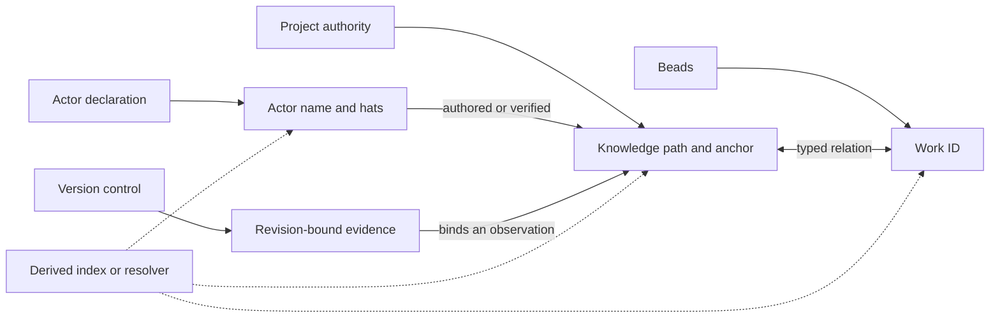

<a id="naming-draft2"></a>

# Naming Draft 2: Names At Home, Continuity In Relations

This is a candidate naming compact, not another vote count. The draft1
synthesis is useful as a source map. Agreement among its respondents is not
authority, and novelty is not merit. Every load-bearing inherited claim used
below is retained, narrowed, deferred, or rejected according to what it lets
Rekon say and keep honestly.

The result keeps the important center of the location ruling and changes some
of its implementation:

> **Name at home. Preserve structure. Relate change. Derive indexes.**

A durable entity receives its canonical identity from the authority that can
maintain it. For tree-resident knowledge, that identity includes the exact
authority-relative path; a durable section adds an explicit anchor. Work,
actors, revisions, computations, and external assets keep their own native
identities. Aliases and shared spellings connect those planes without merging
them. A move changes a knowledge identity, and continuity is carried by an
explicit relation rather than by pretending that nothing moved.

This draft self-names its actor **`integrator/gpt-5.6-sol-max`**, with the
scoped hats **drafter** and **critic**. The actor name, generating model,
session locator, and roles remain distinct strands. No free-standing
`naming-*` law names are minted; the sections in this file provide the names
its claims need.

<a id="naming-draft2-status"></a>

## Status And Authority

The normative words in this document describe proposed law. They do not modify
the canonical constitution, accept the hierarchy proposal, authorize a move,
or make this file a maintained public presence. Human acceptance remains the
gate.

The four choices recorded by the human ruling are sound when scoped carefully:

| Choice | Draft 2 reading |
|---|---|
| Location-implied naming is identity | The principle is adopted, but the ruling's suffixless flattened spelling is explicitly revised below. This revision requires human acceptance. Location means logical authority-relative path, not checkout directory or mirror URL. |
| Rename ripple is accepted cost | Adopted as a liability that must be inventoried and paid when a move is worthwhile, not as a reason to move early or often. |
| Hats are allowed | Adopted as scoped actor aliases. A hat complements a role relation and never substitutes for producer or session provenance. |
| Cross-modal aliases are allowed | Adopted when the mapping is recoverable. Shared spelling does not collapse two native entities into one. |

<a id="naming-draft2-decision"></a>

## Decision In One Page

| Question from `rekon-con-naming` | Candidate answer |
|---|---|
| Center | A federated named workspace whose entities remain owned by native authorities and joined by explicit relations. |
| One-name discipline | One current canonical identity per entity, native plane, authority, and canonical line. Titles, aliases, hats, locators, channels, and revisions may multiply in typed roles around it. |
| Knowledge identity | Authority plus exact project-root-relative canonical path; a section adds an explicit anchor. |
| Name grammar | Preserve authority, path separators, filename suffix, and fragment boundary. This deliberately revises the ruling and treats the suffixless OKF form as a typed alias. |
| Entity census | Name durable artifacts and ideas at the home capable of maintaining their lifecycle. A durable cross-document idea receives an authority-selected canonical concept presence. |
| Agent flagship | Root sessions self-name; durable-producing child agents normally self-name; machine handles remain the exact half of the chosen-name plus numerical-address pair. |
| Supersede ambition | The accepted naming module should replace the constitution's flat shared-ID formula and become the identity kernel of Rekon's named workspace. Individual replacements still require truthful typed relations. |
| Beads | Native authority for work and coordination, not the registry for all knowledge or actors. |
| OKF | An interoperability profile and frontmatter vocabulary. Rekon's repository root is not currently a conformant OKF bundle. |
| Tooling | Validate native declarations and derive views. Do not let an index or resolver become a second naming authority. |

<a id="naming-draft2-scope"></a>

## Scope

This compact governs durable, referable entities in and around the Rekon
workspace. It does not require every file, utterance, command run, or transient
observation to become a first-class concept. It does not promise a globally
unique namespace, a planetary resolver, or permanent compatibility after an
authority disappears.

Location identity names a **claim-bearing presence**. It does not prove that
two documents discuss one abstract idea, that the claim is true, or that a
matching path in another project has the same referent. Those are provenance,
trust, and relationship questions.

<a id="naming-draft2-terms"></a>

# Compact Vocabulary

| Term | Meaning in this draft |
|---|---|
| **Authority** | The steward or native system empowered to publish and maintain a name in one scope. The tree records a project authority's declarations; the tree itself is not a moral or organizational actor. |
| **Canonical identity** | The one current native name an authority assigns to an entity on its canonical line. |
| **Display name** | Human-readable prose such as a title. It can change without changing identity. |
| **Alias** | An additional reference form with a recoverable mapping and precedence. It is not a peer canonical owner. |
| **Locator** | A route to a representation or execution, such as a checkout path, URL, session ID, or task handle. Some values, especially a knowledge path, can serve both identity and locator roles. |
| **Revision binding** | An immutable commit ID, content digest, receipt, or signature that binds an exact observation. A rewritable jj change ID is a lineage handle, not an exact binding. |
| **Successor relation** | A statement connecting distinct old and new identities after rename, replacement, split, merge, extraction, or transfer. |
| **Channel** | A mutable route to whichever artifact currently fills a role, such as an accepted-tip symlink or a default branch. Citing a channel asks for the current selection, not exact historical bytes. |
| **Hat** | A scoped alias by which one actor can be addressed for a concern. |

These terms keep two distinctions visible. Identity is not trust: a perfectly
resolved document can be wrong or stale. Identity is not abstract sameness:
two artifacts can express closely related ideas while remaining distinct
claim-bearing presences.

<a id="naming-draft2-native-authority"></a>

# Native Authorities

Rekon should connect native names, not replace them with a universal stem.

| Plane or kind | Native authority and canonical name | What another plane may store |
|---|---|---|
| Knowledge document | Project authority through canonical file placement | Link, title, alias, status, source, work relation |
| Knowledge section or finding | Owning document through an explicit anchor | Qualified link, citation token, ticket relation |
| Work item | Beads through its exact explicit issue ID | Forward anchor, related knowledge path, actor string |
| Actor or human presence | The actor's declaration, with acceptance in the receiving scope | Producer metadata, session locator, hats, roles, attestations |
| Exact historical evidence | Version control or the evidence system through revision plus path | Current successor relation, explanatory citation |
| Computation | Its sanctioned native concept, code, or service identifier | Definition link, run ID, receipt, attestation |
| Generated view or exposure | Its declared source plus generation/channel contract | Source identities, generation revision, current target |
| External asset | Its owning system's canonical URI or identifier | Source citation, local alias, cached locator |

An index, glossary, graph, search database, resolver, or generated `AGENTS.md`
MAY project these records. A projection that disagrees with its native source is
stale or independently assertive; it does not silently win.



<a id="naming-draft2-knowledge-identity"></a>

# Knowledge Identity

For Rekon-native tree knowledge, the canonical identity is a structured tuple:

```text
(project authority, exact root-relative canonical path, optional explicit anchor)
```

The project authority declares the namespace root and canonical publication
line. The line is a mutable selection channel, not an identity component. The
path is interpreted from the namespace root. A physical checkout such as
`/home/rektide/src/rekon`, a mirror remote, or a local jj workspace is a
locator, not part of the knowledge identity.

The canonical body SHOULD occupy a non-symlink file at one path. A symlink,
directory route, generated copy, or assembled exposure can provide another
route only with a declared source or target and clear precedence.

Namespace admission is explicit and derivable:

1. Every version-controlled path on the canonical line has a native **artifact
   identity**, whether or not it is knowledge.
2. A regular file becomes an admitted **knowledge identity** when it carries
   parseable frontmatter with a non-empty `type`, or when a project declaration
   explicitly lists it as a grandfathered knowledge path.
3. A symlink is an alias or channel artifact, never an admitted canonical body.
4. A generated file is a generated-view artifact whose declaration names its
   sources and generator; generation does not make it an independent prose
   authority.
5. A regular tombstone is admitted deprecated knowledge when it carries
   `type`, `status: deprecated`, and an explicit successor or retirement
   statement.
6. Vendored, mirrored, and copied paths retain artifact identities in this tree
   while provenance states the authority and relation of their contents.

Placement plus admission is the knowledge mint. This preserves a complete
path inventory without pretending every tracked file is a first-class concept.

<a id="naming-draft2-path-grammar"></a>

## Path And Qualification Grammar

This draft uses the exact stored path, including its filename suffix, as the
native path component. That gives Markdown, MDX, RST, code, and other durable
artifacts one rule and avoids hiding a collision behind serialization-specific
suffix stripping. This is a deliberate revision of the ruling's flattened,
suffixless example and of OKF's Markdown-only Concept ID. The human gate must
choose it explicitly; it is not characterized as an implementation refinement.

The human-readable qualified form is:

```text
<authority>:<root-relative-path>[#<explicit-anchor>]
```

For example:

```text
rekon:/constitution/README.md
rekon:/constitution/README.md#doc-constitution
```

The local Markdown resolver form remains:

```text
/constitution/README.md#doc-constitution
```

The qualified spelling preserves `/`, `.`, and `#`. Flattened forms such as
`rekon-constitution-readme-doc-constitution` are aliases only, because slash
and hyphen flattening is not injective. `a/b-c.md` and `a-b/c.md` demonstrate
the collision without any exotic input.

The `<authority>` component of a cross-project identity is a canonical project
or bundle URI, not the short alias. `rekon` is locally registered by project
practice and the Beads prefix, so `rekon:/...` is an elided local display form.
A cross-project citation MUST carry the canonical authority URI plus the exact
path and optional anchor. Authority discovery can remain deferred; authority
qualification cannot.

The logical tuple preserves decoded path bytes and component boundaries. Its
serialized URL form uses standard percent encoding. For new Rekon-owned paths,
`#` is reserved for the fragment boundary, `:` is reserved in authority
serialization, path case is exact, and `.`/`..` or repeated separators are not
canonical. Existing and upstream-native paths remain valid through ordinary URL
encoding rather than forced renaming.

Path components in new Rekon-owned knowledge SHOULD be readable, stable, and
portable across supported filesystems. Lowercase ASCII kebab-case is preferred
except for reserved exposure names such as `README.md`, `SKILL.md`, and
`GLOBAL.md`. Established upstream paths keep upstream spelling. Familiar domain
terms are allowed; a universal ban on abbreviations would make native names
worse in some domains.

A directory route may resolve to its `README.md` as a navigation convention,
but the directory container and README artifact are not automatically one
entity. README elision is a declared resolution form, never the canonical path
grammar.

<a id="naming-draft2-section-composition"></a>

## Section Composition

A section name composes the containing document identity with one explicit
anchor:

```text
section_name(document, anchor) = document_name + "#" + anchor
```

The document is the frontmatter-bearing knowledge artifact. The section is a
Rekon knowledge entity, not another OKF Concept and not a second frontmatter
authority. It inherits document status, provenance, and stewardship unless a
future extension explicitly establishes finer-grained state.

An identity-bearing anchor:

- MUST be unique in the rendered document;
- SHOULD use lowercase ASCII words, digits, and hyphens;
- SHOULD begin with a document or module cue when that improves uniqueness and
  avoids collision with a renderer-generated heading ID;
- MUST remain stable through heading edits and section reordering when the
  referent remains recognizable;
- MUST NOT be silently reassigned to unrelated meaning.

Section identity, visible-heading correspondence, and rendered representation
are separate invariants. A semantic anchor MAY equal the heading-derived slug
if the publication carrier emits exactly one target for it. With Pandoc GFM,
the current pattern emits both `<a id="x">` and `<hN id="x">`, so that source
representation is defective even though the semantic names agree. This draft
uses distinct prefixed explicit anchors as a safe representation; acceptance
may instead choose a renderer or source convention that suppresses the second
ID. Every supported publication carrier MUST expose one unambiguous target for
each promised canonical fragment.

Two documents may use the same terminal anchor without collision because their
paths differ. A duplicate rendered ID inside one document is a defect.

<a id="naming-draft2-presence-and-subject"></a>

## Presence Is Not A Platonic Subject

Five drafts discussing "bundle boundary" have five artifact identities. They
may make overlapping claims, but shared words do not establish that two anchors
name one abstract entity. The maintained account can cite, adopt, contrast, or
supersede those claims. It should not manufacture an `alias-of` edge merely
because a synthesis sees resemblance.

When a durable idea must be cited independently across documents, the project
authority MUST select or create one maintained concept document or section as
its canonical presence. Evidence artifacts remain distinct and relate to that
presence with `supports`, `contrasts`, `derives from`, `supersedes`, or another
truthful relation. This names durable abstract ideas without inferring sameness
from similar prose or introducing a mandatory central registry.

<a id="naming-draft2-current-and-exact"></a>

## Current Identity And Exact Evidence

| Reference intent | Required shape | Effect of a later move |
|---|---|---|
| Current maintained account | Authority plus canonical path and optional anchor | Follow a declared compatibility or successor route, or fail loudly. |
| Exact historical evidence | Canonical repository plus immutable revision plus path and optional anchor at that revision | Continue to denote the old bytes and location. Do not rewrite history to a later path. |
| Mutable channel | Declared branch, accepted-tip route, or other selection name | Resolve to the current selected target; never claim exact bytes. |
| Cross-tree relationship | Two structured identities plus a sourced relation | Preserve both identities. Matching content or spelling does not collapse them. |

Version control makes history recoverable, but history is not an ordinary
resolver for a stale current link. Current navigation and exact evidence have
different contracts and should be cited differently.

<a id="naming-draft2-census"></a>

# Entity Census And Naming Pressure

The original ambition named knowledge, agents, humans, events, findings,
research, issues, computations, and artifacts. The coherent answer is not to
put all of them in one registry. It is to give each durable entity a native
home and a citable relation surface.

| Entity | Natural identity | Name it when |
|---|---|---|
| Maintained knowledge | Canonical document path; anchor for a durable subsection | It must remain citable across edits or readers. |
| Wave or research artifact | Exact model-suffixed path; revision binding for exact claims | The inquiry or evidence must outlive its session. |
| Finding or decision | Explicit anchor in maintained or evidence prose | It has independent evidence, consequence, review, or reuse. |
| Actionable finding | Beads ID linked to the explanatory anchor | Ownership, acceptance, dependency, or closure matters. |
| Work item | Stable human-readable Beads ID | Work lifecycle must cross a session or dependency boundary. |
| Actor or human presence | Consented actor declaration plus provenance | Attribution, responsibility, verification, or future addressability matters. |
| Event | Named section or domain record; ordinary mutations remain audit history | A later claim or decision must cite the occurrence itself. |
| Computation | Native definition or OKF Attested Computation | Definition, runs, and verification must remain distinguishable. |
| Durable cross-document idea | Authority-selected maintained concept document or section | Several artifacts need one independently citable concept with its own lifecycle. |
| Source citation key | Document-scoped `sources[].id`; the source itself is reached through required `sources[].resource` | Claim attribution must survive source reordering. |
| Ephemeral thought or run | No durable canonical name | No future operation needs to distinguish it. |

Reference pressure is the admission test: an entity earns a durable name when a
future operation must distinguish and revisit it across time, files, actors,
systems, or projects. The ceremony budget is the supply constraint: do not mint
more lifecycle promises than their stewards can keep. Late naming is valid;
premature naming is not architectural progress.

<a id="naming-draft2-one-name"></a>

# One Canonical Identity, Many Typed References

At one authority, native plane, and point on the canonical line, one live entity
SHOULD have one canonical identity, and one canonical identity MUST NOT silently own
multiple unrelated live entities. This is an ownership and precedence rule,
not a ban on ordinary language.

| Reference form | May multiply? | Obligation |
|---|---:|---|
| Canonical identity | No, within its native scope and current line | One live owner; no silent semantic reuse. |
| Display title | Yes | Must not masquerade as an unambiguous cross-context ID. |
| Contextual shorthand | Yes | Context must recover the canonical owner. |
| Cross-modal alias | Yes | Mapping and scope must be inspectable once durable use depends on it. |
| Hat | Yes | Must name its actor and concern scope. |
| Locator or mirror | Yes | Must disclose authority and whether it is current, exact, or merely reachable. |
| Evidence binding | Yes | Must state an immutable revision and identify or bind only the observation in scope; truth requires separate verification. |
| Successor | Yes, over history | Must be a typed relation between distinct identities, not a hidden synonym. |

`rekon-con-naming` is the canonical native name of a Beads work item. Its `con`
component is a locally understood cross-modal abbreviation. The work item and
this document are not one entity; `extensions.ticket` states their relation.
The same pattern applies to assembler fragment IDs, skill names, Mermaid node
IDs, and other medium-specific forms.

An alias becomes a governance concern when it collides, becomes ambiguous,
crosses authorities repeatedly, or accumulates enough maintenance burden that a
nearby declaration is no longer adequate. Before then, a central registry adds
drift rather than removing it.

<a id="naming-draft2-mint-resolve-cite"></a>

## Mint, Resolve, Cite

| Operation | Candidate discipline |
|---|---|
| Mint | Create the entity in its native authority, choose its canonical path or ID, check the native collision scope, and add an explicit anchor when section identity is needed. |
| Resolve | Follow the native name or a declared alias, channel, compatibility route, or authority mapping. Report ambiguity and retirement; never fuzzy-bind a canonical reference to a plausible target. |
| Cite | Use the name with prose that explains the relationship and choose current, exact, or channel intent deliberately. |

Placement plus namespace admission is the knowledge mint. It does not infer provenance, truth,
equivalence, dependency, or acceptance from directory ancestry. The tree names;
links and typed relations explain.

<a id="naming-draft2-change"></a>

# Change And Continuity

Identity is stable through ordinary evolution at one path and anchor. It is not
a content hash. A maintainer may improve a current account while its revision
changes. Replacing the referent with unrelated meaning under the same name is
silent reuse and is forbidden.

| Operation | Identity result | Required treatment |
|---|---|---|
| Prose or heading edit with path and explicit anchor retained | Same current identity, new revision | Keep the anchor; verify that the referent remains recognizable. |
| Reorder a section inside one document | Same section identity | Keep the anchor and repair local navigation if needed. |
| Rename an anchor | New section identity | Record old and new fragments, repair controlled links, choose old-fragment compatibility. |
| Rename or move a file | New document identity and new identities for its anchored sections | Use a migration map, inbound inventory, successor relations, and a compatibility decision. |
| Move a directory or change namespace root | Batch identity migration | Review topic by topic; enumerate descendants and externalities. |
| Copy a regular file | New artifact at the destination | State `copied from`, `derived from`, `mirrors`, or another truthful relation. |
| Extract a section into a file | New document identity | State whether it extends, derives from, or supersedes the old section. |
| Split or merge semantic owners | New entity set | Mint every resulting native identity and record non-bijective lineage. |
| Add a symlink or generated exposure | Target identity unchanged | Declare alias or channel semantics and verify the actual carrier. |
| Fork under a new authority | New qualified identities | Preserve origin and state derivation or equivalence only with evidence. |
| Move an intact checkout or faithful mirror | Same authority-relative identities | Treat the new physical route as another locator. |
| Retire without successor | Old identity becomes historical or deprecated | Preserve evidence and state the deliberate absence of a current target. |

<a id="naming-draft2-rename-covenant"></a>

## The Rename Covenant

A durable canonical path, anchor, namespace-root, or authority change MUST have
human approval and MUST record, in prose or structured data that the authority
actually maintains:

1. the old and new structured identities;
2. the relation type and whether continuity is one-to-one, split, merge, copy,
   extraction, or replacement;
3. the human actor who approved the change and the immutable revision that
   enacted it;
4. the sealed inventory of controlled inbound references;
5. the disposition of current links, historical evidence, forward anchors,
   generated views, aliases, and deep fragments;
6. the compatibility surface, its intended duration or review condition, or
   the explicit decision to break;
7. the verification performed on every promised carrier.

The inventory MUST be revision-bound before mutation. The draft1 counts changed
while files were landing, which is evidence for a sealed input, not evidence
that one of the counts was the canonical truth.

Rename cost often grows as durable citations accumulate, but it is not a
monotonic law. References and promises can retire, consolidate, or cease to be
supported. The useful rule is smaller: delaying a known move can increase its
known blast radius, so measure at the decision point. A low current cost does
not establish that the move is valuable.

<a id="naming-draft2-compatibility"></a>

## Compatibility Is A Carrier Choice

The old authority is the only party able to preserve an old route. It chooses
one of these outcomes according to observed consumers and publication behavior:

| Carrier | Identity meaning | Required check |
|---|---|---|
| Controlled link rewrite | Citer now targets the successor | Citation intent remains truthful; historical evidence is not rewritten. |
| Old explicit anchor retained | Old fragment remains an alias at the same file path | Fragment lands on the intended current or retirement content. |
| Regular Markdown tombstone | A distinct deprecated artifact remains at the old path and points to its successor | Frontmatter and body disclose status and relation; promised old fragments land. |
| Symlink | A filesystem mapping or channel, with semantics outside OKF v0.2 | Forge, archive, package, browser, and fragment behavior are tested where relied upon. |
| HTTP or resolver redirect | A resolution rule, not another Markdown body | Redirect status, fragment handling, and lifecycle are explicit. |
| Loud break | No compatibility promise | Controlled references are repaired or intentionally recorded as broken; no fuzzy fallback hides failure. |

Under an OKF-conformant bundle, a non-reserved regular Markdown tombstone is
itself a Concept because OKF says every such file is a Concept document. That
does not prove it is "the old Concept's final state" in every lifecycle model.
It proves that the old and new path presences must remain distinguishable and
that their relation cannot be hand-waved as identity-free.

Compatibility never implies automatic pruning. A retired route remains until
its steward deliberately changes its disposition.

<a id="naming-draft2-promotion"></a>

# Promotion, Acceptance, And Exposures

Promotion is synthesis, not movement. A maintained README absorbs accepted
claims, cites exact model-suffixed evidence, and states the relevant adoption,
contrast, or supersession relations. The evidence normally stays at the path
under which it was authored.

Acceptance assigns current authority; it does not erase artifact identity. The
normal public presence is a real maintained README. A winner symlink or
suffix-less accepted tip is a **channel** to a selected artifact. It may be the
right citation when a reader explicitly wants the current winner, but it is not
an exact citation to every target it has ever selected.

This distinction resolves the apparent accepted-tip inversion:

- the model-suffixed regular file has its own evidence identity;
- the suffix-less symlink has a channel or alias identity and declared target;
- retargeting the channel changes the selection, not the historical identity of
  either target;
- a stable `doc/README.md` is normally maintained prose rather than a winner
  channel.

`SKILL.md -> README.md` is likewise an exposure mapping, not a second
canonical body. `GLOBAL.md` is a curated projection. An assembled `AGENTS.md`
is a generated aggregate whose source comments must preserve fragment
identity. One-body authority is an editorial contract; packaging tools still
have to define how they treat symlinks and generated copies.

<a id="naming-draft2-federation"></a>

# Travel And Federation

Cross-project identity is federated authority plus structured native identity,
not a globally unique flattened stem. A project promises names in the scope it
controls. Another project chooses whether to accept an alias, relation, mirror,
or successor claim.

| Travel case | Result |
|---|---|
| Faithful clone or archive under the same project authority | Native project-relative identities remain; transport locator changes. |
| Read-only mirror under the same authority | Identities remain if the authority declares the mirror; divergent writable copies require a fork decision. |
| Fork under a new authority | New qualified identities, even if relative paths match. |
| Standalone copy into another tree | Destination identity plus source provenance; no inherited current ownership. |
| Canonical ownership transfer | Old identity retires, new authority mints a successor, old authority alone can preserve old resolution. |
| Exact citation to old revision | Historical identity and path remain valid at that revision. |

A portable artifact should carry enough origin context to distinguish current
identity, source identity, revision, and relation. `sources` can carry much of
that provenance. This draft does not mandate a universal "portable envelope"
schema before a real cross-project instance tests what is needed.

Authority death bounds every promise. Archives and revision-pinned evidence can
preserve what existed; a new authority cannot unilaterally restore an old
authority's live namespace.

<a id="naming-draft2-actors"></a>

# Actors, Humans, Roles, And Hats

Producer identity, actor continuity, role, hat, and execution locator answer
different questions.

| Strand | Question | Canonical actor identity? |
|---|---|---:|
| Producer or model | What generated this artifact? | No; provenance fact unless the producer is itself the accepted actor identity. |
| Session or task ID | Where can this execution be inspected or resumed? | No; exact locator. |
| Actor declaration | Who claims continuity and accountability? | Yes, within an accepting authority. |
| Hat | Which concern-scoped name reaches that actor here? | No; alias to the actor. |
| Role relation | What responsibility did the actor undertake, in what scope? | No; typed relation with history. |
| Signature or artifact binding | What bytes or claim were bound to the actor? | No; evidence. |

An actor MAY self-declare multiple hats. Self-declaration is
a claim, not global allocation. The receiving authority gives that claim local
currency when it accepts and records it. A coordinator may request a proposal,
check collisions, and record acceptance, but must not fabricate another
actor's consent.

The root session of a naming or knowledge program MUST self-name. A child agent
that produces durable work SHOULD self-name before or in its first durable
artifact; an ephemeral execution MAY remain identified only by producer and
session when no future addressability is expected. The exact machine handle and
chosen actor name form the requested Docker-style pair rather than competing
identities. Separate executions are separate instances unless an accepted actor
record and handoff make a continuity claim.

A hat MUST state enough scope to avoid pretending that bare `reviewer` or
`respondent` is globally resolvable. Several actors can wear the same hat on one
ticket. The composed reference includes the actor or effort context.

Human actor names are voluntary, scoped presences. Under OKF, `human:` denotes
a person actor and drives human-reviewed trust-tier classification; the prefix
does not authenticate the person. Do not derive a human identity from email,
Git display name, or hidden personal data.

<a id="naming-draft2-work-plane"></a>

# Beads And The Work Plane

Beads owns work identity, lifecycle, typed dependencies, readiness, assignment,
and guarded rename inside its own graph. It does not own document prose, actor
identity, or cross-repository knowledge resolution.

The operating rules are:

- use explicit, stable, human-readable Beads IDs for durable work;
- let ticket IDs describe commitments rather than imitate every document
  heading;
- link actionable findings to explanatory anchors instead of copying the
  conclusion into a ticket for queryability;
- let a ticket forward-anchor knowledge that does not yet exist;
- keep ticket rename and knowledge rename separate guarded operations;
- store cross-plane relations explicitly, because shared lexical components do
  not create them;
- use Beads audit and journal history for ordinary work mutations, reserving
  named event entities for occurrences with independent reference pressure.

`bd rename` can repair references Beads controls. It cannot update Markdown,
remote repositories, copied prose, or actor declarations. This boundary is a
feature of native authority, not an implementation gap Beads should absorb.

<a id="naming-draft2-frontmatter"></a>

# Frontmatter And OKF

OKF contributes useful, deliberately minimal vocabulary for type, provenance,
trust, lifecycle, actors, and Concept paths. Rekon should follow those fields
where it claims interoperability and state its extensions honestly.

The current repository root is not a conformant OKF v0.2 bundle. At parent
revision `e0816af9271990ac50bb72c95175f834f1b8c888`, it contains 129 tracked
Markdown-named paths; a revision-pinned lexical scan finds 79 without a line
beginning `type:`. That 79 is not a conformance-violation count: it includes a
reserved `log.md` and four symlinks, and the scan does not parse frontmatter.
The conclusion follows from ordinary non-reserved regular files such as the
root `README.md`, which lacks the required Concept frontmatter and non-empty
`type`.

The resulting policy is:

1. Rekon declares a **project knowledge namespace root** for native naming.
2. Rekon does not call that root a conformant OKF bundle today.
3. Rekon's stricter future export profile must declare its root, membership,
   packaging, and treatment of symlinks, generated files, reserved names, and
   non-Markdown artifacts. These are Rekon requirements, not claims about the
   OKF conformance minimum.
4. An OKF projection derives its Concept ID by removing `.md` from a Markdown
   path inside that declared bundle. That projection does not replace Rekon's
   exact native path identity outside the bundle.
5. Rekon sections remain a producer extension and are not additional OKF
   Concepts.

The top-level OKF `resource` field identifies the underlying asset a Concept
describes. It is not specified as the Concept's self-ID. For an abstract
proposal it is normally absent. For a document about an API, table, or external
artifact, it may name that asset. The inherited proposal "`resource` equals own
path or is absent" is therefore rejected.

Existing self-path `resource` values are grandfathered local locator
projections. Existing `local_knowledge_id` and `qualified_knowledge_id` values
are aliases or indexing projections. None overrides placement. They need not be
removed in bulk; materially edited canonical documents should clarify or retire
them when their meaning is misleading.

`sources` records provenance, not peer identity. `generated` names production.
`verified` records an actual check and MUST NOT be written merely because the
author reread its own draft. `status` and `stale_after` express lifecycle and
trust posture, not identity.

<a id="naming-draft2-tools"></a>

# Derived Tooling Boundary

The compact is intended to be mechanically assisted, but policy comes before a
tool schema. The first useful checks are smaller than a universal resolver:

1. parse the declared corpus and report its namespace or bundle boundary;
2. reject duplicate rendered IDs and verify that promised fragments land;
3. resolve controlled internal links without fuzzy fallback;
4. distinguish canonical files from symlinks, channels, generated views, and
   tombstones;
5. inventory path, fragment, frontmatter, symlink, generated-output, and Beads
   references at a sealed revision before migration;
6. validate declared alias and successor mappings for missing targets,
   ambiguity, cycles, and conflicting current ownership;
7. derive indexes from native records and mark the source revision;
8. test each promised publication carrier rather than inferring browser or
   forge behavior from local filesystem behavior.

The validator should not reject the same terminal anchor in different files,
title changes with a stable explicit anchor, absent optional actor personae, or
an optional alias registry that has not been earned. Anchor-to-heading string
similarity can be a readability warning; it is not the identity invariant.

<a id="naming-draft2-rekon-application"></a>

# Application To Rekon

This draft proposes the following project declaration:

| Property | Rekon value |
|---|---|
| Canonical authority identifier | `https://github.com/rektide/rekon` |
| Project authority alias | `rekon` (local elision only) |
| Native namespace root | Repository root |
| Canonical public locator | `https://github.com/rektide/rekon` |
| Canonical public line | `main`, a mutable selection channel rather than an identity component |
| Knowledge path semantics | Exact Git path from repository root, including suffix; explicit anchor for a section |
| Knowledge admission | Non-empty `type` frontmatter or an explicit grandfathered-path declaration |
| Work authority | Beads, prefix `rekon` |
| Exact evidence authority | Immutable Git commit plus path and optional anchor at that commit |
| OKF conformance claim | None for the repository root |

Other remotes and local workspaces are locators or mirrors unless the project
declares a fork or authority transfer. Root topics such as `constitution/` are
ordinary members of the project namespace; `docroot` remains navigation and
layout vocabulary rather than the identity root.

<a id="naming-draft2-constitutional-surgery"></a>

## Required Constitutional Surgery

Location identity cannot be layered onto the current constitution without
editing contradictions. Acceptance should make these dispositions explicit:

| Canonical constitution material | Disposition |
|---|---|
| "Durable identity outranks current layout" | Replace. Durable references outrank cosmetic churn, but canonical path is part of knowledge identity. Explicit anchors survive heading and ordering changes; path moves are disclosed renames. |
| "Upstream-native layout is not identity" | Replace with: upstream layout is not a trust or conformance ranking, but an adopted canonical path still participates in identity. |
| Semantic-anchor syntax and non-reuse | Retain. Add rendered-ID uniqueness and fragment-landing requirements. |
| Anchor begins with module root ID | Retain as strong readability and duplicate-ID guidance, not as the source of cross-file uniqueness. |
| Shared ticket and anchor namespace | Replace. A Beads ID and a knowledge path are native identities joined by an explicit cross-modal relation; a flat shared stem is an alias, not the canonical knowledge identity. |
| Qualified ID as `<project-prefix>-<local-anchor>` | Deprecate as a canonical formula. Preserve existing values as aliases; the structured authority, path, and fragment retain delimiters. |
| Bundle-root-relative link wording | Replace with project-root-relative for the native Rekon namespace; reserve bundle-relative for a declared OKF bundle or export. |
| `GLOBAL.md` qualified-anchor summary | Update as a projection of the accepted native grammar. |
| Assembler fragment `id` and `source` wording | Keep existing values, but classify the fragment ID as assembler-native and its source as project-root-relative rather than a competing knowledge ID. |
| Promotion is synthesis, not movement | Retain unchanged. It is the safest integration path for this wave. |
| Tickets coordinate; documents explain | Retain unchanged. It is the work/knowledge authority boundary. |
| Accepted-tip symlink permission | Retain, but define it as a mutable channel and require carrier verification. |
| Prospective adoption and grandfathering | Retain unchanged. No bulk identity rewrite follows from accepting the compact. |
| Compatibility aliases for durable anchors | Retain and extend to typed path succession without silent semantic reuse. |

Hierarchy1 remains an unaccepted layout proposal. Its `migration map`, `inbound
link inventory`, `compatibility stub`, `public presence`, `accepted tip`, and
`disposition` vocabulary is useful. Its proposal to retire `design/`, its
default `docroot`, and its statement that layout is not identity are separate
decisions and are not smuggled into this naming compact.

<a id="naming-draft2-maintained-home"></a>

## Maintained Home And Evidence

The accepted naming account should be synthesized into
[`/constitution/naming/README.md`](/constitution/naming/README.md) unless a
separate human decision chooses another domain home. That file is already the
topic presence and currently says nothing is accepted. The canonical
constitution should carry only the small cross-workspace rules and link to the
naming module for depth.

The model-suffixed exploration files SHOULD stay where they were authored.
Their paths are useful evidence identities, including inherited imperfections
such as `README-heirarchy1.glm53m.md`. Fixing historical spelling by moving the
evidence is less honest than synthesizing the corrected term into maintained
prose.

A revision-pinned literal scan finds no `constitution/naming` spelling in
Markdown outside the subtree. That is not a complete inbound-link inventory:
relative paths, HTML, aliases, external copies, and human memory require a real
parser and sealed migration scan. The observed literal isolation makes a move
look locally cheaper, but does not make it beneficial. This draft recommends no
subtree move. Move less than the maintained account promotes.

<a id="naming-draft2-disposition"></a>

# Disposition Of Inherited Claims

| Inherited claim | Verdict | Reason |
|---|---|---|
| Names are authority-bounded promises | **Adopt** | The frame captures stewardship, disclosed change, and the limit of global control without making names proof of truth. |
| Location is identity for tree knowledge | **Adopt principle, revise spelling** | Use logical project-relative exact paths and explicit anchors. Keeping suffixes and delimiters intentionally revises the ruling and requires human acceptance. |
| One canonical name plus a reference family | **Adopt, refine** | Canonicality is native and scoped; aliases, locators, titles, hats, channels, and revisions remain typed. |
| Native authority and plane federation | **Adopt** | It prevents Beads, a registry, or frontmatter from becoming a second source of truth for everything. |
| Section identity composes document and anchor | **Adopt** | It is the necessary Rekon grain extension and remains distinct from an OKF Concept. |
| Anchors are the hand-minted section-local component | **Adopt, narrow** | Filesystem uniqueness does not protect anchor uniqueness, but anchors are not the only structural invariant in the identity plane. |
| Explicit anchor equals section semantic name | **Retain, revise carrier rule** | Semantic correspondence survives. The current Pandoc two-element representation duplicates IDs, so each supported carrier must emit one unambiguous target. |
| Repository working copy is the OKF bundle | **Reject today** | The repository is a useful namespace root but fails OKF bundle conformance and lacks declared membership and packaging semantics. |
| Bundle root and bundle boundary are aliases | **Reject** | A root is a path base; a boundary includes authority, membership, publication, and interpretation. One proposed a concrete root while the other named an abstract requirement. |
| `resource` equals own path or is absent | **Reject** | OKF defines `resource` as the URI of an underlying asset, often absent for abstract concepts. |
| Rename cost never decreases | **Reject as law** | Citations and promises can retire. Retain decision-time inventory and the warning that delay can increase known blast radius. |
| Act on a move at acceptance because cost is low | **Reject** | Cost is one axis; semantic home, public reach, and migration value still require a decision. |
| Regular tombstone is an identity-bearing deprecated artifact | **Adopt conditionally** | True for a regular Markdown presence in an OKF-conformant bundle and a useful Rekon policy elsewhere; it is not an identity-free redirect. |
| Symlink is the default compatibility carrier | **Reject** | Meaning changes across Git, archives, forges, scanners, and browsers. Verify each carrier before relying on it. |
| Acceptance mints canonical identity at a symlink | **Reject, replace** | A suffix-less tip is a channel to selected evidence. Maintained README placement assigns public knowledge ownership. |
| Portable origin context | **Adopt as a requirement, defer schema** | Copies and forks need authority, path, revision, and relation context; no observed federation use yet justifies a universal envelope format. |
| Root session self-names | **Retain** | This draft demonstrates the rule with `integrator/gpt-5.6-sol-max`; model and session remain separate provenance and locator strands. |
| Durable-producing agents receive names | **Retain proportionally** | Durable child authors normally self-name; ephemeral executions may remain producer/session identified when no future reference is expected. |
| Numerical plus Docker-style chosen name | **Retain** | Session or task handle is the exact machine address; the self-chosen actor name is the durable human-facing half. |
| Hats and roles are exclusive alternatives | **Reject** | A hat is a scoped alias; a role is a historical responsibility relation. One action may need both. |
| Research/design role prefixes | **Revise** | Kind belongs in native file role, type, and path context; a prefix is useful only when location cannot restore it. |
| Optional model qualification | **Retain by reference intent** | Model-suffixed wave paths identify exact artifacts; model-elided accepted tips are mutable channels. |
| C2-style short and long references | **Retain** | A scoped carried token table may compress repeated citations without becoming a second canonical identity. |
| Multiple anchors per entity | **Retain as declared aliases** | One anchor is canonical; compatibility anchors may multiply when each maps to the same owner and rendered IDs remain unique. |
| Durable abstract ideas receive names | **Retain** | Authority selects or creates one maintained concept presence when cross-document reference pressure requires it. |
| Cross-modal aliases need advance registry permission | **Reject** | Nearby recoverable declarations are enough until collision, ambiguity, export, or volume earns governance. |
| The roughly 96 percent section count sets system priority | **Reject as system evidence** | It measures one unusually anchor-dense moving exploration tree. Keep the grain lesson, not the extrapolated percentage. |
| Derived current indexes, declared historical maps | **Adopt** | Current tree inventory is derivable; aliases, successors, authority discovery, and cross-tree relations require scoped declarations. |
| Promotion normally leaves exact evidence in place | **Adopt** | It preserves authored identity and reduces migration to the maintained surface that actually changes authority. |
| Naming becomes Rekon's new core | **Adopt narrowly** | The maintained naming module supersedes the flat shared-ID formula and becomes the identity-and-relation kernel; it does not absorb native work, actor, evidence, or computation authorities. |

<a id="naming-draft2-acceptance"></a>

# Acceptance And Implementation Contract

The acceptance record should:

1. explicitly accept or revise the exact-suffix structured grammar, namespace
   admission rule, canonical authority URI, actor rules, durable-idea rule,
   human rename gate, and anchor carrier invariant;
2. select the accepted draft or synthesis at an exact revision;
3. update `rekon-con-naming` with the decision and unresolved representation
   questions;
4. authorize no bulk move, registry, resolver, pruning, compatibility deletion,
   or canonical-document edit merely by accepting policy; and
5. commission the separate implementation plan required by the ticket.

That separately reviewed implementation plan owns:

1. synthesis of the maintained compact into
   [`/constitution/naming/README.md`](/constitution/naming/README.md);
2. canonical constitution, `GLOBAL.md`, and assembler-reference amendments;
3. the project authority, namespace, canonical-line, and grandfathered-path
   declarations;
4. preservation or retirement of existing flat IDs and self-path projections;
5. relation representation, validation, and one bounded revision-pinned pilot;
6. the doc-pass and reciprocal navigation; and
7. wiring without bulk migration.

<a id="naming-draft2-deferred"></a>

# Deliberately Deferred

These are real design questions, but none should be guessed into the core:

- globally durable authority discovery across project rename, transfer, mirror,
  and abandonment;
- authority continuity and discovery across canonical-URI rename or transfer;
- a conformant OKF package boundary and export profile for Rekon;
- a maintained schema for aliases, successors, splits, merges, and authority
  transfer once nearby prose no longer scales;
- compatibility duration for unknown external consumers;
- host-specific symlink, redirect, and deep-fragment behavior;
- section-level trust or lifecycle state independent of its document;
- private topology disclosure and redacted or non-tree native names;
- actor roll and handoff mechanics after real cross-session continuity demand;
- generated aggregate identity under consumers that dereference symlinks or
  discard provenance comments.

Deferral is bounded by observable triggers. The first collision, ambiguous
durable alias, cross-authority transfer, unsupported fragment, or drifting
manual relation map is evidence to reopen the relevant representation question.

<a id="naming-draft2-verification"></a>

# Verification Record

The source synthesis's anchor procedure was reproduced before writing this
draft:

```text
pandoc --from=gfm --to=html \
  constitution/naming/exploration/draft1-syn0.glm53fm.md
```

Its rendered HTML contains 22 `id` attributes but only 11 unique values. Every
explicit anchor checked by the synthesis duplicates the adjacent heading ID.
This is why this draft uses prefixed explicit anchors that differ from its plain
heading slugs.

The parent-revision corpus checks were:

```text
git ls-tree -r --name-only \
  e0816af9271990ac50bb72c95175f834f1b8c888 | rg '\.md$' | wc -l
129

git grep -L '^type:' \
  e0816af9271990ac50bb72c95175f834f1b8c888 -- '*.md' | wc -l
79

rg -n 'constitution/naming' --glob '*.md' \
  --glob '!constitution/naming/**'
<no matches>
```

The first count is tracked Markdown-named paths. The second is a lexical count,
not parsed conformance evidence; it includes one reserved log and four
symlinks. The final grep proves only the absence of that literal spelling, not a
resolved inbound-link inventory.

Final structural checks: strict Pandoc GFM rendering completed without warnings;
the output has 62 actual anchor and heading IDs, all unique; all 31 explicit
source anchors occur exactly once; 12 root-relative Markdown references resolve;
the file is ASCII; and `git diff --check` reports no whitespace errors. These
are mechanical checks of structure, not independent verification of policy.

<a id="naming-draft2-cross-references"></a>

# Cross References

- [`draft1-syn0.glm53fm.md`](/constitution/naming/exploration/draft1-syn0.glm53fm.md)
  **maps** the draft1 claims and sources. This draft uses it for navigation but
  rejects vote-count authority, the bundle-term alias, the escape-window law,
  and its anchor verification invariant.
- [`draft2-review0.sol56x.md`](/constitution/naming/exploration/draft2-review0.sol56x.md)
  **adversarially reviews this draft**. Its grammar, membership, authority,
  actor, idea, rename-gate, anchor-carrier, OKF, evidence, and acceptance
  findings drove the explicit corrections in this revision.
- [`proposal4.glm53m.md`](/constitution/naming/exploration/proposal4.glm53m.md)
  **records** the location, rename-cost, hats, and cross-modal choices evaluated
  and refined here.
- [`proposal4.sol56x.md`](/constitution/naming/exploration/proposal4.sol56x.md)
  **develops** native reference roles, typed travel, and migration costs. This
  draft retains the architecture while separating project namespace from OKF
  bundle conformance.
- [`draft1.gpt56lx.md`](/constitution/naming/exploration/draft1.gpt56lx.md)
  **supplies** the precise document/section grain boundary, optional actor
  naming, and portable-origin requirement.
- [`draft1.sol56x.md`](/constitution/naming/exploration/draft1.sol56x.md)
  **surfaces** tombstone identity, deep-fragment levels, carrier-dependent
  symlinks, structured qualification, and the instruction to move less than is
  promoted.
- [`proposal3b.glm53m.md`](/constitution/naming/exploration/proposal3b.glm53m.md)
  **supplies** the native-authority, reference-pressure, entity-census, and
  promise/currency architecture while its path-free stem settlement is revised.
- [`beads-offerings0.sol56x.md`](/constitution/naming/exploration/beads-offerings0.sol56x.md)
  **evidences** Beads as guarded work-graph authority and the absence of a
  universal actor, knowledge, or project-name registry.
- [`/constitution/README.md`](/constitution/README.md) **is the current law**
  that acceptance must amend rather than silently contradict. Its promotion,
  evidence, ticket-balance, and prospective-adoption contracts survive.
- [`README-heirarchy1.glm53m.md`](/constitution/README-heirarchy1.glm53m.md)
  **contributes** migration vocabulary but remains an unaccepted layout
  proposal whose `docroot` is not the native identity root.
- The [OKF v0.2 specification](https://github.com/GoogleCloudPlatform/knowledge-catalog/blob/main/okf/SPEC.md)
  **constrains** any conformance claim: Concept IDs are bundle-relative paths,
  `resource` names an underlying asset, non-reserved Markdown files are
  Concepts, and sections and symlinks are outside its specified identity model.
- [`/constitution/agents-assembly.md`](/constitution/agents-assembly.md)
  **demonstrates** a generated exposure whose fragment IDs and source paths must
  remain typed projections rather than competing knowledge identities.
- Beads epic `rekon-navigation` **depends downstream** on named, authority-aware
  beacons and relations; it is a practical consumer of this compact rather than
  evidence for it.
