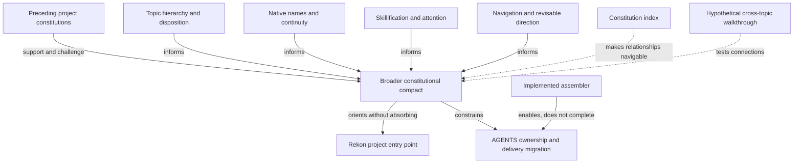

# A Work Map, Not A New Backlog

The user proposed using tickets to paint the picture, then explicitly asked not
to create them yet. This document uses **existing commitments** and
**hypothetical follow-ups** to ask what the constitutional program actually
contains. It creates no tickets, claims no assignments, changes no dependencies,
and records no acceptance.

The center is the constitution in this repository. Other corpora contribute
evidence or future skill material; they do not automatically add domains to the
constitutional core. The [index](/constitution/index.md) is the reading surface;
the [reassessment](/constitution/reassessment0.gpt6a.md) is the developing
argument. This is the work-shaped view of their relationships.

## Existing Commitments Before New Ones

State below was read from Beads on 2026-09-04. Use `bd show <id>` for the live
record; the linked documents own explanation, not ticket lifecycle.

| Existing work | State | Constitutional question and current evidence |
|---|---|---|
| `rekon-doc-constitution` | Open epic | What shared compact lets workspace knowledge explain itself and support action? [Current account](/constitution/README.md); initial authoring, torch-pass, adoption, and exposure work are closed children, not proof that all later questions are settled. |
| `rekon-doc-constitution-hierarchy` | Open decision | How do topic ownership, public presence, disposition, and existing layouts fit? [Hierarchy1](/constitution/README-heirarchy1.glm53m.md) changes the earlier proposal without authorizing migration. |
| `rekon-con-naming` | Open decision | What names entities, who owns each name, and how do identities change? [Draft3](/constitution/naming/exploration/draft3.sol56x.md) builds on a recorded human ruling while proposing further grammar and home changes. |
| `rekon-skillify` | Open epic | How does knowledge become an activatable, testable capability? [General design](/design/skillify/README1.sol56x.md), distinct from a one-time AGENTS refactor. |
| `rekon-agents-maintenance-skillify` | In progress | How does Rekon change source ownership without losing ambient behavior? [Local migration design](/design/rekon/agents-modularization0.sol56x.md). |
| `rekon-navigation` | Open epic | How does a mapped problem space become a revisable, evidence-directed course? Five open children cover contract, bearings, route, pilots, and authoring. |
| `rekon-doc-constitution-rekon-skill` | Open feature | How should this repository explain itself and expose its own practice? The root [README](/README.md) still contains only TODOs. Project orientation is a real missing surface, distinct from constitutional detail. |

The assembler is an important **completed implementation dependency**, not an
unbuilt component: `rekon-agents-maintenance-assembler` and
`rekon-doc-constitution-global` are recorded closed. The
[assembly reference](/constitution/agents-assembly.md#agents-assembly-status)
separately records the unfinished production cutover.

Most of the apparent new work already has a home. The first ticketing question
should be **which existing commitment needs a clearer connection or acceptance
criterion**, not how many more issues to create.

## Connections To Make Explicit

These are explanatory relations, **not proposed Beads blocking edges**. In
particular:

- A useful index does not wait for a universal resolver or settled grammar.
- A constitutional draft can recognize Navigation without waiting for its full
  schema and pilots. Stable promises about the type need that evidence.
- Topic-first organization does not require moving existing files; name
  continuity remains relevant wherever the topic lives.
- A naming convention does not make an actor authorized, a claim verified, a
  ticket complete, or a skill available in a host.
- General skillification can mature independently of the AGENTS cutover. The
  cutover must account for existing operating rules rather than assuming that
  new skill files have replaced them.

## Navigation Is A Particularly Useful Connection

The current `rekon-navigation` epic already connects naming and the constitution.
Its five children are:

- `rekon-navigation-contract`: distinguish Navigation from Exploration, Design,
  Plan, Roadmap, and the issue graph before fixing a template.
- `rekon-navigation-bearings`: name toward/away-from properties without treating
  silence as opposition or reducing all preferences to one score.
- `rekon-navigation-route`: position, destination, dependencies, observable
  beacons, forks, and stop/reroute conditions.
- `rekon-navigation-pilot`: test the founding Watchman case and a materially
  different second corpus.
- `rekon-navigation-authoring`: expose the proven practice as an on-demand
  workflow without overwriting source explorations.

That last relationship matters: **a constitutional concept, its representation,
its evidence, and its skill exposure are different work products**. The existing
program already separates them. We should learn from that shape rather than
create a second “navigation in the constitution” epic.

## Hypothetical Follow-Ups — Not Filed

These are discussion handles, not minted ticket IDs. Parentage and dependency
edges would be decided only if work is actually filed.

| Hypothesis | Possible work shape | What would make it complete | Existing work it would connect |
|---|---|---|---|
| **Maintain the constitutional index** | Bounded task under the constitution epic, if recurring upkeep needs tracking | A reader can locate the current account, recorded decisions, latest substantial alternatives, and their status. Changed paths and promised fragments resolve. A significant new wave triggers a small index/doc-pass update rather than another exhaustive catalog. | Constitution, hierarchy, naming, skillification, Navigation. This pass creates the initial index; ongoing usefulness remains to be exercised. |
| **Reconcile the broader constitutional compact** | A successor authoring/decision task, or an explicit continuation under the existing epic | A new README candidate states the shared purpose and obligations, distinguishes what it inherits/revises/defers, and routes detail to its owners. Human decisions and unresolved conflicts are visible; acceptance does not silently implement the proposal. | Existing hierarchy and naming decisions, general skillification, Navigation, predecessor lineage. |
| **Make claim, acceptance, and implementation status unambiguous** | First try strengthening existing decision acceptance criteria; create a focused task only if the gap crosses owners | Representative documents and tickets distinguish observations, proposals, accepted policy, verification, and deployment. Metadata examples no longer imply that acceptance manufactures verification. Historical evidence is not rewritten to look newly checked. | Hierarchy disposition, naming acceptance, assembly status, Navigation arrival evidence. |
| **Exercise one cross-topic learning loop** | A bounded pilot, only if existing pilots do not already cover the needed connection | Start with an ordinary need; find the current account; choose relevant depth; identify the next justified action; inspect completion evidence; return a correction to its owner. Record failures and unnecessary ceremony. No requirement to create every artifact type for the task. | Knowledge modules, skills, work, navigation, provenance, and indexes; complements rather than duplicates Navigation's two-corpus pilot. |
| **Align constitutional projections after a decision** | Implementation work after accepted scope, preferably assigned to existing owners | README, relevant GLOBAL wording, skill exposure, and tool reference agree within their declared scopes. An explicit parity check preserves ambient instructions. Any identity moves get their own reviewed compatibility plan. | Constitution, naming, hierarchy, AGENTS modularization, implemented assembler. Not permission for a production cutover now. |

The strongest immediate example is index maintenance: concrete, local, useful
before the larger design settles, and easy to review. The synthesis task is the
present request. The remaining rows are hypotheses to sharpen against predecessor
research and real use, not a reason to open five issues automatically.

## What This Map Deliberately Does Not Turn Into Tickets

- One issue per philosophical principle, glossary word, heading, or source file.
- New ownership for work already covered by hierarchy, naming, skillify, or
  Navigation.
- A wholesale move out of `design/`, `.design/`, or upstream-native roots.
- An actor registry, universal graph store, or cross-project resolver merely
  because the constitution discusses their possible concerns.
- New language/API/tool standards copied out of the archive. Those may earn
  domain skills without expanding the constitutional center.
- Automatic cleanup of old drafts, compatibility files, or undeclared material.

## Next Discussion, Before Filing Anything

The predecessor comparison should identify **missing obligations**, not merely
more interesting documents. For each finding, ask:

1. Is it genuinely shared constitutional behavior or a local research technique?
2. Does the current README already say it clearly?
3. Is an existing ticket already responsible for making it real?
4. Is the missing piece explanation, a decision, an implementation, a check, or
   simply a navigation link?
5. What observable result would justify creating a new work item?

This keeps the issue graph a picture of actual commitments rather than a second
ontology of everything we can name.

## Cross-references

- [Constitution index](/constitution/index.md) is the maintained reading surface
  this map helps organize; unlike this dated proposal, it should be kept current.
- [Reassessment](/constitution/reassessment0.gpt6a.md) explains why the broader
  compact needs more than naming and why reference/skill material must remain
  domain-owned.
- [Balanced ticket coordination](/constitution/README.md#doc-constitution-tickets)
  supplies the existing proportionality test: track work when lifecycle helps,
  not to obtain one-to-one parity between issues and prose.
- [Skillification's lifecycle](/design/skillify/README1.sol56x.md#skillify-lifecycle)
  helps distinguish a capability design from proven routing and usable exposure.
- [Ownership before activation](/design/rekon/agents-modularization0.sol56x.md#agents-maintenance-skillify-two-transformations)
  constrains any future projection-alignment work: changing where guidance is
  owned and changing when it is seen must remain separately reviewable.
