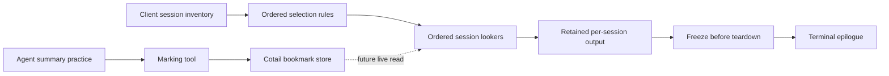

# Session mementos

The human wants useful context left on the terminal screen: some of the latest
question and response, eventually the last explicitly bookmarked summary, and
more than the single current session. The initial display owner is the
`opencode-term-v2` **exit epilogue**, not a new in-TUI dashboard.

**The work anchor is `rekon-session-mementos`.** It retains the desire and review
history while linked documents explore the implementation. Producing a draft is
not accepting its design; update the ticket toward the best evidence as the
direction matures. Existing Cotail tickets retain Cotail implementation ownership.

## Human direction captured

- Show other active sessions as well as the current session. “Active” needs
  selectable meanings: recently updated, such as within **2d**, is not the same
  as currently running.
- Default almost always to **this window/client**. Recent sessions everywhere
  may be interesting as an explicit scope, but must not leak into the default.
  Open tabs matter. A shared tab store is not proof of exclusive client ownership.
- Selection should be **assembled from individual rules, executed in order**:
  for example, restrict to this client, then restrict by activity. Avoid a fixed
  cross-product of preset booleans that cannot express a sequence.
- After selecting sessions, assembled **session lookers** determine what to
  display: identity/activity, question/response, and eventually marked summary.
  Selection and content gathering are different responsibilities.
- Cotail bookmarking is not implemented, but existing design work should be
  extended rather than discarded. Allow an explicitly selected bookmark database;
  default to `rektide_*` records/tables in the selected OpenCode channel database.
  Do not guess that an executable name or profile label identifies that database.
- Rekon should own an agent-facing message-marking tool/practice. The suggested
  default is **mark the next response**, with explicit historical message targets
  and child-session targets also supported. Agents should explicitly mark the
  summary responses they author; detecting or generating a summary is a separate
  capability from storing the mark.
- Investigate the externalized `subagent_list` capability in
  `opencode-subagent-recovery` as a precedent. A capability can belong in the
  Rekon ecosystem without necessarily becoming an OpenCode core patch.
- Preserve a memento of a broader deployable chain-of-command/filter pattern.
  The human has repeatedly found generic versions difficult: **do not lose the
  idea, and do not make the immediate feature hostage to implementing it**.

## Ownership and seams

| Owner | Responsibility | Not implied by this request |
|---|---|---|
| OpenCode epilogue | Ordered selection, per-session output, live gathering, immutable freeze and terminal formatting | General JSX slot rewrite; fetching while shutting down; multi-server dashboard |
| Cotail | Source-qualified durable bookmark targets, storage and retrieval | Reclassifying every assistant answer as a summary; changing ordinary queries to write |
| Rekon | Marking tool semantics, authoring practice, cross-project intent and broader composition research | Installing an unreviewed skill; automatic summary inference; a universal runtime framework |

## Review gates

1. **Select the client-scope meaning and ordered-rule semantics.** Distinguish
   visible shared tabs from sessions actually visited by this process; specify
   rule ordering, current-session preservation, and activity clock behavior.
2. **Authorize a coherent display slice.** Keep the existing freeze-before-cleanup,
   once-only output, plugin isolation, and safe terminal-text constraints. Prove
   multiple sessions without requiring Cotail bookmarks first.
3. **Agree the bookmark/marking contract.** Verify source/channel resolution,
   explicit write ownership, pending intent versus bound message, exact child
   addressing, and interrupted/partial output behavior before implementation.
4. **Review the reusable-pattern memento independently.** Specify what could be
   shared and what would be distorted. No general framework is authorized.

## Work map

- `rekon-session-mementos-display`: ordered client-scoped selection and assembled
  epilogue content, with a small verified implementation slice when authorized.
- `rekon-session-mementos-mark`: document and review the agent marking tool and
  summary-authoring contract; implementation remains gated on agreed semantics.
- `rekon-session-mementos-composition`: preserve and compare the reusable ordered
  pipeline idea with the Watchwoman recursion-rule precedent.
- Cotail's existing `cotail-bookmarks` epic and children: storage, source identity,
  resolution and CLI; a Cotail-owned new draft reconciles this request with them.

## Cross-references

- [OpenCode epilogue registry implementation](file:///home/rektide/src/opencode-term-v2/.design/term-v2/epilogue-registry-implementation0.gpt56s.md)
  — existing ownership and lifecycle invariants; this request expands the retained
  session cardinality, not the general visual-slot algebra.
- [Cotail bookmarks index](file:///home/rektide/src/cotail/.design/bookmarks/index.md)
  — prior target/capture/source-identity work and ticket lineage to preserve.
- [Rekon constitution](/constitution/README.md#doc-constitution-principles)
  — tickets coordinate acceptance; documents hold the arguments and evidence.
- [Rekon tooling](/README.md#rekon-tooling) — existing CLI commands are not an
  agent tool host. Tool ownership needs an explicit integration mechanism.
- [Phoenix inquiry](/design/rekon/phoenix0.gpt6a.md) — preserving intent and reasons
  through replacement motivates keeping the broader composition dream addressable.

## Research prompt

Trace the current epilogue, Cotail bookmark proposals, and external OpenCode tool
precedent. Design client-scoped ordered session selection followed by ordered
lookers; verify source-qualified marking and next-response binding. Preserve a
concrete path to multi-session output now, and a separately reviewable memento
of a reusable composition pattern without constructing a speculative framework.
