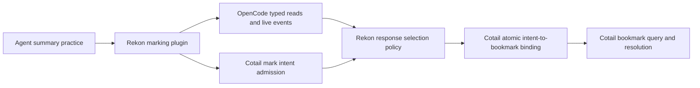
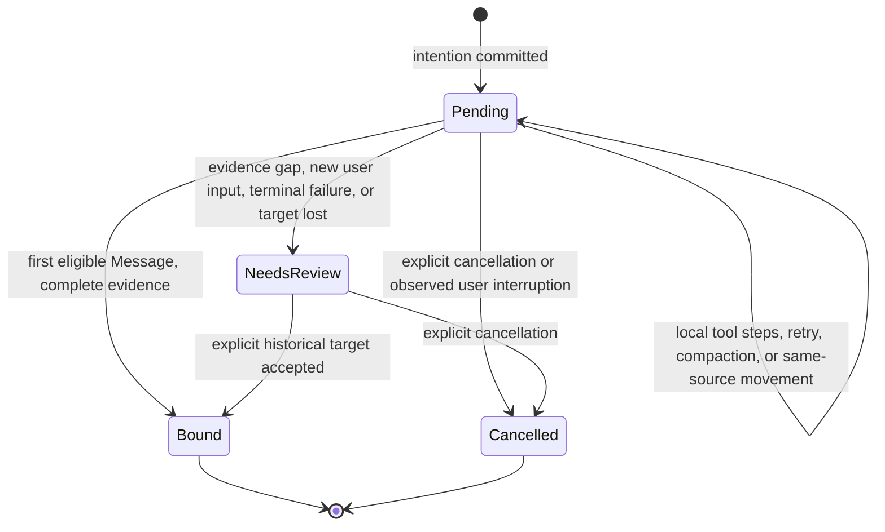

<a id="marking-situation"></a>
# Mark the response, not the intention

Rekon should make consequential conversation easier to recover. An agent should
be able to bookmark a known message, or say **“the response I am about to write is
a summary; keep a reference to it.”** This must work inside child Sessions and
when a parent selects a child's actual response. The parent notification is not
the child response's identity.

This draft designs the **producer and authoring practice**, not a second bookmark
store. Cotail owns persistent intent, source-qualified targets, storage, querying,
and resolution. The shared work anchor is `rekon-session-mementos`; this slice is
`rekon-session-mementos-mark`. Ticket creation and updates belong to the parent.

The commission permits selected SQLite storage and prefers `rektide_*` tables in
the **actual selected OpenCode channel database** by default. This replaces the
preexisting Cotail draft's separate-XDG-file/read-only-OpenCode storage policy;
that older policy is **not** imported here. I read only its preexisting
[`index.md`](file:///home/rektide/src/cotail/.design/bookmarks/index.md) and
[`draft5.gpt56.md`](file:///home/rektide/src/cotail/.design/bookmarks/draft5.gpt56.md)
for vocabulary, not the other agent's new summary wave. No schema, migration,
source-catalog investigation, runtime implementation, installation, or live
database access was performed.

Research prompt for the next implementation checkpoint:

> Can an external Rekon plugin admit a summary-mark intention, bind it to one
> real completed assistant Message, and recover or explicitly refuse ambiguity
> after retries, interruption, movement, and child continuation—without
> impersonating a host final-response hook or duplicating Cotail storage?

<a id="marking-recommendation"></a>
## Recommendation

1. **Build a small external Rekon plugin, not an OpenCode core tool.** It owns
   author-facing selection and summary practice. Use the existing tool context
   for caller identity, and existing retained Session reads for exact targets.
2. **Offer `message_mark` with `next-response`, `message`, and `latest-response`
   selectors.** Omission means `next-response` in the calling Session. The
   deferred selector returns `pending`, never a fictional message bookmark.
3. **An automatic summary mark is an explicit author declaration.** The agent
   elects to summarize and invokes `message_mark({kind: "summary"})` just before
   writing it. Do not infer summary status from the last message, a heading,
   completion status, or an OpenCode compaction record.
4. **Define the default structurally, not as “the final answer.”** Bind the first
   subsequent qualifying assistant Message, excluding the tool's own Message.
   Current public message schemas do not preserve a portable final/commentary
   channel or a semantic summary flag.
5. **Keep deferred binding fail-closed.** Continuous observation can bind it;
   full recovery additionally needs retained lifecycle evidence. Missing evidence
   produces `needs-review`, not “take whatever answer is latest now.” Exact and
   explicitly selected historical targets remain useful even without recovery.
6. **Ship child support in the first useful cut.** Child self-marking uses the
   same default; parents can mark exact or latest eligible child responses.
   Cross-child/root-wide discovery is not an implicit side effect of marking.

The important ceiling: **the current plugin API alone cannot guarantee that
every accepted deferred intention will eventually bind correctly across arbitrary
downtime.** A truthful, useful tool can preserve an unresolved intention instead.
Removing that ceiling needs a retained evidence source, not just better prompts.

<a id="marking-vocabulary"></a>
## A few terms with distinct jobs

| Term | Meaning here |
|---|---|
| Message | A retained OpenCode Message with an actual `msg_…` ID in a Session. |
| Response candidate | A completed assistant Message meeting the explicit eligibility predicate below. It is not a host-defined assistant turn. |
| Mark intention | An accepted request to bookmark a future candidate. It has an identity, but no Message `Target` yet. |
| Bound mark | A Cotail bookmark referring to the resolved source-qualified Message `Target`. |
| Summary declaration | The author explicitly says the selected response performs summarization. It is not certification of accuracy, completeness, or usefulness. |
| Inferred summary candidate | A later classifier's suggestion, with its own provenance. Not equivalent to a declaration and not part of this first tool. |
| Caller / target | The Session and tool call making the request / the Session and Message being marked. They may differ. |

Reuse Cotail's **Address → source-qualified Target → optional observed capture**
distinction. Do not introduce a second `Pointer`, a stored “latest” identity, or
a synthetic placeholder `msg_…`. Bookmark creation time is not the target's
position. This first producer requests a reference **without transcript capture
by default**; tags, note, declared purpose, and producer provenance are the new
facts. A bookmark cannot restore an agent's state.

<a id="marking-contract"></a>
## Proposed author-facing contract

These are proposed shapes, **not existing Rekon or Cotail APIs**. Cotail should
settle the shared wire representation; the following specifies behavior.

```ts
type MarkInput = {
  kind?: "bookmark" | "summary" // default: bookmark
  target?:
    | { type: "next-response"; sessionID?: string }
    | { type: "message"; sessionID?: string; messageID: string }
    | { type: "latest-response"; sessionID?: string }
  note?: string
  tags?: string[]
  requestID?: string // explicit retry key; normally supplied by adapter
}
```

No arguments means bookmark the next qualifying response in the caller's
Session. The normal automatic-summary invocation is only:

```json
{"kind":"summary"}
```

An exact historical child target is explicit:

```json
{
  "kind":"summary",
  "target":{"type":"message","sessionID":"ses_child","messageID":"msg_answer"},
  "note":"Child's account of the verified plugin boundary"
}
```

### Selector semantics

| Selector | Resolution and admission |
|---|---|
| `message` | Validate existence and membership in the selected source/Session. Ordinary bookmarks may target any retained Message; `kind: summary` in this initial producer requires completed, nonempty assistant text without a message error. A previously completed tool-bearing response may be selected explicitly. |
| `latest-response` | At one bounded read, choose the newest candidate matching the same eligibility policy as `next-response`, then freeze its actual Message ID. Return that target and a short preview so the caller can notice a mistaken choice. It never means “the latest whenever later queried.” |
| `next-response` in self | Admit after the current marking tool call; exclude its enclosing assistant Message entirely. Watch subsequent Messages in that Session, not the next tool result or event. |
| `next-response` in a child | Requires a named accessible child and a target-local boundary captured at admission. Never compare the parent's Message IDs/timestamps with the child's. Initially require ongoing target work; watching an idle child's unspecified future assignment is a separate choice. |

The last restriction keeps future-child marking from accidentally attaching to
an unrelated later task. Historical child marking and child self-marking do not
have this restriction.

Return a small discriminated receipt:

- `bound`: intention/request ID, bookmark ID, exact Cotail Target, declared kind;
- `pending`: intention ID, target Session, boundary/policy version, recovery
  capability, and the fact that no bookmark target exists yet;
- `needs-review`: intention ID and a precise unresolved reason;
- invalid, inaccessible, unsupported, or unavailable input: a typed failure,
  not a successful empty bookmark.

The model should not repeat its whole summary inside the tool argument or get
the whole transcript back as acknowledgment. Keep ordinary receipts to identity
and state; explicit historical selection may return a bounded text preview.

### Discovery and management without a second query product

There must be a bounded way to obtain **Message IDs**, not only text and times.
The inspected `subagent_list` returns Session IDs but its `Message` and
`lastOutput` schemas omit Message IDs
([source:67–93](file:///home/rektide/src/opencode-subagent-control/src/index.ts#L67-L93)).
Do not instruct an agent to extract an ID it was never given.

Expose a selectively discoverable `message_marks` companion for status,
explicit cancellation of an intention, and target-candidate lookup. Its reads
delegate to Cotail's bookmark/query operations and the host-read adapter. A
candidate lookup returns source/Session/Message identity, role, completion,
small text preview, cursor, and truncation indicator. No reasoning/tool bodies
by default. Do not grow a general transcript-search engine inside this module.
Adding IDs to `subagent_list` could improve composition later, but is not a
prerequisite or authorized change here.

<a id="marking-ownership"></a>
## Ownership and deployment boundary



| Owner | Owns | Does not own |
|---|---|---|
| Rekon practice | When a response should be declared a summary, compact guidance, child author behavior, examples and evaluation. | Bookmark truth, storage layout, automatic acceptance of the summary's claims. |
| Rekon plugin | Input boundary, caller provenance, child-target policy, candidate selection, receipts and capability gating. | OpenCode execution orchestration, provider retries, a parallel Session model. |
| Cotail | Persistent intention and bookmark operations, selected database handling, source-qualified identity, conditional binding/idempotency, queries and resolution. | Deciding from prose whether the agent intended a summary. |
| OpenCode | Actual Messages, tool-call identity, execution lifecycle, retained projections and available log/event evidence. | Rekon-specific summary practice or bookmark tables. |

**Cotail integration requirements to negotiate, not a storage design:** admit an
idempotent intention; enumerate unresolved intentions for a selected source;
record observation progress; atomically bind an unresolved intention to one
Target and receipt; conditionally cancel/suspend it; retrieve status. The
intention transition and bookmark creation must not be two independently
acknowledged writes. Multiple Location instances of one plugin are normal, so
duplicate observers must converge on the same result or report conflict.

Do not put authoritative marks in `ctx.storage` and then copy them to Cotail.
The host's plugin KV is durable and globally plugin-ID namespaced, but its
public surface is `get/set/remove/scan`, not a cross-Cotail transaction or CAS
API ([host:712–738](file:///home/rektide/src/opencode-working/packages/core/src/plugin/host.ts#L712-L738),
[KV:27–55](file:///home/rektide/src/opencode-working/packages/core/src/kv.ts#L27-L55)).
It demonstrates external plugin durability, not a reason to introduce a second
authority or silently use host-owned KV instead of the requested tables.

### Source and database selection

- Keep storage database selection separate from transcript source identity,
  even when the default colocates them. Cotail owns both resolution policies.
- The plugin receives `ctx.app.channel`, but no public database handle/path
  ([App:1–5](file:///home/rektide/src/opencode-working/packages/plugin/src/app.ts#L1-L5),
  [Context:25–52](file:///home/rektide/src/opencode-working/packages/plugin/src/promise/plugin.ts#L25-L52)).
  Channel is a configuration input, not proof of which SQLite file backs an
  arbitrary remote or embedded server.
- Use a Cotail-resolved configured source/store binding; refuse an unverified
  mismatch between that binding and host Session reads. Do not hardcode
  `opencode.db`, derive identity from `cwd`, or attach another channel's data.
- Do not let routine model arguments select arbitrary writable filesystem
  paths. Operator configuration chooses the store. An eventual multi-source
  tool may select an already configured source ID explicitly.
- This design neither grants access to a live database nor installs a plugin.
  Storage-path discovery and database safety are Cotail's parallel work.

### Suggested domain grouping when implementation is authorized

```text
session-mementos/marking/README.md   # canonical authoring practice
session-mementos/marking/SKILL.md    # optional exact exposure, if it earns one
src/session-mementos/marking/        # selectors, binding policy, tests
src/host/opencode/                  # external plugin registration/read adapter
```

An alternative is a cohesive `src/session-mementos/opencode/` adapter beside
the policy if no other host exists. Prefer that smaller grouping initially;
do not extract a generic host framework to justify portability. Existing
[`rekon.ts`](/rekon.ts#L1-L35) has six other commands and no marking entrypoint.
A CLI adapter later must require explicit caller/target identity; shell `cwd`
is not an implicit current Session.

<a id="marking-binding"></a>
## Deferred binding: what exactly gets marked?

### The initial candidate predicate

A candidate must:

1. belong to the exact selected source and Session;
2. start strictly after the admission's target-local boundary, and differ from
   the caller's enclosing Message in the self case;
3. be `type: assistant`, have non-whitespace `text` content and
   `time.completed`, have no Message error, and finish with `stop`;
4. have no local tool calls requiring another model call; provider-executed
   tool parts may be present only when settled successfully;
5. precede any invalidating boundary described below.

Use retained Message order or aggregate sequence, **not timestamp arithmetic,
lexicographic ID guessing, or “after a short delay.”** The adapter may need to
page to locate the anchor. Persist actual host-issued sequence/cursor evidence
when available; a timestamp is an observation, not an ordering guarantee.
Host cursor pagination is not itself a pinned multi-page snapshot. A historical
selector must retain its initial upper boundary or use a Cotail same-read
operation rather than let newly arriving Messages change the selection mid-scan.

This predicate is intentionally narrower than “anything the UI displays.”
Reasoning-only messages, partial streams, `length`/unknown finishes, tool-only
messages, compaction Messages, and parent-side synthetic completion notices do
not qualify. It is also intentionally **not a semantic-final detector**: a
tool-free commentary Message meeting these fields is indistinguishable from a
final response in the public schema. The authoring practice avoids inserting
such a message after arming. Historical selection can repair a mistake.

The local/provider-executed distinction is real: the runner's continuation
condition comes from local tools, not simply the finish string
([publisher:590–598](file:///home/rektide/src/opencode-working/packages/core/src/session/runner/publish-llm-event.ts#L590-L598)).
Do not equate `finish: stop` alone with “no further work.”

### Admission and binding sequence

1. Validate the input once. Obtain `{sessionID, messageID, id, agent}` from the
   real tool context; model-supplied values cannot overwrite caller provenance.
2. Resolve target access and source/store binding. For self, preserve the current
   tool Message as the excluded origin; for child-next, capture a boundary in
   the child's history, not the parent's.
3. Arrange observation before admitting the intention, with a handover/check
   for anything completed during admission. A future child candidate that
   started before the boundary is not retrospectively captured.
4. Cotail durably admits the intention before the tool reports `pending`.
   Default retry identity is source + caller Session + caller Message + tool
   call ID. An explicit `requestID` supports a caller retry with a new tool call.
   Reusing a key with conflicting parameters fails; it does not retarget.
5. Observe host events as wakeups; validate the actual retained Message before
   proposing a binding. `session.text.ended` closes one text part, and
   `session.step.streamed` precedes tool settlement. Neither is sufficient.
6. Cotail conditionally creates one bookmark and resolves the intention to that
   exact Target. A retry returns the same receipt. An acknowledgment lost after
   commit must not create another bookmark.
7. Status/query reports the eventual result. Do not inject a synthetic prompt
   merely to say “bookmark saved”: that can wake/steer the very Session being
   observed. A non-model UI indication is optional future presentation.

For automatic self-summary requests, coalesce a retry of the same request,
not every bookmark of the same Message. A parent's endorsement and the child's
authorship can be different intents over the same Target. If repeated new tool
calls should supersede an outstanding automatic summary intention, that must
be an explicit policy—not blanket target deduplication in the store.

### Lifecycle transitions and refusal boundaries



| Situation | Required behavior |
|---|---|
| Several tools / parallel tools before the answer | Skip their Messages. Do not bind the marking call's own enclosing Message, even if it also contains text. Tool execution overlaps streaming, so within-message “text after the call” is not a reliable portable boundary. |
| Pre-output retry / full-context retry | Retain the intention. A retry may reuse the assistant Message ID; an HTTP attempt is not a new target. |
| Incomplete-stream continuation | Do not bind failed partial text. Keep the intention eligible for the next successful candidate if retry/continuation evidence is continuous. Do not concatenate fragments into a fictional Message Target. |
| New user input is delivered after arming | Suspend as `needs-review` before selecting a later response. Mere queue admission is not delivery and must not cancel an earlier answer. Preserving a mark across a steer would require deliberate rearming. |
| User interruption / supersession before binding | Cancel or suspend with explicit reason; never allow the stale intention to catch a later unrelated resume. A fully completed eligible Message ordered before interruption may already be bound. |
| Shutdown interruption / process death | Preserve unresolved intent. Resume automatic binding only if the missing interval is provable. Otherwise `needs-review`; durability of intent is not completeness of observation. |
| Same-source Session movement | Keep Session identity, origin, and store selection. Do not reset the intention from `ctx.location`. A running observer may continue across movement; unload/reload invokes the same gap rule as restart. |
| Child continues or switches agent | Parent/child IDs still identify Sessions, not jobs. A newly delivered prompt fences the old intention. Record the actual responding agent separately from the caller if different. |
| Successful execution ends with no eligible response | Suspend with `no-eligible-response`, rather than silently watching the next assignment. |
| Source unavailable, deleted/reverted Message, unknown event version | Stop automatic inference. Preserve intent/status; do not fuzzy-retarget to similar text. Already bound references resolve honestly through Cotail. |

The “new user input” rule is a conservative product choice, not an existing host
policy. Auto-compaction and instruction updates are not user prompts and should
not cancel by themselves. For an unknown synthetic message between arming and
candidate, require the adapter to classify the boundary or suspend rather than
assume it is the known retry continuation.

### Why generic plugin reads are not enough for perfect recovery

The plugin has retained `session.messages`, but only a **volatile** event
subscription. `Session.Info.outcome`/`time.idle` summarize the **last** terminal
execution; they cannot prove that no intervening interruption occurred.
`session.active()` is a process-local observation, not a durable lifecycle log.

There is already an experimental HTTP `session.log` with `after`, `follow`, and
`log.synced`; the plugin's Session domain does not expose it. Moreover, the
inspected Bus defaults event-payload persistence to **false**. A durable event
envelope and a `log.synced` watermark do not themselves prove that intervening
payloads were retained. Merely forwarding `session.log` would not fix missing
history ([Bus:174–203](file:///home/rektide/src/opencode-working/packages/core/src/bus.ts#L174-L203),
[log:828–869](file:///home/rektide/src/opencode-working/packages/core/src/bus.ts#L828-L869)).

Therefore distinguish these implementable profiles:

| Profile | What can honestly ship |
|---|---|
| Historical-only | Exact Message and explicit latest-response selection, including children. No deferred promise. Requires retained history reads and Cotail writer. |
| Live deferred, conservative recovery | Default next-response while observation is established; durable intentions; restart/movement gaps become `needs-review` unless evidence suffices. No OpenCode patch required. |
| Recoverable deferred | Adds an authenticated retained-log reader or a Cotail-owned equivalent evidence query with verified coverage. Needs coverage checks, not just method-existence checks. Still no semantic final/summary detection. |

**Recommend the second profile as the first full producer**, alongside the
historical path, if unresolved-intent outcomes are accepted. If the product
requires eventual automatic binding after every restart, gate that promise on
the third profile instead of quietly weakening it.

Possible next seams, **not authorized patches**:

- A client-shaped plugin `session.log` forwarding the existing endpoint is the
  smallest host read addition, following the subagent-recovery precedent. It
  still requires a trustworthy retention/coverage contract.
- An explicitly configured authenticated client can call the existing HTTP log
  without any host patch. The plugin is not handed server URL/credentials by
  its context; this connection must be supplied, not obtained by guessing the
  elected local service. Read the V2 client guide before implementing it.
- Cotail may expose the needed ordered evidence from its already selected
  source. This is an integration request to its query owner, not permission for
  the Rekon plugin to open tables or recreate event replay.
- If “final visible response” must mean more than the structural predicate,
  OpenCode would need an actual persisted semantic boundary/channel contract.
  No current public hook supplies it; a provider HTTP response hook cannot.

<a id="marking-children"></a>
## Child Sessions are first-class targets

Two requirements must be tested separately:

1. **A child author can mark itself.** Nothing requires a parent-only privilege
   or a root Session. Its tool context defaults to its own Session. It receives
   the same compact summary guidance, provided the plugin/tool is enabled for
   its Location and agent.
2. **A parent can mark a child's retained message.** Resolve the explicit
   Session ID and exact Message within that source. A copied `<subagent>`
   notification in parent history is a different Message and must not be used
   as the child Target.

Recommended initial model-facing access scope: self and verified direct
children, excluding forks from the implicit child relation. Broader explicit
Session access can be an operator option; the underlying plugin reads can
read beyond direct children, so this restriction is **Rekon policy**, not a host
security boundary. Ordinary in-process plugins are not sandboxes.

Use `Session.parentID` and `fork`, not matching titles, directory ancestry, a
process-local job ID, or a parent's last tool result. `children` supports
pagination; follow real cursors and do not silently truncate a child's history.
When an exact Session ID is provided, `get` suffices to check the relationship;
do not enumerate all Sessions just to find one child.

Movement is not ancestry: a child can be elsewhere and still belong to this
parent. A nested descendant, sibling, fork, or foreign root is not silently a
direct child. Deciding to permit those targets must not weaken the two core
requirements above.

<a id="marking-practice"></a>
## Summary-authoring practice and context cost

Skillification argues for **automation for deterministic work, and the smallest
ambient seed for a costly-to-miss action**. This capability needs both: the
agent makes a semantic declaration; code binds and stores it. A large skill
that must be remembered immediately before finishing an answer would hide the
critical prerequisite.

Proposed compact guidance, delivered only when a working marking tool is
available:

> When your next response summarizes work, findings, decisions, or a handoff,
> call `message_mark` with `kind: "summary"` immediately before writing it.
> This also applies in child Sessions. `pending` marks your intention, not a
> saved response. Do not treat routine progress, reasoning, or tool output as a
> summary. If marking is unavailable, finish the useful response without
> claiming it was saved.

This is draft language in a design file, **not an edit to active AGENTS**.
Suitable eventual carriers:

- **Tool description plus a conditional context-hook seed (recommended for
  the OpenCode profile).** The hook checks that `event.tools` contains the
  effective marking tool. Do not suppress child agents by checking for no
  parent. The hook alters outgoing context, not stored Messages.
- **An explicitly selected GLOBAL contribution** for hosts without conditional
  capability delivery. Its owner stays the canonical practice, and inclusion
  belongs to the declared assembly manifest—not an opportunistic root edit.

Do not deliver both ambient copies simultaneously. Register detailed guidance
as a skill only if historical selection, unresolved intentions, or cross-Session
work earns a real routing need. Keep the normal automatic path to one small
call and one short rule; keep storage mechanics out of model context.

### What should trigger a declaration?

| Declare a summary | Do not automatically declare |
|---|---|
| A final account of findings and remaining uncertainties. | “I am reading the files now.” |
| A digest/checkpoint that recovers the state and next decision. | An ordinary answer that does not summarize prior work. |
| A child report that hands results back to its parent. | Raw tool output, reasoning, or a pasted transcript. |
| A handoff narrative intended to help another actor resume. | A bare artifact path or completion receipt with no substantive account. |

The declaration records what the author intended this Message to do. A summary
of a failed experiment is still a summary. A successfully saved summary may
still be wrong. Marking does not say the human accepted it, all work completed,
the Session ended permanently, or a practice helped.

An inferred classifier could later suggest unmarked historical summaries with
`inferred` provenance, classifier/version/basis and optional confidence. It must
not manufacture an explicit author declaration or merge its confidence with
human/agent intention. Likewise an explicit historical mark by a parent records
the parent's judgment, not a retroactive claim that the child called the tool.

<a id="marking-source-audit"></a>
## Source audit: existing facts and their limits

Inspection used `opencode-working` at reported working revision `d08e633f`
(parent `090c1292`), external `opencode-subagent-control` at `935fa201`, and the
three commissioned recovery documents. These are source snapshots, **not proof
of the installed binary's capabilities**. The archive OpenCode checkout was
located first; no archive `llms.txt` was present. The public V2 plugin guide was
fetched through the OpenCode skill on 2026-09-06.

| Fact | Primary evidence | Consequence |
|---|---|---|
| Public plugins register tools, hooks, events and durable plugin KV. | [V2 plugin guide](https://opencode.ai/v2/docs/build/plugins); [Promise Tool domain:11–68](file:///home/rektide/src/opencode-working/packages/plugin/src/promise/tool.ts#L11-L68). | No core tool implementation is necessary for mark admission. |
| Tool context identifies the caller Session, Message, call and agent. | [Schema Tool:14–20](file:///home/rektide/src/opencode-working/packages/schema/src/tool.ts#L14-L20). | Never ask the agent to guess its own origin Message ID. It is not the future response ID. |
| Session hook inventory has prompt/context/model.request/http.request/http.response/retry, but no response-finalized hook. | [Promise Session:13–83](file:///home/rektide/src/opencode-working/packages/plugin/src/promise/session.ts#L13-L83). | Hooks cannot atomically stamp an as-yet unwritten final Message. |
| This composition exposes retained history and child reads; the fetched public guide's Session reference omits them. | [Session domain:85–113](file:///home/rektide/src/opencode-working/packages/plugin/src/promise/session.ts#L85-L113); [host pagination:124–178](file:///home/rektide/src/opencode-working/packages/core/src/plugin/host.ts#L124-L178). | Treat them as verified carried capabilities, not universal public-release availability. Probe and test the target host. |
| `session.context` is compaction-trimmed history, not full retained history. | [Session context:361–364](file:///home/rektide/src/opencode-working/packages/core/src/session.ts#L361-L364); [history:43–64](file:///home/rektide/src/opencode-working/packages/core/src/session/history.ts#L43-L64). | Do not use it as a fallback that claims historical coverage. |
| Assistant has text/reasoning/tool parts, finish/error/retry, streamed/completed times, but no portable text channel. | [Message schema:159–235](file:///home/rektide/src/opencode-working/packages/schema/src/session-message.ts#L159-L235). | Text existence, stream completion, successful step, and semantic finality are different. |
| Step.ended is published after tools settle; interruption/failure take a different path. | [step:133–260](file:///home/rektide/src/opencode-working/packages/core/src/session/runner/step.ts#L133-L260). | It is a useful wakeup, not sufficient summary evidence. |
| Retry may reuse the Message ID; incomplete continuation and compaction can allocate another. | [runner:192–282](file:///home/rektide/src/opencode-working/packages/core/src/session/runner/llm.ts#L192-L282). | Bind actual successful Messages, not attempt counts or predicted IDs. |
| Public events include execution, step and text lifecycle events with identity. | [event inventory:39–80](file:///home/rektide/src/opencode-working/packages/schema/src/event-manifest.ts#L39-L80); [Session events:219–238](file:///home/rektide/src/opencode-working/packages/schema/src/session-event.ts#L219-L238), [308–405](file:///home/rektide/src/opencode-working/packages/schema/src/session-event.ts#L308-L405). | A live external observer can do useful binding without invented hooks. |
| Plugin events use Bus.subscribe, a volatile stream; no replay cursor is exposed there. | [host:335–345](file:///home/rektide/src/opencode-working/packages/core/src/plugin/host.ts#L335-L345); [Bus:121–160](file:///home/rektide/src/opencode-working/packages/core/src/bus.ts#L121-L160). | Use a durable read for missed intervals or suspend the intention. |
| Setup executes without ambient Location services; raw Bus subscriptions can otherwise be Location-filtered. | [plugin load:64–74](file:///home/rektide/src/opencode-working/packages/core/src/plugin.ts#L64-L74); [Bus:726–762](file:///home/rektide/src/opencode-working/packages/core/src/bus.ts#L726-L762). | Register the observer at plugin setup as documented; filter by intended source/Session, not plugin cwd. Verify movement and cleanup in integration tests rather than assuming every subscription has identical scope. |
| HTTP already has replay/follow Session log; plugin domain does not; payload retention defaults off. | [Protocol:646–662](file:///home/rektide/src/opencode-working/packages/protocol/src/groups/session.ts#L646-L662); [Bus:174–203](file:///home/rektide/src/opencode-working/packages/core/src/bus.ts#L174-L203); [server wiring:119](file:///home/rektide/src/opencode-working/packages/server/src/routes.ts#L119). | A new forwarding method alone cannot establish recoverability. |
| Execution terminals cover a busy period, possibly coalesced drains; shutdown preserves a recovery claim. | [execution:100–140](file:///home/rektide/src/opencode-working/packages/core/src/session/execution.ts#L100-L140); [Session outcome:44–51](file:///home/rektide/src/opencode-working/packages/schema/src/session.ts#L44-L51). | Neither execution success nor latest idle time identifies one final response. |
| Standalone subagent tool recovers children/history and excludes forks by policy. | [external plugin:155–179](file:///home/rektide/src/opencode-subagent-control/src/index.ts#L155-L179), [257–286](file:///home/rektide/src/opencode-subagent-control/src/index.ts#L257-L286), [496–540](file:///home/rektide/src/opencode-subagent-control/src/index.ts#L496-L540). | Reuse the external-tool pattern, not its entire search/status model. |
| That tool's read surface once passed fixtures but failed production. | [runtime-provider record:36–94](file:///home/rektide/src/opencode-subagent-recovery/.design/subagent/runtime-provider-20260905.glm53.md#L36-L94). | Method-existence probes are not enough; exercise the real server construction graph. |

<a id="marking-acceptance"></a>
## Acceptance and next coherent slices

This is design-only. The following are **future checks**, not tests run here.

### Producer and deterministic binding checks

- Exact own/child historical targets bind to actual Message IDs; mismatched
  source, Session or nonexistent IDs fail without writes.
- Latest-response freezes one target and discloses the observed selection;
  later messages cannot change the bookmark.
- A `pending` receipt exists only after durable intention admission. A `bound`
  receipt exists only after bookmark and intention transition commit together.
- Repeat one request ID; interrupt after commit but before receipt; deliver
  duplicate/reordered wakeups; load two Location plugin instances. One target
  is selected or conflict is explicit, without duplicate automatic receipts.
- Exercise tools before/after text, parallel tools, provider-executed tools,
  reasoning-only output, content-filter/length finishes, pre-output retries,
  failed partial streams and successful continuation. No placeholder or
  partial Message is silently promoted to a completed summary.
- Deliver a new steer, queue later work, interrupt as user, shut down, restart,
  move Location, compact, delete/revert history, and continue a child. Check
  each transition table row, including gaps that must become `needs-review`.
- Test event retention off as well as on. A synced watermark without retained
  payloads must not be mistaken for a complete evidence interval.

### Host and practice checks

- Boot the real isolated server/application graph and invoke the plugin's
  reads/tools, following the runtime-provider regression precedent—not only a
  fixture with a manually populated runtime cell. No live Sessions needed.
- Test an older host without retained history: do not register a deceptively
  working tool, and do not emit guidance promising unavailable functionality.
- Run self-marking in both primary and child agents; parent-selected child
  target; moved child; explicit foreign/fork denial; multi-page old history.
- Run the same practice on summary, ordinary answer, progress report, handoff,
  failed investigation report and bare receipt. Record false positives and
  missed declarations separately from binding correctness.
- Verify no second full summary copy is sent/stored by default, normal receipts
  stay short, management descriptions are selectively disclosed, and there is
  only one ambient rule carrier.

### Checkpoints

1. **Agree semantics and integration contract.** Parent resolves the choices
   below with Cotail's writer/query owner; checkpoint this design, not active
   configuration.
2. **Exact-target producer plus real child flow.** Implement the external tool
   adapter and Cotail delegation when authorized. This proves useful capability
   without hiding lifecycle uncertainty.
3. **Deferred binder with honest gaps.** Implement and test the structural
   predicate/state transitions; enable the short authoring seed only when
   capabilities are operational.
4. **Recovery upgrade only if required.** Choose retained log/evidence access;
   verify coverage and deployed retention before promising automatic recovery.

Each slice should preserve a coherent commit and report what is now possible,
which guarantees remain conditional, and what evidence supports the next step.

<a id="marking-open"></a>
## Decisions for the parent/human

These can be selected independently; recommendations are not accepted policy.

1. **Meaning of next response:** accept the structural successful-response
   predicate plus author discipline **(recommended)**; require an actual host
   final-channel boundary; or restrict the first release to exact historical
   marking. A `stop` message alone cannot supply the second option.
2. **Recovery expectation:** preserve unresolved intentions and require explicit
   repair after an unprovable gap **(recommended first cut)**; or require
   retained lifecycle evidence before enabling the default deferred selector.
3. **Intervening work:** suspend on delivered user input **(recommended)**;
   alternatively preserve across steers only with explicit rearming/confirmation.
4. **Cross-Session scope:** self + direct children **(recommended initial policy)**;
   also permit explicit descendants; or all configured readable Sessions.
   None changes the requirement for children to self-mark.
5. **Parent arming future child work:** require an already active child
   **(recommended)**; allow a supplied prompt/boundary correlation for idle
   children; or omit cross-child deferred selection while retaining historical
   and self marking.
6. **Repeat declarations:** only request-ID idempotency **(recommended core)**;
   additionally coalesce one outstanding automatic self-summary intention per
   author/target; or preserve every explicit declaration separately. Do not
   accidentally erase a parent's independent endorsement.
7. **Deployment packaging:** a Rekon subpath plugin entrypoint or a separate
   Rekon-owned plugin package. Either keeps runtime producer code outside
   OpenCode; this is not a request to install it now.

<a id="marking-cross-references"></a>
## Cross-references and doc-pass

Searched the Rekon corpus for summary, handoff, bookmark, capability, evidence,
context, activation, and completion; followed the current entrypoints before
older tooling notes. Substantive relationships:

- [Rekon overview](/README.md#rekon-tooling) **locates this as new tool work**
  beside an existing CLI. A readable practice is not a deployed capability.
- [Skillification revision 1](/design/skillify/README1.sol56x.md#skillify-placement)
  **supplies the placement decision**: deterministic binding is code, author
  intention is judgment, and the minimal pre-response instruction must not be
  hidden behind an unactivated skill. Its
  [context economics](/design/skillify/README1.sol56x.md#skillify-evaluation-economics)
  motivates measuring the whole authoring path, not only ambient bytes.
- [AGENTS assembly](/constitution/agents-assembly.md#agents-assembly-status)
  **constrains activation**: production cutover remains deferred. This draft
  neither edits the monolith nor silently activates a proposed fragment.
- [Digest](/digest/README.md#digest-output) **is a natural producer**: a useful
  checkpoint has state, practical differences, intent and next courses, not
  just shortened text. A summary mark makes its response easier to locate;
  it does not prove the digest helped.
- [Evidence](/evidence/README.md#evidence-reference) **constrains the claim**:
  naming and provenance make a response inspectable; an explained evidentiary
  relationship is still needed before its contents support a decision.
- [Follow-behind agent](/agents/followup.md#report-what-helps) **is a child
  authoring precedent**: concise actionable findings, checks and uncertainty.
  Do not force a fixed summary template or mark every progress acknowledgment.
- [Tooling assessment](/assess/rekon/tooling0.glm53.md#tooling0-summarizer)
  **separates neighboring summarization products**: generating semantic
  summaries and managing Markdown indexes are different from marking an
  already authored Session response. No summarizer pipeline is needed here.
- [Prompt self-assessment](/assess/review/prompt-assessment0.gpt6a.md)
  **supplies a practice-evaluation warning**: evaluate whether agents marked
  the intended responses, not only whether the underlying plugin passes tests;
  drafting guidance in an active AGENTS file would already activate it.
- [Cotail bookmark draft5](file:///home/rektide/src/cotail/.design/bookmarks/draft5.gpt56.md#revised-product-boundary)
  **supplies the identity/intent/capture distinction**, not the new storage
  policy or an implemented writer. This producer does not duplicate its source
  catalog, capture codecs or query architecture.
- [Subagent recovery final record](file:///home/rektide/src/opencode-subagent-recovery/.design/subagent/final0.gpt56s.md)
  and [original exploration](file:///home/rektide/src/opencode-subagent-recovery/.design/subagent/subagent.gpt56s.md)
  **supply the mechanism/policy precedent**: generic host reads, external tool,
  capability-by-capability carryability. The original explored alternatives
  are not silently treated as the final accepted implementation.
- [Production runtime-provider correction](file:///home/rektide/src/opencode-subagent-recovery/.design/subagent/runtime-provider-20260905.glm53.md)
  **sets an integration acceptance bar**: test the actual application graph,
  because a successful capability probe and passing isolated fixture once hid
  a production failure.

Only this new document is authored in this slice. Reciprocal links and a shared
session-mementos index belong to the parent's integration pass after review;
older sources and the independent new Cotail wave are not modified. No ticket
state is duplicated here.
