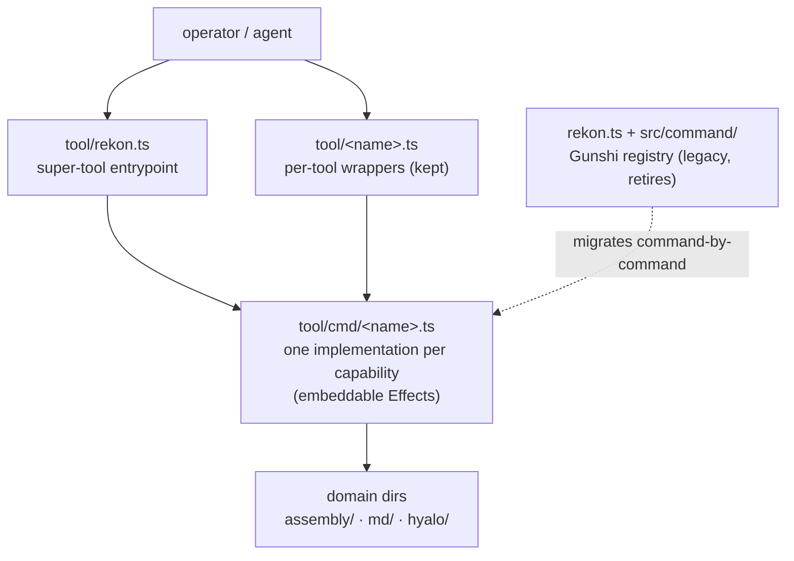
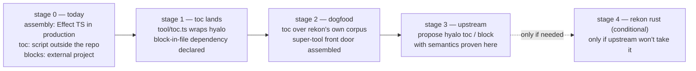
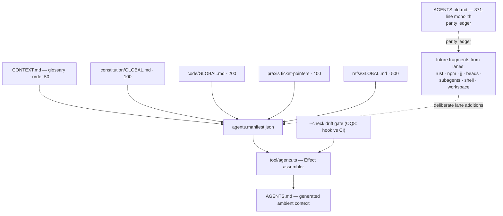

# Rekon toolchain end-state — draft

## Commission

The AGENTS.md cutover landed 2026-10-07: [`agents.manifest.json`](/agents.manifest.json)
selects the glossary ([`CONTEXT.md`](/CONTEXT.md), fragment `glossary`/50) plus four
GLOBALs into a generated [`AGENTS.md`](/AGENTS.md); the 371-line monolith is preserved
at `AGENTS.old.md`; the Effect assembler ([`tool/agents.ts`](/tool/agents.ts)) is the
first production tool in the shared `tool/` toolkit. The human now wants the
**toolchain end-state** decided. Quote-accurate vectors (2026-10-07):

> "we should figure out what our desired tool chain end state really is. there's a
> number [of tools], but we also want each individual one to be a subcommand in the
> super tool."

> "i wish we had a more rust only toolchain less shell scripting... if hyalo can help
> assemble that'd be great. we need to figure out. unknown."

> "toc is kind of a strong idea but again more as inspiration. let's try to be rust
> mostly? maybe? i guess we just start with ts."

> "let's try to get the toc tool over into a good spot once we figure that out then
> prioritize replacing it soonish."

> "~/src/block-in-file might be a better tool to work. its ts i believe."

> "assembly is kind of our more pressing topic."

This draft proposes; it does not decide. Anything labeled **Recommendation** is a
proposal for the human/parent to accept or overturn. Genuinely open questions are
collected in [§5](#open-questions) rather than silently resolved.

## Assumptions (stated, checkable)

- **A1 — Layout rulings hold.** One shared `tool/` toolkit; executable entrypoints at
  its top; `cmd/`, `assembly/`, `md/`, `hyalo/` are responsibility-named domain dirs;
  `t` is a shortcode, not a directory
  ([structure.md §tools](/constitution/structure.md#tools);
  [tool/README.md](/tool/README.md)).
- **A2 — Effect 4.0.1 is the going-forward TS framework** for new tool code
  ([agents-effect0](/design/rekon/agents-effect0.sol61xh.md) verified the integrated
  `effect/cli`; it is annotated **unstable** upstream, lockfile-pinned, so CLI upgrades
  require regression tests).
- **A3 — hyalo 0.24.1 is an installed external rust binary** at `/usr/local/bin/hyalo`,
  upstream-owned (ractive/hyalo); the local archive checkout (v0.20.0-13) is behind the
  installed version ([hyalo-toc0 §surface](/design/rekon/hyalo-toc0.glm53m.md#hyalo-toc0-surface)).
- **A4 — The assembler contract is binding** on any assembly evolution
  ([constitution/agents-assembly.md](/constitution/agents-assembly.md);
  operationalized by [tool/assembly/README.md](/tool/assembly/README.md)).
- **A5 — Reading of "rust mostly".** Treated as *prefer compiled deterministic engines
  where they already exist (hyalo), TS for repo-internal composition, and eliminate
  ad-hoc shell* — not a mandate to port working TS to rust today. The human's own
  "maybe? i guess we just start with ts" supports this reading; it is confirmed as
  [OQ5](#open-questions), not assumed settled.
- **A6 — No hosted CI exists** in the repo today (no `.github/`), so "CI gate" below
  means an automated `--check` invocation whose *placement* is open ([OQ8](#open-questions)).

## 1. The super-tool decision

The human vector is explicit: each tool should also be *a subcommand in the super
tool*. The open part is the mechanism — and what happens to the per-entrypoint layout
`structure.md` documents today.

| Option | Shape | For | Against |
|---|---|---|---|
| **A. Effect super-tool front door** | `node tool/rekon.ts  …`; subcommands compose the same `tool/cmd/<name>.ts` modules | One `--help` surface discovers every capability; shared Effect layers/services; satisfies the "subcommand in the super tool" vector directly; one framework (A2) | `effect/cli` unstable annotation (mitigated by lockfile + regression tests); slightly more ceremony per command |
| **B. Per-tool entrypoints only** (status quo layout) | `node tool/agents.ts`, `tool/toc.ts`, … each standalone | Matches the documented layout contract as written; each tool independently runnable and import-safe (symlink launch already tested); no choke point | No unified discovery; N invocation spells; shared seams must be deliberate; does not by itself satisfy the subcommand vector |
| **C. Extend the Gunshi registry** | keep [`rekon.ts`](/rekon.ts), register new commands there | Zero new machinery; completion plugin already present; commands are small | Gunshi path is legacy *by declared direction* ([structure.md](/constitution/structure.md#tools): "remains the legacy implementation while capabilities gain their new homes"); abandons the verified Effect investment; the registry lives at repo root, outside `tool/` |
| **D. Thin dispatcher script** | tiny script mapping names → per-tool files | Minimal code | Reimplements arg parsing badly; is itself the kind of shell-ish glue the human wants *less* of; no flag/help composition |

**Recommendation (A+B hybrid, marked as recommendation):** the *implementation* lives
exactly once in `tool/cmd/<name>.ts` as embeddable Effects (the `runAgents(args)`
pattern in [tool/assembly/README.md §implementation](/tool/assembly/README.md)
already proves it); a super-tool entrypoint `tool/rekon.ts` composes those modules as
`effect/cli` subcommands; the per-tool files `tool/<name>.ts` remain as one-line
delegation wrappers so the documented layout ("entrypoints at the top of `tool/`") and
direct invocation stay true. This makes options A and B the same code with two front
doors instead of competing architectures.

**What happens to `tool/agents.ts`-style entrypoints:** keep as wrappers initially
(zero risk, preserves every documented command); retire later only if they prove to be
clutter ([OQ2](#open-questions)). `rekon.ts` + `src/command/` (Gunshi) retires
command-by-command as each capability lands its Effect home — it is never extended
with new capabilities.

## 2. Subcommand roster

Every existing capability, mapped. "Hold" means: no work until a consumer names it
(the toolkit's own [no-empty-future-subsystem rule](/tool/README.md)).

| Capability | Today | Verdict | Reasoning |
|---|---|---|---|
| `agents` — fragment assembler | [`tool/agents.ts`](/tool/agents.ts) (Effect, production since 2026-10-07) | **Adopt** as subcommand `agents` (naming [OQ10](#open-questions)) | Production tool; contract-bound; tested; becomes the first subcommand of the super-tool |
| `agents` — legacy Gunshi | [`src/command/agents.ts`](/src/command/agents.ts) via `rekon.ts` | **Retire** (after drift gate + contract-doc repair, [§4](#assembly-roadmap)) | Two producers with intentionally different headers is a standing drift trap ([tool/assembly/README.md §header](/tool/assembly/README.md)); the Effect tool is the declared production path |
| `interpolate` — template expansion | [`src/command/interpolate.ts`](/src/command/interpolate.ts), guide at [`tool/cmd/interpolate.md`](/tool/cmd/interpolate.md) | **Adapt** — port to an Effect subcommand | Live utility independent of the retired prompt corpus; its open P2 bead `rekon-interp-exec` (exec mode) should be re-affirmed or dropped during the port ([OQ3](#open-questions)) |
| `install-commands` — prompt-command installer | [`src/command/install-commands.ts`](/src/command/install-commands.ts) | **Retire** | Its input corpus is retired ([`prompt/.archive/README.md`](/prompt/.archive/README.md)); its guide is already `status: deprecated` ([tool/cmd/install-commands.md](/tool/cmd/install-commands.md)) |
| `combine` — merge prompt plans | [`src/command/combine.ts`](/src/command/combine.ts) | **Retire** | Input corpus retired — `prompt/` holds only `.archive/`; assembly supersedes its merge role for AGENTS; close beads `rekon-combine` + `rekon-combine-glob` ([OQ4](#open-questions)) |
| `project-files` — project file listing | [`src/command/project-files.ts`](/src/command/project-files.ts) | **Hold** | No identified consumer in current rekon workflows; adopt only when named ([OQ9](#open-questions)) |
| `ln` — archive symlink hygiene | [`src/command/ln.ts`](/src/command/ln.ts) (+ `src/symlink/`) | **Hold → adapt** | Consumer is `~/archive` org simplification; port when adopted, not before ([OQ9](#open-questions)) |
| `toc` — line-ranged hidden ToCs | [`~/ado/bin/hyalo-toc.ts`](file:///home/rektide/ado/bin/hyalo-toc.ts) (outside repo) | **Adopt now** as `tool/toc.ts` + `toc` subcommand | Direct human vector ("get the toc tool over into a good spot… replacing it soonish"); fixed-point regeneration over `hyalo find`, `--check` drift gate; 121 lines, ports nearly verbatim ([hyalo-toc0 §options](/design/rekon/hyalo-toc0.glm53m.md#hyalo-toc0-next)) |
| managed blocks — insert/update/remove marker regions | [`~/src/block-in-file`](file:///home/rektide/src/block-in-file/README.md) (Deno TS, single file) | **Adopt as a dependency, not a rewrite** | The same primitive behind hyalo's managed regions and the ToC splice; `--read` + `diff` is a drift check; candidate substrate for any future generated-in-place region ([OQ7](#open-questions) picks the mode) |
| `okf index` / `madr toc` — hyalo built-ins | hyalo binary | **Use directly, no wrapper** | Rekon's corpus does not carry OKF index files yet; wrap only when a real consumer exists |
| drift gate — `agents --check` in automation | flag exists, no gate | **Adopt** | Protects the cutover; placement is [OQ8](#open-questions) |

## 3. The rust boundary

"Rust mostly, less shell" made concrete under reading A5: **engines in rust where a
rust engine already exists (hyalo); TS for repo-internal composition until a
capability proves general; no new shell glue.** The human's "maybe? i guess we just
start with ts" is consistent with starting TS and consolidating rust *upstream-first*.

| Strategy | What it means | For | Against | When it wins |
|---|---|---|---|---|
| **Wrap hyalo** | TS/Effect subcommands invoke `hyalo find/read` | Engine already rust, installed, upstream-maintained; fastest route to a good `toc` spot; no duplicate Markdown parsing | New dependency kind for the node-only stack (must be stated in the tool README); version drift (installed 0.24.1 vs archive v0.20.0-13) | **Now** — recommended default |
| **Reimplement under rekon in rust** | Port fixed-point ToC / managed blocks into a rekon-owned crate | Full ownership; no binary dependency | Cargo toolchain enters a pnpm/Effect repo; duplicates verified upstream capability; no second consumer yet — the "no empty future subsystem" rule argues against | Only if hyalo refuses needed semantics or goes unmaintained |
| **Stay TS everywhere** | Reimplement ToC/block logic in Effect without hyalo | One runtime; no external binary | Re-builds a working rust engine in TS; drifts from hyalo conventions; more surface to test | Only if hyalo cannot be guaranteed present (other machines, [OQ6](#open-questions)) |
| **Upstream into hyalo** | Land `hyalo toc` (and later `hyalo block`) upstream | Rust consolidates where rust lives; rekon consumes releases; matches the "rust mostly" end-state with zero rekon rust | Depends on upstream cadence; local checkout behind installed binary; not started | As the follow-up once the TS wrapper proves the semantics ([hyalo-toc0](/design/rekon/hyalo-toc0.glm53m.md#hyalo-toc0-next) option 4) |

Per-capability boundary:

| Capability | Boundary | Why |
|---|---|---|
| Assembly | **TS (Effect), stays** | Rekon-specific semantics (manifest, fragment contract, provenance); no external consumer; just landed with a full test suite |
| `toc` | **rust engine + TS composition now; upstream `hyalo toc` later** | `hyalo find` is the live parser; the wrapper is 121 lines of glue; upstreaming moves the engine maintenance off rekon |
| Managed blocks | **TS (block-in-file) now; upstream candidate later** | The primitive already exists as one TS file; rust-ifying it before a second consumer is speculative |
| Shell glue | **Eliminated** | The literal commitment in the vector: new automation arrives as subcommands or Effects, never as new `.sh` |

Staged sequence (gates, not calendar — no time estimates):

## 4. Assembly roadmap (the pressing topic)

**State after cutover.** The manifest selects five fragments — `CONTEXT.md`
(glossary/50), constitution/100, code/200, praxis-ticket-pointers/400, refs/500 — into
`AGENTS.md`. Bare `node tool/agents.ts` regenerates; `--check` compares bytes without
writing.

**The gap that makes assembly pressing:** monolith sections with no fragment source
are now **absent from ambient context** — subagents/stewardship, waves/doc-pass,
well-known directories, project planning, coding advice, Rust, JS/npm, jj+jj-hunk,
beads, webcomponents, shell usage
([research0 §tensions](/design/context-compilation/research0.glm53fx.md)). The
extraction lanes stand at skillify ◐ / engineering ○ / workspace ○ (beads
`rekon-agents-maintenance`). `AGENTS.old.md` now *is* the parity ledger.

Roadmap in gate order (each stage independently committable):

1. **Drift gate.** Run `node tool/agents.ts --check` automatically; placement open
   ([OQ8](#open-questions)). Cheapest protection for the cutover; do first.
2. **Contract-doc repair.** [`constitution/agents-assembly.md`](/constitution/agents-assembly.md)
   still describes `src/agents/` paths; re-point to `tool/assembly/` and name the
   Effect tool as the production implementation (research0 §1 last bullet notes the
   supersession already).
3. **Legacy producer retirement.** Remove `rekon.ts agents` (or clearly demote it);
   afterwards exactly one generated-header identity exists and the intentional-header
   difference note becomes historical.
4. **Extraction lanes** (the bulk of the work). Per the parity-ledger discipline
   ([inventory0](/design/rekon/context-weave/inventory0.gpt56s.md) as ledger;
   [agents-modularization0](/design/rekon/agents-modularization0.sol56x.md) on
   extraction ≠ deletion): lift each AGENTS.old.md section into a domain-owned
   `GLOBAL.md` fragment, KISS bodies per the 2026-10-06 direction, add to the
   manifest deliberately, keep the ledger current. Candidate owners: Rust → a rust
   guidance home; JS/npm + jj → `code/`; beads + shell + subagents → workspace or new
   domains (the agents-modularization0 open list already carries these).
5. **Glossary posture.** `CONTEXT.md` now participates as an ordinary fragment
   (`glossary`/50). Decide whether to keep that (recommended — no special-casing in
   the assembler) or introduce a first-class glossary slot. Constraint carried: the
   provenance comment omits `status`, so any posture signal must be body text.
6. **`AGENTS.old.md` retirement.** When the ledger shows full coverage or explicit
   per-section no-op rulings, archive with citation repair — retire with preservation,
   the same pattern as the [doc/ cull](/design/rekon/doc-cull0.glm53m.md).

## 5. Open questions for the human

1. **Super-tool name and invocation.** `rekon`? `rk`? Invoked as `node tool/rekon.ts`
   or installed onto PATH? (Any PATH install reintroduces a distribution concern
   `structure.md` deliberately defers.)
2. **Wrapper policy.** Keep per-tool entrypoints `tool/<name>.ts` indefinitely, or
   retire them once the super-tool exists? (Recommendation: keep; they are one line
   each and preserve the documented layout.)
3. **interpolate's future.** Port as-is, and is exec mode (`rekon-interp-exec`, P2
   open) still wanted? **install-commands**: confirm outright retirement.
4. **combine.** Confirm retirement so beads `rekon-combine` and `rekon-combine-glob`
   can close?
5. **Rust reading.** Does "rust mostly" mean *prefer rust engines where they exist*
   (wrap hyalo — this draft's reading) or *rust-first for new capabilities*? What
   second consumer would justify rekon-owned rust?
6. **hyalo dependency kind.** Is an installed external binary acceptable as a toolkit
   dependency (documented in the tool README), with what version floor (0.24.1)? What
   happens on machines without hyalo — graceful degradation or hard requirement?
7. **block-in-file adoption mode.** Vendor the single `.ts` into `tool/md/`
   (license/attribution check: jauntywunderkind's repo), depend on `~/src/block-in-file`,
   or install its Deno binary and wrap? Note it is Deno-targeted — a runtime mismatch
   with the node/effect stack worth settling before depending on it.
8. **Drift-gate home.** Hosted CI (none exists today — create it?), a jj pre-push
   hook, or an agent-run praxis check?
9. **project-files / ln.** Any live consumers? Adopt into the toolkit or archive with
   citation repair?
10. **`agents` subcommand naming.** Still the right name now that it assembles ambient
    context generally (`assemble`? `context`?)? Renames carry deliberate cost —
    default recommendation is keep.
11. **First `toc` corpus.** Which rekon documents get managed ToCs first
    (constitution README? long design indexes? assess docs?), and do hidden
    line-ranges belong in files agents read via assembled context?

## Cross-references

- [constitution/structure.md §tools](/constitution/structure.md#tools) **governs** the
  physical layout any super-tool must respect; this draft proposes amending its
  example with `tool/rekon.ts`, which is a parent-owned change, not mine to make.
- [constitution/agents-assembly.md](/constitution/agents-assembly.md) **supplies** the
  binding assembler contract; roadmap stages 2–3 repair its pointers and retire the
  second producer.
- [design/rekon/hyalo-toc0.glm53m.md](/design/rekon/hyalo-toc0.glm53m.md) **recorded**
  the four integration options this draft builds on; stage 1 executes option 1, stage
  3 pursues option 4.
- [design/rekon/agents-effect0.sol61xh.md](/design/rekon/agents-effect0.sol61xh.md)
  **evidences** the Effect 4 CLI composition the super-tool would extend.
- [design/context-compilation/research0.glm53fx.md](/design/context-compilation/research0.glm53fx.md)
  **assembled** the settled rulings, tensions, and open questions this draft inherits
  rather than re-litigating.
- Beads `rekon-agents-maintenance` (epic) **owns** the extraction lanes; beads
  `rekon-combine`/`rekon-combine-glob`/`rekon-interp-exec` **await** the roster
  decisions above.
