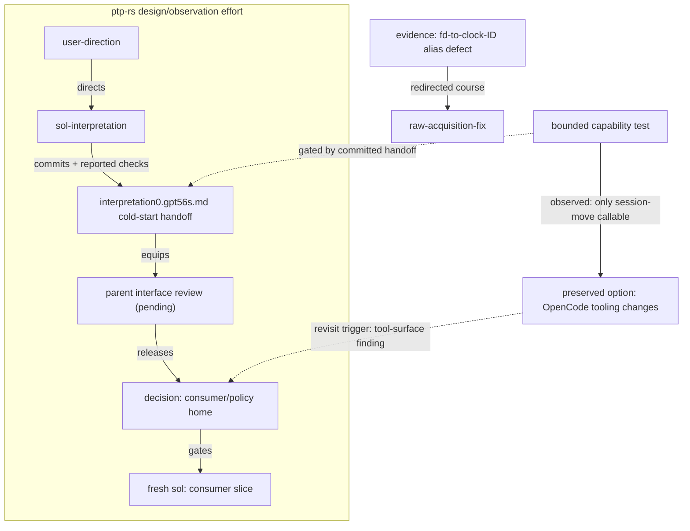

# Workflow diagrams — priming before drafting

## What is up

A parent session in `ptp-rs` has been steering an incremental, Sol-assisted
reshaping of a Rust PHC observer into a library: authorize a slice → review
actual interfaces → direct the next slice, with committed checkpoints and
evidence along the way (see
[transfer0](file:///home/rektide/src/ptp-rs/design/observation/transfer0.gpt6a.md)).
Work is not a fixed linear checklist: results (a discovered fd→clock-ID alias
defect, a bounded capability probe, a pending consumer-placement decision)
change the next direction. The user now asks for a **praxis in Rekon** that
encodes such workflows as **Mermaid diagrams of work** — including
feedback/results, speculative work gated by conditions, and other information
sources feeding decisions — and states that **naming consistency applies to
Mermaid node IDs AND labels**.

This is the wave's `init` document: research and priming, not the praxis
itself. A research prompt for the drafting round:

> What vocabulary, naming policy, and diagram conventions does Rekon already
> own for representing work, evidence, gates, feedback, and conditional
> proposals — and how should a Mermaid praxis reuse them without minting a
> parallel naming scheme or a second work tracker?

## Canonical vocabulary already owned elsewhere

The praxis should **use these terms, not re-define them**. All from
[CONTEXT.md](/CONTEXT.md) unless noted:

| Concept in the ask | Canonical term | Reference |
|---|---|---|
| A bounded piece of work | **Action** (distinct from its reusable method, **practice**) | [CONTEXT.md#action](/CONTEXT.md#action) |
| The continuing pursuit | **Effort**; active lines are **intent fronts** | [CONTEXT.md#effort](/CONTEXT.md#effort), [digest](/digest/README.md#digest-attention) |
| The native work item | **Work anchor** (the Beads ticket; documents explain, they are not a second lifecycle) | [CONTEXT.md#work-anchor](/CONTEXT.md#work-anchor), [README](/README.md#rekon-sense-map) |
| Inputs that bear on a judgment | **Claim / evidence / provenance** — evidence is a role, not a grade | [CONTEXT.md#claim](/CONTEXT.md#claim), [evidence](/evidence/README.md#evidence-reference) |
| A decision point | **Acceptance** (scoped owner decision) — distinct from **verification** | [CONTEXT.md#acceptance](/CONTEXT.md#acceptance) |
| A preserved state | **Checkpoint** — preservation is not acceptance | [CONTEXT.md#checkpoint](/CONTEXT.md#checkpoint), [commits](/code/commits.md#commits-checkpoints) |
| Learning from the action | **Case story** — desired help → commission → conduct → result → reflection | [evidence](/evidence/README.md#evidence-case-stories) |
| Map vs route vs step | **Opportunity map / selected course / next slice** | [chase-future](/praxis/chase-future/chase-future0.gpt6a.md#courses) |
| Status of a candidate | Dispositions: **selected now / bounded exploration / preserved option / not pursuing on this evidence** | [chase-future:135-139](/praxis/chase-future/chase-future0.gpt6a.md#courses) |
| When to look again | **Revisit trigger** — a changed fact, never "someday" | [chase-future:170-175](/praxis/chase-future/chase-future0.gpt6a.md#courses) |
| Waiting on inputs | **Evidence gates**: complete wave vs dependency readiness, with release conditions | [gates](/assess/gates/README.md) |
| The save-first loop | **capture → revise → compare** | [commits](/code/commits.md#commits-checkpoints) |

The chase-future **compact course record**
([chase-future:141-168](/praxis/chase-future/chase-future0.gpt6a.md#courses))
is the closest textual twin of what these diagrams encode: Bearings, Selected
next slice, Courses of enduring interest, Return from action.

## The naming policy — exact canonical chain

The user's instruction "naming consistency applies to Mermaid node IDs AND
labels" is already law in this workspace. Apply it; do not invent a parallel
scheme.

1. **Active human-codified guidance** (the live rule): "mermaid diagrams are
   excellent visual references. use meaningful node identifiers"
   ([AGENTS.md:122](/AGENTS.md#project-planning)), deepened by
   [code/planning.md#planning-mermaid](/code/planning.md#planning-mermaid):
   `watcher --> debounce --> emitter`, not `a --> b --> c`.
2. **One-name discipline** (the wave's settled contribution):
   [proposal2.glm53m.md:125-147](/constitution/naming/exploration/proposal2.glm53m.md#one-name)
   — the identifier *is* the name; **when a name must survive a hostile
   medium — a mermaid node id, a YAML key, a filename — contort the name as it
   is into viability (hyphenate, drop separators) rather than minting a labeled
   duplicate**; aliases are abbreviated resolution forms, never second
   identities; positional handles are not names. Its constellation is drawn
   exactly this way: "Every node is drawn as its identifier — contorted into
   mermaid viability, never labeled with a duplicate. Subgraph ids are the
   cluster names, equally contorted"
   ([proposal2:215-220](/constitution/naming/exploration/proposal2.glm53m.md#constellation)).
3. **Contortion rule, standalone form**:
   [proposal3b.glm53m.md:657-660](/constitution/naming/exploration/proposal3b.glm53m.md)
   — hostile media contort the name's spelling into viability; lossy
   projections should be *declared*, not disguised.
4. **Recorded human ruling** (what makes this policy, not just a proposal):
   [proposal4.glm53m.md#the-override-stated-as-ruling](/constitution/naming/exploration/proposal4.glm53m.md#the-override-stated-as-ruling)
   — location-implied naming is identity (the tree is the namespace), and
   **cross-modal aliases are precedent**: markdown anchors, mermaid node ids,
   beads IDs, YAML keys, and filenames share one namespace. The override
   explicitly keeps "one-name as canonicality with locality" among what
   survives ([proposal4:191-203](/constitution/naming/exploration/proposal4.glm53m.md#what-survives-unchanged)).
5. **Status caveat**: later grammar and hierarchy proposals remain proposals —
   "Do not confuse these holdings with acceptance of every later grammar"
   ([constitution/index.md:17-21](/constitution/index.md),
   [naming/README.md:52-60](/constitution/naming/README.md)). Cite the ruling
   and the discipline; do not re-legislate grammar inside the praxis.

**Application recipe for a workflow diagram:**

- A node's **id** is the entity's existing name, contorted into mermaid
  viability: the work anchor ID for work (`rekon-…`), the document path+anchor
  for documents and checkpoints, an honest model suffix for a model instance.
- A node's **label, if any, renders the same name** (often the fuller form the
  id abbreviates) — never a second, divergent name. Where the id already reads
  well, prefer bare ids with no labels at all (the naming-wave style); the
  diagram then cannot fork identity.
- **Edge labels are relation words** (directs, commits, gates, equips,
  revisits, supersedes, grounds), not new names.
- Subgraph ids are cluster names, equally contorted.

## Diagram conventions already in the corpus

- `flowchart TD/LR`, rectangular nodes, relation-word edge labels
  (`-->|informs|`) — everywhere; see
  [work-map0:86-98](/constitution/work-map0.gpt6a.md#connections),
  [skillify README1:101](/design/skillify/README1.sol56x.md).
- **Dashed edges `-. label .->` for informing / relational / future /
  speculative edges** — established idiom:
  [work-map0:96-97](/constitution/work-map0.gpt6a.md#connections) ("makes
  relationships navigable"), [constitution/README.md:145-148](/constitution/README.md)
  ("coordinates", "connect"),
  [beads-offerings0:205-206](/constitution/naming/exploration/beads-offerings0.sol56x.md)
  ("linked, not owned"), and
  [brief0:79](/design/session-mementos/brief0.gpt6a.md) — `bookmarks -. future live read .-> lookers` —
  a speculative future edge.
- **Status markers on edges** (✅ / ❌ / ⚠️ for present / absent / partial
  capability) — [assess/rekon/tooling0.glm53.md:246-255](/assess/rekon/tooling0.glm53.md).
- **Boundary note discipline**: diagram edges are explanatory relations,
  **not Beads blocking edges**, and hypothetical rows are "discussion handles,
  not minted ticket IDs"
  ([work-map0:100-112, 139-155](/constitution/work-map0.gpt6a.md#connections)).
- **Useful absences**: no decision diamonds (`{…}`) anywhere in the corpus —
  gating is carried by documented gate tables plus edge labels and dispositions,
  not diamond syntax; no mechanical mermaid↔reality validation exists (the
  naming resolver/tool seam is deliberately deferred,
  [proposal3b:654-657](/constitution/naming/exploration/proposal3b.glm53m.md)),
  so consistency is review discipline for now.

## The five node kinds the praxis must distinguish

Mapping the parent's ask onto owned vocabulary:

1. **Work / actions** — bounded actions and next slices; named after their work
   anchors or committed docs; a slice's node is not "done" until its evidence
   exists.
2. **Evidence / input artifacts** — claims, sources, provenance; evidence is a
   *relation to a claim*, so edges say what a source supports, challenges, or
   leaves unresolved ([evidence/README.md:33-59](/evidence/README.md#evidence-reference)).
   Author-reported checks are evidence, not acceptance
   ([transfer0 scope note](file:///home/rektide/src/ptp-rs/design/observation/transfer0.gpt6a.md)).
3. **Decisions / gates** — a gate protects a named decision and has a release
   condition ([gates:22-31](/assess/gates/README.md)); acceptance ≠
   verification; a commit checkpoint is not acceptance
   ([commits:58-61](/code/commits.md#commits-checkpoints)).
4. **Results / feedback** — the "Return from action" record and case stories:
   what became possible/impossible, effect on course and preserved options
   ([chase-future:162-175, 203-217](/praxis/chase-future/chase-future0.gpt6a.md#courses)).
   Feedback edges loop back into decisions — that loop is the point of the
   diagram.
5. **Unknown / conditional proposals** — preserved options with dispositions
   and revisit triggers; "Unknowns should remain named, not forced into
   false yes/no conclusions for a tidy chart"
   ([chase-future:135-139](/praxis/chase-future/chase-future0.gpt6a.md#courses)).
   A conditional branch in the diagram authorizes nothing by being drawn.

## Illustrative sketch (small, not polished)

Encoding the ptp-rs interpretation→consumer rotation, practicing the naming
recipe (ids are the entities' names, contorted; labels render the same name;
dashed = informing/conditional):

Note what the sketch does *not* claim: no node is a minted Beads ticket, no
dashed edge authorizes work, and the pending review is drawn as open, not
passed.

## Tensions and open choices for the drafting round

- **Bare ids vs labeled nodes.** The naming wave draws bare identifiers; the
  work-map draws CamelCase ids with human labels. Under the one-name
  discipline the label must render the *same* name; the praxis should state
  its default (bare ids where readable, labels only as fuller renderings) and
  say why.
- **Ownership of the practice.** `/praxis/` connects cross-cutting postures;
  `rekon-navigation` owns "a mapped problem space becomes a revisable course"
  ([work-map0:114-135](/constitution/work-map0.gpt6a.md#navigation)); chase-future
  owns the compact course record. A diagram praxis is a *representation*
  practice — it should link to all three without becoming a second course
  program or a second work tracker.
- **Diagrams rot.** No tool validates a diagram against tickets or files.
  Recommend: every node's id resolves to a real home (path+anchor or ticket),
  so stale ids are at least loud, in the spirit of the rename-ripple ruling
  ([proposal4:88-95](/constitution/naming/exploration/proposal4.glm53m.md#the-override-stated-as-ruling)).
- **No decision-diamond precedent.** Keep gating as gate nodes + relation
  edges, or justify new syntax explicitly.
- **"Someday" edges are a bug** — conditional nodes need dispositions and
  revisit triggers in the accompanying text, not vague dashed futures.
- **Scope creep**: a diagram of work can quietly become a project plan with
  time-frames and phases — both are banned by
  [planning rules](/code/planning.md#planning-no-timeframes).

## Recommended home and outline

- **Draft here**: `design/workflow-diagrams/` wave (`init0` → parent-authored
  or delegated `draft0.<model>.md`; a `syn` round if multiple models draft).
- **Promotion target**: a sibling practice directory such as
  `/praxis/workflow-diagrams/README.md`, linked from
  [praxis/README.md](/praxis/README.md) alongside post-build and
  readme-driven — it is a general representation practice, not a
  chase-future subsection.
- **Outline for the eventual praxis**: purpose and when to draw; the five node
  kinds mapped to owned vocabulary; the naming recipe (canonical chain above);
  edge conventions (solid flow, dashed informing/conditional, relation-word
  labels, status markers); boundary notes (not Beads edges, no minted tickets,
  no acceptance or time-frames implied, nodes resolve to real homes); one
  worked example (the ptp-rs transfer is ready-made); cross-references and
  what-this-does-not-claim.

## Recommended next drafting slice

Write `design/workflow-diagrams/draft0.<model>.md`: the praxis skeleton per
the outline above, with the ptp-rs observation effort as the worked example
(read
[transfer0](file:///home/rektide/src/ptp-rs/design/observation/transfer0.gpt6a.md)
checkpoints and
[interpretation0](file:///home/rektide/src/ptp-rs/design/observation/interpretation0.gpt56s.md)
handoff as source material). Keep it to the representation discipline; route
course-design questions to navigation and course-record questions to
chase-future. After the draft: a doc-pass (cross-link praxis/README,
chase-future, work-map, evidence, gates), then ask the user to weigh the home
placement and whether a `syn` round is wanted.

## Cross-references

- [Praxis home](/praxis/README.md) — **prior art and future connector**:
  assessment, digest, remake, and coding practices already hold the postures
  this diagram praxis would make visible; "engine the practice" is its stated
  ambition.
- [Chase the future](/praxis/chase-future/chase-future0.gpt6a.md) — **closest
  prior art**: the compact course record is the textual form of these
  diagrams; dispositions and revisit triggers are the conditional-work
  vocabulary.
- [Evidence gates](/assess/gates/README.md) — **owns gate semantics** the
  diagram's decision nodes should cite rather than restate.
- [Commit checkpoints](/code/commits.md#commits-checkpoints) and
  [planning rules](/code/planning.md#planning-mermaid) — **active guidance**
  on capture-before-revise and on mermaid node identifiers.
- [Naming exploration](/constitution/naming/README.md) (esp.
  [proposal2](/constitution/naming/exploration/proposal2.glm53m.md#one-name),
  [proposal3b](/constitution/naming/exploration/proposal3b.glm53m.md),
  [proposal4 ruling](/constitution/naming/exploration/proposal4.glm53m.md#the-override-stated-as-ruling))
  — **the naming policy chain** this praxis must apply, not extend.
- [CONTEXT.md](/CONTEXT.md) — **the glossary** for every term a diagram
  labels.
- [Evidence](/evidence/README.md) — **evidence-as-relation and case stories**;
  feedback edges should satisfy its "what it does not prove" discipline.
- [Work map](/constitution/work-map0.gpt6a.md) — **mermaid-of-work precedent**
  and its "explanatory, not blocking edges" boundary.
- [Session-mementos brief](/design/session-mementos/brief0.gpt6a.md) and
  [tooling assessment](/assess/rekon/tooling0.glm53.md) — **edge-convention
  precedents**: dashed future reads; ✅/❌/⚠️ status markers.
- [ptp-rs transfer0](file:///home/rektide/src/ptp-rs/design/observation/transfer0.gpt6a.md)
  and
  [interpretation0](file:///home/rektide/src/ptp-rs/design/observation/interpretation0.gpt56s.md)
  — **the motivating worked example**, external to Rekon.
