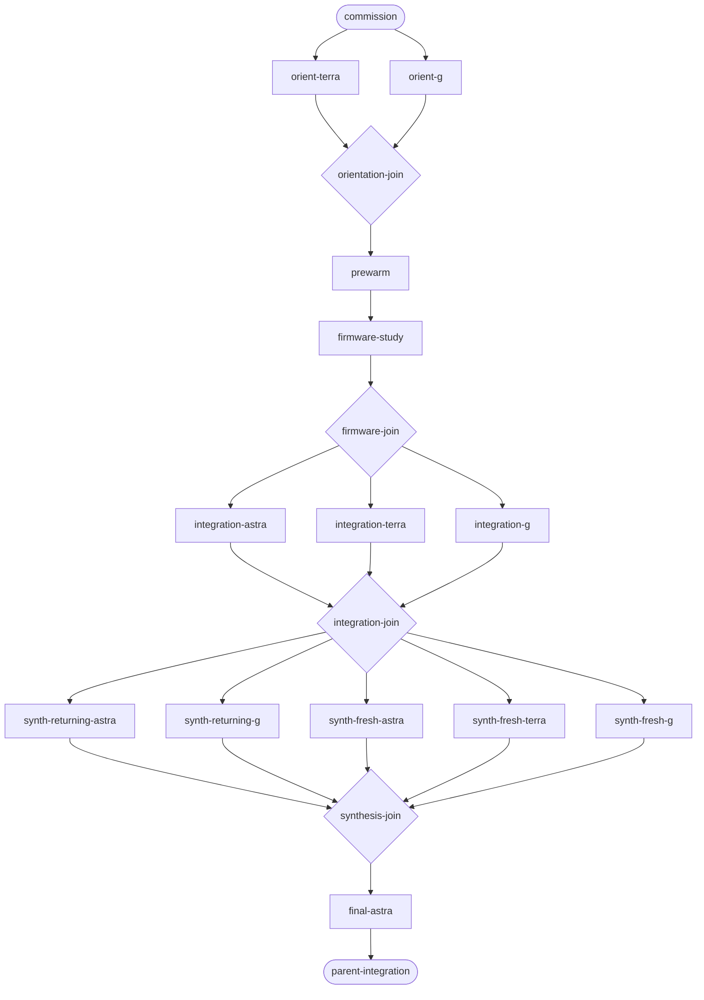

# Use case: research the other, then reason about our model

The operator wants agents to understand QMK and ZMK, then use that evidence to
reason about Kinefolk's capabilities, fit, expressiveness, APIs and model design.
The parent commissions work, carries completed evidence across gates, learns the
code and intended design itself, and defers major conclusions until all waves
return. Kinefolk's [commission](file:///home/rektide/src/kinefolk-rs/design/input-model/firmware/brief0.gpt6a.md)
owns the research questions and current dispatch record. This is a commissioned
flight and case seed, not a claim that the full sequence has run or succeeded.
The parent-authored draft was moved here from Kinefolk's
`design/input-model/firmware/launch-use-case0.gpt6a.md` (commit `067904e7`);
the original author and human commission remain in the provenance above.

## Flight dependency chart

Each rectangular node is an agent turn, diamonds are **all-of evidence joins**,
and rounded nodes are the commission and parent integration. Solid edges express
required sequencing, not authorization for additional work. Parallel branches are
independent within their wave. A returning-agent node resumes the named native
session; a fresh node starts a new session. Each bare node name resolves to its
local anchor below; the names are case-local and are not work tickets.

## Node meanings and execution semantics

**commission:** the human requests the sequence and clarifies the external-study
versus Kinefolk-fit distinction; the product brief retains the detailed scope.

**orient-terra:** Terra max independently orients to Kinefolk.

**orient-g:** G independently orients to Kinefolk in parallel.

**orientation-join:** both orientation reports must return and be read; F receives
both reports and the parent's explanation. Launching either cannot satisfy it.

**prewarm:** F refreshes both QMK and ZMK and records repository locations,
refresh outcomes, immutable revisions, structure and useful entrypoints.

**firmware-study:** one dedicated Astra high studies both firmware projects in
their own terms, using the completed prewarm.

**firmware-join:** the firmware study and handoff provide a read and sufficient
common factual foundation before the integration wave starts.

**integration-astra:** a new Astra high independently investigates Kinefolk fit.

**integration-terra:** Terra medium independently investigates Kinefolk fit.

**integration-g:** G independently investigates Kinefolk fit. All three examine
capabilities, expressiveness, APIs, model design and meta-layering; peer same-wave
outputs are withheld until synthesis.

**integration-join:** all three integration reports must return and be read before
the five independent syntheses receive their common completed corpus.

**synth-returning-astra:** resume the integration Astra for a synthesis.

**synth-returning-g:** resume the integration G for a synthesis.

**synth-fresh-astra:** a fresh Astra high synthesizes independently.

**synth-fresh-terra:** a fresh Terra high synthesizes independently.

**synth-fresh-g:** a fresh G synthesizes independently. All five receive the
completed integration corpus, but not their concurrent siblings' syntheses.

**synthesis-join:** all five synthesis artifacts must return and be read before
the final reconsideration; a completed turn is not itself evidence sufficiency.

**final-astra:** resume the integration Astra for one further turn that may
examine all five perspectives, including its own synthesis.

**parent-integration:** integrate completed evidence and open model choices.
Parent learning from code and design proceeds during the run; major conclusions
wait for the completed sequence. Preserve disagreements and qualifications.

### Failure and partial results

These all-of joins require the named successful artifacts, not merely terminal
notifications. If a required turn fails or returns partial work, record the slot's
disposition and available artifact; the join remains closed unless the human
authorizes a partial release or changed cohort. Retry or replace only within the
authorized scope. Label any narrower evidence base and treat a later return as an
explicit addendum or new synthesis. Independent work whose own prerequisites are
met can continue. [Evidence gates](/assess/gates/README.md) distinguish arrival,
readiness and deliberate release; the parent judges sufficiency after reading.

## Artifacts and continuation identity

Each turn returns its owned document paths, evidence/revision pointers, check
results and commit. The parent records the returned native `sessionID` and uses
it to resume returning agents. Similar model names do not establish session
identity. Reports use model-suffixed filenames; shared navigation is parent-owned.

This use case specifies a coordination plan, not an executable graph runner.
Execution uses the harness's background-agent dispatch and completion
notifications. [Model lookup](/agents/models/README.md) explains the model and
variant names; neither this case nor that reference grants dispatch authority.

## Expected help and later assessment

The gates should make the firmware prewarm relevant to Kinefolk, preserve a clear
external-system evidence base, and keep model recommendations from racing ahead
of the comparative inquiry. Returning and fresh sessions should expose both
continuity of reasoning and assumptions inherited from earlier turns.

At completion, record whether those expectations held: which findings changed
the parent's understanding, where synthesis found real disagreement, whether
handoffs lost important context, and what model decisions remain open. The
presence of all expected documents alone does not establish the pattern's value.
The [case-story practice](/evidence/README.md#evidence-case-stories) supplies the
expected-versus-actual assessment; this is a prospective case seed until outcomes
and use are recorded. [Flights](/praxis/flights/README.md) owns the reusable
coordination practice, while the product brief owns the inquiry itself.
