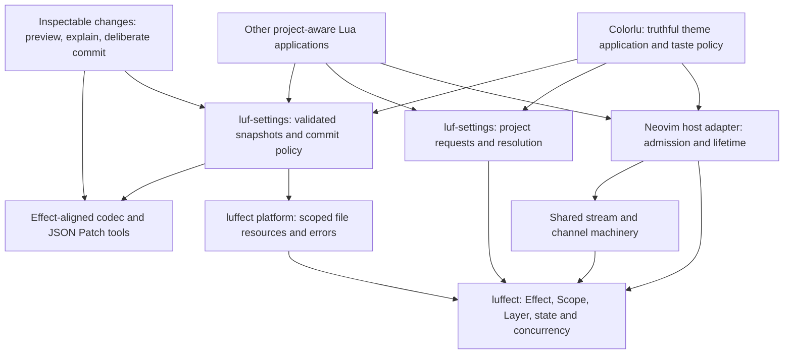

# the W: make a careful first client an ordinary next client

**The three-project split has earned its keep. The next win is to strengthen the
contracts between those projects, then use those contracts to offer more—not to
pour every new capability into colorlu or keep adding isolated Effect exports.**

Colorlu demonstrates that editor-local authority, explicit project identity, and
Effect-style lifetimes fit together. It also shows where the first caller still
has to be unusually knowledgeable: how to enter the host safely, distinguish
requests from resolved projects, avoid overwriting invalid settings, and finish
an entered write without leaking a temporary file.

My recommended course has three leading investments:

1. **Trustworthy settings foundations:** faithful values and snapshots, scoped
   file resources, and an honest commit outcome contract.
2. **A reusable Neovim hosting and project-activation layer:** capture, admission,
   resolution, and disposal with explicit ownership—but no theme policy in the
   runtime.
3. **Inspectable changes:** pursue the actual v4 `JsonPatch` / codec-derived
   Differ direction to enable migration previews and richer settings tools.

A focused **Channel / callback-ingress pass** is the best subsequent stream
investment. An installed-consumer and semantic-conformance check should accompany
these slices rather than become a large, separate verification project.

These are recommendations, not newly authorized implementation. The current
Path code is left alone as requested. No source, configuration, or live settings
were changed during this assessment.

## basis and confidence

The dependency gate opened after the completed build checkpoint. The parent read
the runtime/project/theme code and relevant upstream implementations. A single
subsequent evidence agent inspected storage and performed four bounded probes;
the parent then read its report, probe, and the consequential source paths before
synthesizing. There were no parallel implementation waves.

| source | pinned basis |
|---|---|
| colorlu | `222bd7ce472fee9f1f5cc1ce5796b82d42f19762` |
| luf-settings | `2c963db1eb20bd87bbb33265aeece41a8e8e49be` |
| luffect | `e6d74195a40f20bdc6460dc654797c1fcaafb1f1` |
| Effect v4, earlier checkout | `96ced895a07f89b2dd03c3e470884f7e25063696` |
| Effect v4, newer fetched reference | `bd393d63c19bdd0ab212d95576cec89051c8501c` |

The newer Effect reference is the one inspected, **not a claim about today's
unfetched remote tip**. Recheck the frontier when selecting an implementation.
Local product commits may not yet be published; revision-bound canonical links
below identify the sources inspected on disk.

The build author reports 32 passing tests on each of three Lua interpreters,
four passing headless contracts, and a read-only incumbent-data smoke. That is
substantial evidence for first light, not an independent rerun, visual acceptance,
power-loss test, or configured-AstroNvim cutover. The storage agent's new probe
results have their own narrower scope in the [evidence report][storage].

## what to preserve

- **Neovim remains authoritative for catalog and applied theme.** Verification
  occurs after the actual command, not after guessing that a deferred operation
  must have succeeded. The [nested-host-loop intent test][intent-test] goes
  beyond the obvious happy path.
- **Project identity is explicit on every settings operation.** A finished A
  event can be saved for A after switching to B without redirecting the write.
  [These semantics are separately tested][workflow-tests].
- **Pure taste policy remains small and local.** There is no benefit in requiring
  service injection for every filter or selection function.
- **Layer, Scope, Ref and the runtime have real application leverage.** Memory
  drivers exercise the workflows without a live editor, and lifecycle resources
  have owners. This is more meaningful than the count of recently ported modules.
- **One policy-bearing settings module sits above replaceable stores.** Keep
  descriptors, legacy precedence, namespace serialization and migration together.
  The [storage evidence][storage] judges that separation positively while finding
  limits in the adapters' substitutability.

The correct response is neither “start over” nor “the suite is green, so the
foundations are finished.” It is to promote the guarantees the first client
revealed, while preserving the domain distinctions that made it correct.

## 1. trustworthy settings: graduate from a scalar success to a value contract

### why this is first

The reusable claim is wider than the exercised setting. A theme is a string;
future exclusion lists, policy documents, layouts, and other preferences are
structured values. The [bounded probes][storage-probes] found:

| observed case | architectural consequence |
|---|---|
| `[]` decodes and re-encodes as `{}`; object null properties disappear; `01` is accepted | The current codec is not a faithful strict JSON representation |
| Mutating an input table after memory `set` changes its stored value without a second write; the file adapter retains the old serialized value | Memory tests do not establish the same snapshot behavior as disk |
| Memory accepts a function that the filesystem fails to encode | The stores do not agree on the admissible value domain |
| Malformed JSON produces the expected tag and readable text, but no structured lower-level cause | Error categorization and provenance are weakened across the seam |

These are not hypothetical demands for enormous future state. A single setting
containing an empty list is enough to exercise the first gap. Strengthening an
existing storage promise needs no second product to justify it.

### the preferred seam

**Keep ProjectSettings as the policy owner; make its storage substrate an
immutable snapshot interface.** Prefer serialized bytes plus an opaque revision
over caller-owned Lua tables at the raw store seam. Both memory and filesystem
can then exchange the same alias-free primitive, while a shared layer performs
parsing, validation, migration, patching, and encoding.

A table-valued store remains a credible alternative if it implements an explicit
JSON value model and snapshots at every ingress/egress. It avoids repeated parsing
but adds cloning and representation obligations. For small preference documents,
the byte-oriented design has the clearer test contract. This is a recommended
design choice, not an already-settled replacement interface.

The common contract must distinguish null from absence, arrays from objects, and
valid data from Lua functions/cycles/non-finite values. Preserve unknown fields
at all promised levels, including the target envelope; reject unsupported future
document formats rather than silently rewriting them. Identity metadata should
be checked against the requested root, not merely stored for manual diagnosis.
The [specific source gaps and absent contract tests][storage-values] ground this
scope.

Ordinary mutators should have one understandable malformed-target policy. Today
colorlu must know to use legacy-aware `get` then validating `modify`, because
[`set` and `remove` do not validate an existing target][settings-mutators]. An
explicit repair/replace operation can be legitimate; normal operations should
not accidentally become repair paths. Keep encoder defects inside the effect
execution model consistently, rather than throwing eagerly for one method.

### complete the real Effect file-resource substrate

The current low-level uv module already manages file descriptors, but the
[temporary path in luf-settings is cleaned only in an error handler][settings-writer].
Colorlu consequently [masks an entire entered commit][compat] against interruption.
That is sensible containment by this client, not a good permanent responsibility
for every settings consumer.

Port a coherent **FileSystem file-resource slice**, not another bespoke colorlu
write helper: scoped `open`, file `writeAll` and `sync`, scoped temporary resources,
and preserved `PlatformError` causes. These are [real upstream interfaces and
adapter implementations][storage-upstream]. Luffect owns host operations and
resource cleanup; luf-settings owns same-filesystem preparation, replacement,
document policy and outcome; colorlu owns whether its lifecycle waits and how it
presents a failure.

Do not turn that into one undifferentiated “durable” promise:

| dimension | question a caller actually needs answered |
|---|---|
| Visibility | Can a reader see partially written bytes? |
| Cancellation/outcome | Was preparation abandoned, did replacement commit, or is the result not yet known? |
| Crash durability | Were contents and required directory changes synced for the claimed host profile? |
| Isolation | Can two processes lose one another's updates? |
| Shutdown | Will this application keep running long enough to await outstanding work? |

The current mask can let bytes commit while the caller eventually receives an
interrupt. A finalizer alone does not resolve that ambiguity. Define the commit
decision point and any needed read-back/receipt behavior; use a real locking or
transactional backend before promising cross-process isolation. Visibility-only
and synced profiles are plausible later choices, not reasons to require SQLite
or fsync everywhere now.

**Payoff:** rich settings become safe to test in memory, the next consumer stops
learning method-specific protection rules, and colorlu can remove its storage
safeguards rather than have them copied elsewhere.

**Next proof:** one shared value/mutation/invalid-format matrix across both
adapters, plus interruption and cleanup-failure traces at preparation and replace.
Preserve the first-light behavior while moving those obligations down.

## 2. hosted execution and project activation: share the right coordination

### the real gap is admission and authority, not “more async”

Colorlu's [submission queue][submission] and [controller][controller] handle safe
host entry, immediate invalidation, startup, replacement and observable disposal.
Those are repeated application-lifetime obligations built over a useful
ManagedRuntime—not evidence that ManagedRuntime should be replaced.

Recommend an optional **Neovim host adapter** in the luffect platform family,
with a controllable host-turn adapter for tests. It should make capture → submit
→ run → close behavior explicit and keep generic `Effect.runFork` semantics
intact. An upstream-aligned core and a Lua-specific host adapter can coexist;
Neovim integration need not pretend to be a portable Effect core primitive.

Do not merely copy the 44-line queue and declare the job done. Specify what a
submission acknowledges, which errors reach the reporter, how registration
failure unwinds resources, what happens after close, and how predecessor disposal
gates replacement. Admission, verified application, and persistence completion
are different acknowledgments. Keep sequences and stamps local to the interface
that needs them, not a new universal event system.

### a project request is not yet a project

The sibling [ProjectSource][settings-source] detects serially, filters out
`Option.none`, and deduplicates resolved roots. Colorlu therefore uses a
[captured-request source][project-source] that revokes stale authority immediately.
A request can be pending, fail, or resolve to no project; filtering absence loses
the information needed to stop applying a previous project's state.

The useful luf-settings offering is **project activation with both request and
resolution views**. For example, a request identity can be associated with
`Pending`, `Resolved(Option<ProjectRef>)`, or `Failed` state. These names sketch
the meanings, not a frozen public type. Retain explicit references for operations
on non-current projects. A SubscriptionRef can serve replayed snapshots; a request
stream can drive cancellable work. Neither should silently replace the other.

**Most important: cancellation is not erasure of history.** An old restore loses
permission to change the editor; a completed old-project theme event can still
deserve a commit. The [application tests][workflow-tests] establish both. A giant
`switchMap` around detection, application and persistence would collapse those
lifetimes and could discard valid writes.

Likewise, `FiberHandle.run` is not an awaited replacement operation:
[it starts the newcomer before installing it and interrupting the predecessor][handle].
Colorlu's explicit `clear` → `run` is meaningful. Do not change the upstream
primitive to satisfy a shorthand description of latest-wins; preserve the correct
composition and make it easy to reuse where it is actually repeated.

**Payoff:** project-aware tooling, background inspections, command runners and
preview sessions can share activation and host-lifetime guarantees. Theme-specific
intent settlement and “a manual pick beats restore” remain colorlu policy.

**Next proof:** port the existing raw-capture, delayed-detection, no-project,
reentrant-command and reload tests to the shared adapters; make health a second
reader of the same project-state model. Success means removing knowledge from
the application, not wrapping its existing controller in another controller.

## 3. inspectable changes: the Differ direction is genuinely available

**Our previous dismissal was wrong in scope.** The v3 Differ combinator family
and v4's type-only `Differ.ts` are not interchangeable. But a type-only interface
does not imply the absence of an implementation elsewhere.

At the pinned newer revision, [Schema.toDifferJsonPatch][schema-differ] delegates
to a [small, real runtime composition][differ-impl]:

```text
diff(a, b)   = JsonPatch.get(encode(a), encode(b))
combine(p,q) = concatenate p then q
patch(a, p)  = decode(JsonPatch.apply(p, encode(a)))
```

The public capability is also present in the [earlier checkout][older-differ].
This was an incomplete investigation, not just moving-target drift. The earlier
reports remain preserved; [the architectural pass][fronts-differ] records the
corrected reading with exact sources.

### a bounded, useful breadth pick

After the value/snapshot contract, pursue **JSON Pointer + JsonPatch + a focused
codec-oriented slice of Schema**. Port real names and semantics; do not rename
the current `(ok, value)` descriptor helpers to `Schema` and imply the larger
architecture exists. Compare a direct JsonPatch port first with the extra cost
of codec derivation. If a smaller local codec bridge is useful before a coherent
Schema slice, label it as that bridge.

The first demonstration could be a read-only migration or policy preview:

1. obtain a validated snapshot with its origin/revision;
2. derive a proposed new value and a structural difference;
3. explain the change without writing;
4. commit explicitly against the chosen conflict policy.

This opens **inspectable settings**, not just a more configurable picker:
“where did this value come from?”, “what would migration change?”, and “what did
accepting this policy modify?” become reusable operations. Explanations can be
views of the same snapshot/provenance data used by storage, rather than a second
mutable audit store bolted on by each application.

### what it does not buy automatically

Upstream JsonPatch implements add/remove/replace, not every RFC 6902 operation.
Undo needs a retained prior value or inverse computation. A patch is not a
transaction, conflict-free merge, authorization boundary, or distributed protocol.
Schema-derived synchronous transformations also have a specific failure contract.
Preserve those limits instead of recreating an overclaim under a more powerful name.

**Payoff:** migration previews and rich-setting editors first; deliberate preview,
accept/reject and undo workflows as follow-on possibilities. The user's Differ
interest has a real v4-compatible course, subject to clear representation laws.

**Next proof:** `apply(diff(a,b), a)` reproduces `b` over the agreed value corpus,
patch composition respects order, malformed patches fail correctly, and preview
performs zero writes. Then verify a stale-base commit cannot silently claim success
under the selected isolation policy.

## 4. streams: deepen the substrate before adding another operator batch

This is a **recommended bounded exploration after the leading foundations**, not
a demand to port all of Channel before continuing application work.

The [parent stream reading][fronts-streams] found repeated queue/pump/scope machinery
in merge, buffer and switchMap. More importantly, the existing callback source owns
its own queue before any downstream buffer. A bounded buffer later in the pipeline
does not bound an unbounded ingress queue. A synchronous host callback cannot be
made backpressured merely by selecting a suspension strategy in another layer.

Upstream [Stream.callback][upstream-callback] accepts effectful registration and
queue strategy, and [Channel.callbackArray][upstream-channel] concentrates that
machinery. Compare:

- **Complete callback ingress first:** ownership, effectful registration, capacity,
  overflow/acceptance semantics, teardown. Smaller immediate surface change.
- **A focused Channel-shaped substrate:** more work, but shared terminal-cause,
  scope, input/output and concurrency mechanics can serve Stream and Sink growth.

Choose by the obligations actually removed from existing operators and host
adapters. Keep event preservation, state coalescing, and loss-tolerant telemetry
as different policies on shared machinery. “Buffered” must not imply all three.

**Payoff:** reliable watchers and process-output pipelines now; resource-safe byte
streams, incremental import/export, and more substantial Lua streaming later.
Resolve Lua nil/array and element/batch representation intentionally as breadth
expands, rather than silently narrowing upstream value semantics.

**Next proof:** bounded ingress under a slow consumer, observable overflow where
applicable, failure-after-buffer behavior, and cleanup under cancellation. Preserve
each existing operator's semantics; do not rewrite colorlu to showcase Channel.

## make the offerings real: conformance and consumption travel with every slice

Two thin kinds of infrastructure pay across all four fronts:

**A contract ledger, with executable evidence.** For each claimed port, pin the
upstream symbol and implementation path, the supported subset, semantic differences,
and fixtures exercising those differences. Inspect behavior, not names: matching a
TypeId scheme says nothing about method fidelity. Turn important upstream deltas
into selected contract tests rather than routinely rerunning the same full suite as
an architectural sign-off.

**An installed-consumer test.** The new application works through sibling checkout
paths. [Luffect's rockspec][rockspec] omits Effectable, FileSystem, Path,
SubscriptionRef and FiberHandle even though they are reachable in the checkout.
Source inspection establishes that omission; this assessment did not install a
rock. Updating manifest coverage and exercising a clean consumer would make the
new breadth available without colorlu-specific `package.path` surgery. Do not
equate choosing packaging with publishing the packages.

Path is a particularly useful conformance example. It **is** an Effect module,
but luffect's normalizer deliberately changes trailing-separator semantics to suit
project identity. Upstream also supplies a POSIX **service layer**—service shape
is not merely a concession to Windows. A later fidelity pass should separate generic
Path behavior from ProjectRef canonicalization while preserving existing IDs.
That recommendation does not override the human's request to leave the current
Path code alone. The exact comparison is retained in [the parent reading][fronts-constraints].

## the possible system, with native owners



This is an opportunity map, not a proposed monolithic framework or a directory
reorganization. A luffect platform namespace and a separately distributable
Neovim adapter are both plausible packaging arrangements. Keep the generic core,
host adaptation, project settings, and theme policy distinguishable either way.

## courses to pursue and courses to preserve

| course | disposition and reason | what would change the choice |
|---|---|---|
| Faithful values + scoped file resources + explicit commit policy | **Recommend first.** Addresses already-promised behavior and removes client compensation; enables the rich-state directions below | A deliberately string-only settings product would narrow value breadth, but would not remove cleanup/error obligations |
| Host admission + project activation views | **Recommend next.** The vertical contains the actual lifecycle and stale-authority cases; health can consume the same model | Another host might favor a more generic injected adapter, but not generic-core changes to all Effects |
| Codec / JsonPatch / Differ path | **Recommend as the leading expansion.** Directly answers the human's interest with real upstream machinery | Compare the representation and derivation costs once the value matrix is explicit |
| Callback ingress / focused Channel | **Bounded exploration.** Highest leverage stream depth opportunity; choose between small ingress completion and deeper shared machinery | Measured event volume or a second streaming adapter could move it ahead of patch tooling |
| Theme previews and cross-tool followers | **Preserved product courses.** Could use shared snapshots and verified events; not all must become backlog items | Preview changes the current “observe all changes and persist” policy; followers need explicit current-state versus persisted-choice semantics |
| Strong cross-process transactions | **Preserved stronger backend.** A separate contract, not a hidden promise of atomic rename | Actual same-namespace contention or retry requirements justify choosing locks/transactions |
| Broader tracing, reactive graphs, Config precedence | **Preserved options.** Useful possible offerings, but not substitutes for the concrete missing contracts | A specific explanation, derived-state, or precedence use establishes which Effect subset matters |

If only one implementation slice is selected next, choose the file-resource and
commit-cleanup portion of the first course, carrying the value-contract tests
alongside it. It is small enough to validate against the existing vertical, has
clear upstream machinery, and has an immediate removal test: colorlu no longer
needs whole-commit masking solely to prevent leaked temporary paths. The following
snapshot/codec slice opens the richer Differ work. This is not a new queue of agents;
selection and implementation remain with the human.

## what the praxis taught us

The [first-light build][checkpoint] succeeded as a vertical partly because its
author understood and contained dependency limitations. A defect-only review would
repair the individual symptoms; a module-count review would ask for more ports.
Combining the [architectural fronts][fronts] with the [storage evidence][storage]
reveals a third course: strengthen the few promises that let the next application
be less exceptional, then use those promises for meaningfully broader offerings.

The evidence pass changed the direction in two concrete ways:

- Memory/file substitutability is a **value and snapshot** question, not merely
  an interface-and-shared-test-suite question. That moved rich data foundations
  ahead of simply adding more settings consumers.
- Following the actual Differ implementation recovered a promising upstream
  capability that the earlier survey had effectively ruled out. A type-only
  declaration was an insufficient stopping point.

The different aim points were useful, but this is one case, not validation of
a universal process. There is no human acceptance or later implementation result
yet. The probe script remains ignored scratch; its cases should become durable
product contract tests if the corresponding work is chosen. Configured cutover,
visual behavior, cross-process races and power-loss behavior remain unproved.

## cross-references

- [Post-build praxis](/praxis/post-build/README.md) is the reusable method developed
  from this commission; this assessment supplies its first concrete case.
- [Chase the future](/praxis/chase-future/chase-future0.gpt6a.md) is complementary:
  choose opportunity-opening work while retaining other worthwhile courses. Here
  the assessment equips a choice; it does not silently authorize the next slice.
- [Brief](/praxis/post-build/colorlu/brief0.gpt6a.md) preserves scope, source baselines
  and the serial evidence gate. [Case index](/praxis/post-build/colorlu/index.md)
  routes through the predecessor fronts and evidence without rewriting them.
- [Assessment](/assess/README.md) and [high/low strategy](/assess/strategies/high-low0.gpt6a.md)
  explain the complementary judgment/evidence roles. [Digest](/digest/README.md)
  supplies the present-state reading from which these opportunities follow.

[storage]: /praxis/post-build/colorlu/storage-evidence0.gpt56s.md
[storage-probes]: /praxis/post-build/colorlu/storage-evidence0.gpt56s.md#bounded-probes
[storage-values]: /praxis/post-build/colorlu/storage-evidence0.gpt56s.md#memory-and-file-stores-do-not-yet-share-one-value-algebra
[storage-upstream]: /praxis/post-build/colorlu/storage-evidence0.gpt56s.md#relevant-effect-v4-leverage
[fronts]: /praxis/post-build/colorlu/fronts0.gpt6a.md
[fronts-differ]: /praxis/post-build/colorlu/fronts0.gpt6a.md#front-4-recover-the-real-differ-direction
[fronts-streams]: /praxis/post-build/colorlu/fronts0.gpt6a.md#front-3-grow-the-stream-substrate-at-the-source-not-only-at-the-operator
[fronts-constraints]: /praxis/post-build/colorlu/fronts0.gpt6a.md#constraints-worth-preserving-during-synthesis
[checkpoint]: https://github.com/rektide/colorlu/blob/222bd7ce472fee9f1f5cc1ce5796b82d42f19762/.design/first-light/first-light.gpt6astra.md
[intent-test]: https://github.com/rektide/colorlu/blob/222bd7ce472fee9f1f5cc1ce5796b82d42f19762/spec/host/intent_contract.lua#L25-L46
[workflow-tests]: https://github.com/rektide/colorlu/blob/222bd7ce472fee9f1f5cc1ce5796b82d42f19762/spec/workflows_spec.lua#L156-L245
[settings-mutators]: https://github.com/rektide/luf-settings/blob/2c963db1eb20bd87bbb33265aeece41a8e8e49be/lua/luf-settings/service.lua#L189-L282
[settings-writer]: https://github.com/rektide/luf-settings/blob/2c963db1eb20bd87bbb33265aeece41a8e8e49be/lua/luf-settings/fs.lua#L88-L106
[compat]: https://github.com/rektide/colorlu/blob/222bd7ce472fee9f1f5cc1ce5796b82d42f19762/lua/colorlu/settings/compat.lua#L36-L54
[submission]: https://github.com/rektide/colorlu/blob/222bd7ce472fee9f1f5cc1ce5796b82d42f19762/lua/colorlu/runtime/submission.lua
[controller]: https://github.com/rektide/colorlu/blob/222bd7ce472fee9f1f5cc1ce5796b82d42f19762/lua/colorlu/runtime/controller.lua
[settings-source]: https://github.com/rektide/luf-settings/blob/2c963db1eb20bd87bbb33265aeece41a8e8e49be/lua/luf-settings/source.lua#L146-L177
[project-source]: https://github.com/rektide/colorlu/blob/222bd7ce472fee9f1f5cc1ce5796b82d42f19762/lua/colorlu/project/source.lua#L12-L30
[handle]: https://github.com/rektide/luffect/blob/e6d74195a40f20bdc6460dc654797c1fcaafb1f1/luffect/FiberHandle.lua#L249-L263
[schema-differ]: https://github.com/Effect-TS/effect/blob/bd393d63c19bdd0ab212d95576cec89051c8501c/packages/effect/src/Schema.ts#L14043-L14065
[differ-impl]: https://github.com/Effect-TS/effect/blob/bd393d63c19bdd0ab212d95576cec89051c8501c/packages/effect/src/internal/schema/toDifferJsonPatch.ts#L8-L23
[older-differ]: https://github.com/Effect-TS/effect/blob/96ced895a07f89b2dd03c3e470884f7e25063696/packages/effect/src/Schema.ts#L15846-L15848
[upstream-callback]: https://github.com/Effect-TS/effect/blob/bd393d63c19bdd0ab212d95576cec89051c8501c/packages/effect/src/Stream.ts#L695-L701
[upstream-channel]: https://github.com/Effect-TS/effect/blob/bd393d63c19bdd0ab212d95576cec89051c8501c/packages/effect/src/Channel.ts#L526-L533
[rockspec]: https://github.com/rektide/luffect/blob/e6d74195a40f20bdc6460dc654797c1fcaafb1f1/luffect-dev-1.rockspec#L20-L69
