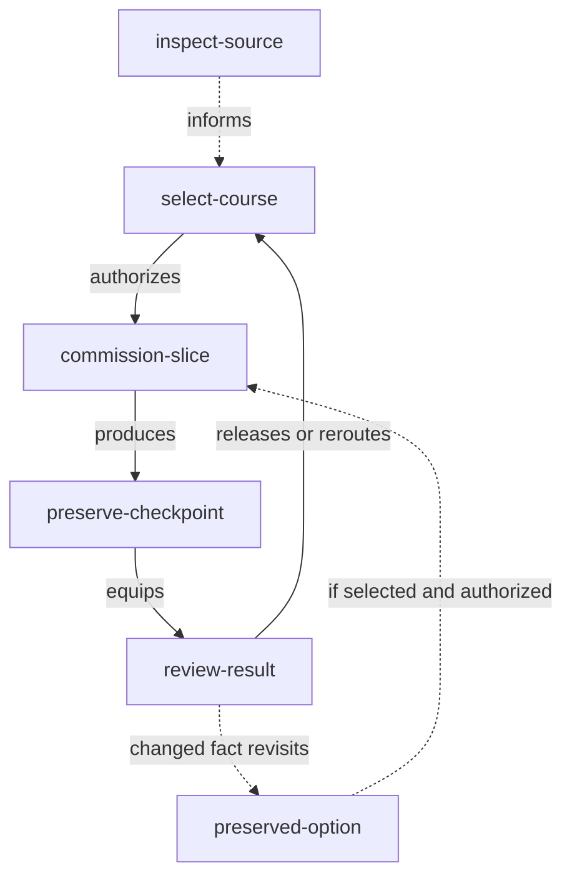
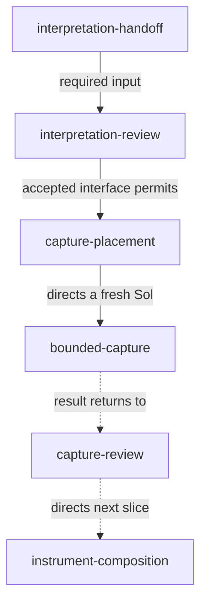
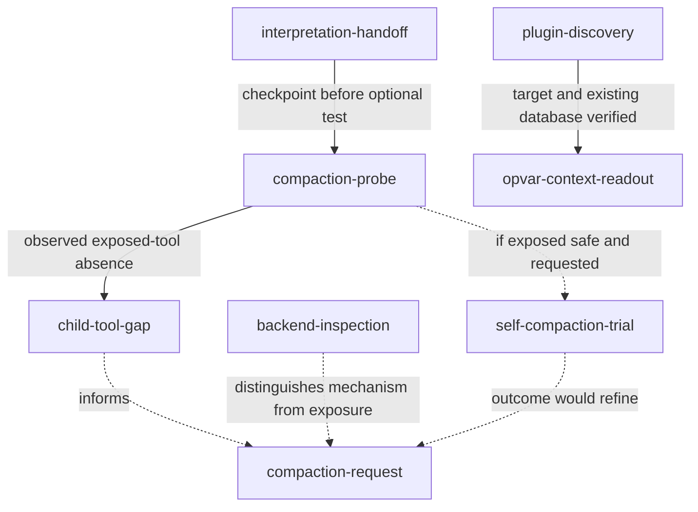

# Workflow diagrams

**Draw what we are doing, what informs it, and what a result could change.** A
workflow is often more than a chain of tasks: a probe resolves an unknown, a
review redirects implementation, and an interesting alternative remains
conditional while useful independent work continues.

Use a diagram when those relationships are becoming hard to hold in prose.
Keep it beside the running effort or course record. Its job is to equip action
and review, not decorate a finished account or establish another work lifecycle.

## Name the work once

Apply the existing [one-name discipline](/constitution/naming/exploration/proposal2.glm53m.md#one-name)
and [recorded naming ruling](/constitution/naming/exploration/proposal4.glm53m.md#the-override-stated-as-ruling):
location and local name identify the referent; cross-modal aliases are resolution
forms of that name. This is the specific policy being applied, not acceptance of
every later naming grammar; see the [constitutional reading map](/constitution/index.md).

- Reuse a work anchor's ID, an artifact's location-derived name, or a named section
  for a newly described action or decision. Do not use `A`, `B`, and `C` as hidden
  handles behind meaningful-looking labels.
- Adapt the existing spelling to Mermaid's syntax; do not mint a second name just
  for the diagram. Declare a shortened or lossy projection beside the diagram so
  it resolves to exactly one source.
- Prefer bare node IDs. If a label is needed, it renders the **same name**; it
  does not supply a second nickname, description, or changing status. Put those
  details in the linked record or relation text.
- Apply the same discipline to subgraphs. When a source is renamed or moved,
  update its diagram references as part of the existing rename process.

The bare IDs in the examples below resolve to explicit anchors in this document,
except `opvar-context-readout`, which is an existing work anchor in `openvariant`.
The document's location is the implicit namespace for its local names. Case
anchors name the **actions/results described here**; linked source artifacts
retain their own names. None of the local anchors invents a Beads ticket.

## Put relationships, not decoration, on edges

Distinguish these roles in the accompanying record; they need not require five
different shapes or colors:

| Role | What must remain visible |
|---|---|
| Action | What is authorized, who acts, and what useful result it should produce. |
| Input/evidence | Which claim it supports, challenges, or leaves unresolved; its source and scope. |
| Decision/gate | Who decides, which inputs are required, and the specific release condition. |
| Result/feedback | What actually happened and which course or assumption it changes. |
| Conditional course | Its disposition, entry condition, and revisit trigger—not an implied promise. |

For these diagrams, solid arrows show selected sequencing, actual production, or
explicit prerequisite relations. Dashed arrows show information feeding a
decision or a conditional course. **The edge text says which:** `informs` is not
`requires`, and `if available and authorized` is not `next`. Line style alone does
not carry a dependency or authorization claim. State the convention locally if
using a different one.

A diagram edge is not automatically a Beads blocking edge. Record an actual
dependency in its native tracker when appropriate; don't infer one from visual
proximity or from both actions appearing in the same conversation.

## The return from action belongs in the workflow

**select-course:** choose the next bounded action and name its owner. A pending
parent decision is work for the parent, not an unexplained external blocker.

**commission-slice:** give the actor context, authority, owned outputs, exclusions,
and the consequential checkpoint. Don't hand away architectural responsibility.

**preserve-checkpoint:** commit coherent work and record checks, source basis, and
limits before revising it. Preservation does not imply acceptance.

**review-result:** read the relevant artifacts, judge the claim they support, and
release, revise, or reroute the next slice. Completion notices are inputs, not the
decision itself. Feed newly discovered defects and opportunities back into course
selection rather than treating review only as a final pass/fail stamp.

**inspect-source:** bring in an existing contract, code path, user correction,
experiment, or other source because it can change a specific decision. Research
is not automatically a prerequisite to every concurrent action.

**preserved-option:** retain a worthwhile alternate course with the
[disposition and revisit trigger](/praxis/chase-future/chase-future0.gpt6a.md#courses)
that make it actionable later. A dashed arrow is not a substitute for that record.

## Worked case: rotate the session, test the capability, keep PTP moving

This is a **2026-09-06 checkpoint**, not a live dashboard. The
[`ptp-rs` running record](file:///home/rektide/src/ptp-rs/design/observation/transfer0.gpt6a.md)
owns current implementation state. The user wanted small Sol-assisted slices,
parent steering, and periodic context rotation at clean topical breaks.

### Selected PTP course

**interpretation-handoff — preserved:** the outgoing Sol committed pure timestamp
interpretation, reported 28 tests and two compile-only doctests passing, and left
a [cold-start source route](file:///home/rektide/src/ptp-rs/design/observation/interpretation0.gpt56s.md#cold-start-handoff-for-the-next-sol).
These are reported checks, not a physical-clock result.

**interpretation-review — completed by parent:** read actual timestamp, header,
sample, and bracket assessments and their tests. Accept the interface for the
next slice, not every possible downstream claim.

**capture-placement — decided:** put collection policy in a sibling observer
package, leaving primitive PHC access independent of prerequisites and fallback.

**bounded-capture — selected and dispatched:** a fresh Sol implements finite
offset collection from the handoff. The previous session is not resumed just
because it knows the history.

**capture-review — awaits its own result:** the parent owns reading the capture
interface and scripted behavior before authorizing dependent composition.

**instrument-composition — conditional next direction:** compose the full
observer only after the capture checkpoint is sufficient; its exact slice is not
pre-authorized by this chart. The returned implementation can change that slice.

### Capability inquiry, with a scoped negative result

**compaction-probe — completed:** inspect the child's actual callable tools after
preserving its work. This probe did not assume that backend support implied an
agent-callable operation.

**child-tool-gap — observed by the child:** its catalog exposed
`tools.opencode.session_move`, but neither self-compaction nor context-length
readout. No compaction was attempted. This establishes that session's exposed
tool gap, **not** the absence of backend compaction or usage data.

**self-compaction-trial — not executed on this evidence:** eligible only if a
supported safe operation is exposed **and** the user requests the test. Revisit
after tool exposure changes. Do not substitute a shell workaround or call a new
session “compaction.” General advice remains not to self-compact unless requested.

**backend-inspection — source-derived report:** the G
[discovery checkpoint](file:///home/rektide/src/openvariant/design/session-context/init0.glm53.md)
reports an existing backend compaction operation but gaps in plugin/agent exposure.
That narrows what needs changing; it is not a successful child self-compaction test.

**compaction-request — strongly wanted, implementation not yet accepted:** the
[patch request](file:///home/rektide/ado/patches.md#addendum-agent-callable-self-compaction-for-every-session)
now has a concrete exposure gap to address. Evidence informs its design; it does
not silently authorize every related core modification.

**plugin-discovery — completed:** the user corrected the intended notification
target from last-activity work to model-change records. G verified `openvariant`
(`openthinkfo`) and its existing Beads database, then created the native feature
**`openvariant:opvar-context-readout`**. Had the database been absent, the next
action would have been to notify the user, not initialize one. The ticket covers
the passive readout and model-change integration, not the core compaction patch.

**There is deliberately no edge from the tooling inquiry to bounded-capture.**
Fresh-session rotation was already possible. The parent's review briefly waited
while side inquiries ran; the user asked why PTP was idle. The correction was to
perform the owned review and dispatch the next Sol—not invent a dependency on
future tooling. This absence of an edge is a substantive architectural statement.

## Maintain the map when evidence returns

1. Record the result's scope: observed, author-reported, source-derived, inferred,
   or still unknown. Link its durable artifact and relevant revision.
2. Update the affected disposition and edge conditions. A missing callable tool
   can close today's trial while strengthening a future implementation request.
3. Name the next owner/action or the exact unresolved input. Ask whether a supposed
   blocker is actually a review the coordinator has not performed.
4. Preserve earlier checkpoints before revising the map. State what changed;
   don't rewrite the earlier uncertainty as if the result were known all along.
5. Check both positive and absent relations: every `requires` needs a reason, and
   independent useful work should not acquire an accidental incoming gate.

Before sharing: can every node resolve? Are names consistent with the owning
records? Do conditional courses have real conditions? Does feedback reach a
decision? Are availability, authorization, verification, and acceptance separate?
Can a reader see what can proceed **now** and who is responsible?

This is human-directed draft praxis, not a validated scheduler, automatic Mermaid
exporter, or new universal naming grammar. The worked case demonstrates the need
and a concrete correction; future use should assess whether the diagrams actually
improve steering rather than merely increase documentation.

## Cross-references

- [Chase the future](/praxis/chase-future/chase-future0.gpt6a.md#courses) supplies the
  course record, dispositions, and revisit triggers this representation makes visible.
- [Evidence gates](/assess/gates/README.md) owns readiness and release conditions;
  [commit checkpoints](/code/commits.md#commits-checkpoints) separates preservation
  from acceptance and requires preserving the predecessor before revision.
- [Evidence and case stories](/evidence/README.md#evidence-case-stories) supplies the
  return-from-action discipline, including what an observation does not prove.
- [Planning's Mermaid guidance](/code/planning.md#planning-mermaid) supplies the
  existing meaningful-identifier requirement; the naming sources above govern
  consistent identity across diagram, document, and work anchor.
- [G research primer](/design/workflow-diagrams/init0.glm53m.md) maps the related
  corpus. Its illustrative sketch is **not** adopted: it incorrectly suggested a
  tooling-to-PTP decision edge and captured a now-outdated pending review.
