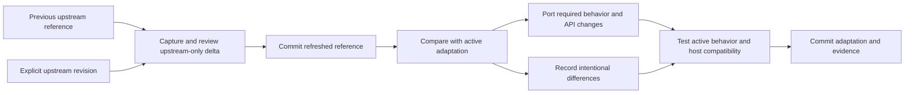

# Upstream reference mirrors

**Keep what upstream supplied separate from what we run.** When adapting
upstream code into a plugin or another independent implementation, retain a
small, inactive source snapshot as the reference for future updates. Refresh
that snapshot first; then deliberately reconcile the active adaptation.

**Working name:** *upstream reference mirror*, also called a *vendor mirror*.
“Reference” distinguishes this from vendored dependencies that participate in
the build. This is a maintenance practice, not a new CLI command or a demand to
mirror every dependency.

## Two trees, two responsibilities

```text
vendor/<upstream>/
  README.md                purpose, license, update instructions, adaptation map
  manifest.json            source revision, paths, hashes, observation date
  LICENSE                  upstream license, retained intact
  <upstream paths...>      non-active snapshot with provenance comments
src/<domain>/              active adaptation with local changes
scripts/upstream/          explicit capture / integrity / comparison tools
```

The **reference tree** answers “what did we take as our upstream baseline?”
The **active tree** answers “what do we run, and how does it differ?” Neither
silently replaces the other.

- Preserve upstream paths inside the reference tree. Capture the donor files
  and the context needed to understand them, not an unexamined whole repository.
- Keep original file contents intact apart from a deterministic provenance
  comment, where the file format supports comments. Do not fix, format, or
  modernize reference code.
- Put local behavior changes in the active tree. Do not import the reference
  tree, run its entrypoints, discover it as a plugin, or include it in build,
  lint, format, and application-test globs. An explicit mirror-integrity check
  is the exception.
- An active file derived from a donor should carry a direct code comment
  pointing to its reference file. Comments should say it is an **adaptation**,
  not suggest that modified code is an untouched upstream copy.
- Preserve licenses, copyright notices, and any required attribution in both
  source and distribution. “Inactive” does not remove license obligations.

Example reference-file header:

```ts
// INACTIVE UPSTREAM REFERENCE — do not import or edit as application code.
// Source: <canonical repository URL>, revision <full immutable commit>.
// Path: packages/tui/src/component/dialog-session-list.tsx
// Refresh through the mirror procedure; original contents follow this header.
```

An active file can instead say:

```ts
// Adapted from vendor/opencode/packages/tui/src/component/dialog-session-list.tsx.
// That inactive snapshot is the comparison baseline; this file owns local behavior.
```

## Provenance that can be checked

Record:

1. Canonical upstream repository URL and a full immutable revision. A branch
   name or an empty working-copy commit is not the best baseline identifier.
2. Each source path and a hash of the **original upstream bytes**, before the
   local marker. Define how the marker is stripped so integrity is reproducible.
3. Capture date, license origin, and any deliberately omitted donor context.
4. Donor-to-adaptation relationships and known behavior divergences. One donor
   may become several local modules; this mapping need not be one-to-one.

Prefer a local archive checkout before fetching. Read committed source at the
chosen revision, or explicitly refuse dirty selected source files. Never
silently label a locally patched working copy as pristine upstream. A fork or
carried-patch source is legitimate when identified as such.

## Refresh procedure



1. Save outstanding owned work before refreshing. Check source identity and
   selected revision; capture only declared files. Do not prune other artifacts.
2. Review old-reference → new-reference independently of local modifications.
   Commit that snapshot as its own coherent change. **A refreshed mirror does
   not mean the adaptation has caught up.**
3. Compare the upstream delta with the active implementation. Account for
   changed interfaces, semantics, input handling, lifecycle, and tests—not just
   lines that apply cleanly.
4. Port relevant changes into the active tree. Preserve deliberate local
   behavior and document changes that do not apply. Do not overwrite the active
   tree wholesale with the refreshed snapshot.
5. Verify the active adaptation and mirror integrity. Record which upstream
   revision was actually reconciled, including unresolved differences; commit
   the adaptation separately.

Three-way reasoning uses **old reference, new reference, and current adaptation**.
The old reference remains recoverable from version history, without a growing
collection of dated snapshot directories.

## What this does not promise

- It is not a runtime extension point. A plugin must still target verified host
  capabilities rather than importing private upstream context through the mirror.
- It is not automatic rebasing, a synchronization daemon, or a dependency update
  guarantee. Upstream changes require a behavior review.
- Hash equality establishes source identity, not correctness or compatibility.
- Copying upstream tests into an inactive tree is not testing the adaptation.
  Tests must exercise the active modules and their actual host boundary.

## Cross-references

- [Commit discipline](/code/commits.md) — preserves snapshot refresh and local
  adaptation as separate reviewable checkpoints.
- [Evidence](/evidence/README.md) — explains what provenance supports, and why
  source identity is not a behavioral verification claim.
- [Task reconstruction](/code/task-reconstruction/philosophy.md) — related but
  different: reconstructing desired behavior need not replay an old patch line;
  the mirror preserves a concrete comparison baseline when direct adaptation is
  the chosen method.
- [Opensesser](https://github.com/rektide/opensesser) — motivating application:
  a custom session picker with inactive OpenCode donor files and active modular
  columns. Its repository owns the concrete manifest and checks.
